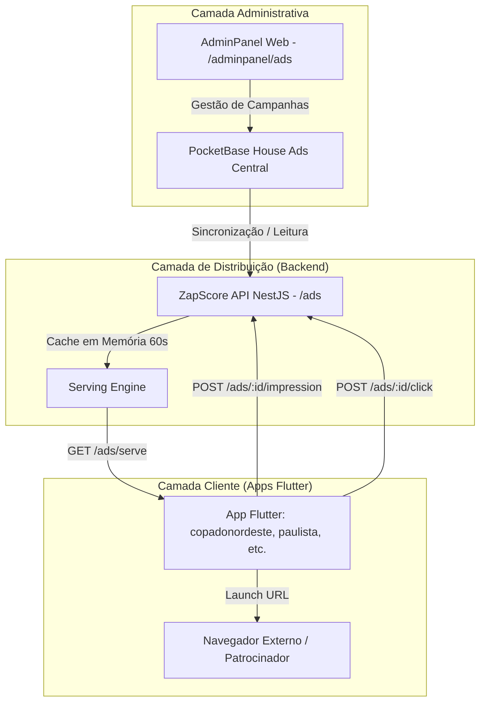

# Guia e Plano Mestre de Implementação - Módulo House Ads ZapScore

> **Documento de Referência Arquitetural e Operacional**  
> **App Alvo Inicial:** `apps/copas/copadonordeste` (Copa do Nordeste - ID 612)  
> **Objetivo:** Estabelecer o padrão oficial e replicável para a ativação do sistema de anúncios próprios (House Ads) em qualquer aplicativo Flutter do ecossistema ZapScore, integrando-o ao motor da API NestJS, ao banco PocketBase central e ao AdminPanel web.

---

## 1. Visão Geral da Arquitetura

O sistema de **House Ads** da ZapScore é uma rede de monetização e autopromoção descentralizada, desenvolvida para monetizar espaços nobres onde o Google AdMob não opera (ou opera com baixa remuneração), além de fornecer fallback imediato quando o AdMob sofrer com escassez de inventário (*no-fill*).



### Componentes do Ecossistema:
1. **PocketBase Central de House Ads (`zapscore-pocketbase-houseads`)**:
   - URL: `https://zapscore-pocketbase-houseads.gtalg3.easypanel.host`
   - Coleções principais:
     - `ad_campaigns`: Registros completos de anúncios (criativo, destino, datas, prioridade, regras de targeting).
     - `ad_stats`: Registro granular de métricas de impressões e cliques.
2. **ZapScore API NestJS (`apps/api/src/ads`)**:
   - Endpoints públicos otimizados com cache em memória (TTL: 60s).
   - Entrega inteligente com base no slug do aplicativo, liga e local de exibição (*placement*).
   - Rastreamento assíncrono e atômico de métricas (sem travar a interface do usuário).
3. **Painel de Controle AdminPanel (`apps/web/app/(main)/adminpanel/ads`)**:
   - Criação e edição visual de campanhas.
   - Monitoramento de impressões, cliques e taxa de conversão (CTR) por anunciante e por app.
4. **Camada Mobile Flutter (`apps/copas/copadonordeste`)**:
   - Consumo defensivo com timeout estrito de 2.5s.
   - Renderização limpa: se não houver anúncio ativo, colapsa para `SizedBox.shrink()` com **zero espaço em branco ou impacto visual**.

---

## 2. Placements (Locais de Exibição) e Especificações de Criativos

O sistema suporta 5 formatos padronizados. Cada formato tem um propósito e uma regra de concorrência com o Google AdMob:

| Placement ID | Nome do Espaço | Comportamento AdMob | Dimensões Recomendadas | Aspect Ratio | Onde é Inserido no App |
| :--- | :--- | :--- | :--- | :--- | :--- |
| **`header_sponsor`** | Topo da Tabela / Oferecimento | **100% Livre (Exclusivo)** | 640 x 120 px | 16:3 (ou 300x80) | Topo das abas de classificação e jogos em `competetion.dart`. Suporta rotação automática. |
| **`popup_launch`** | Pop-up de Abertura / Boas-Vindas | **100% Livre (Exclusivo)** | 600 x 600 px | 1:1 (Quadrado) | Modal no carregamento inicial em `home.dart`. Exibido no máx. 1x ao dia por usuário via SharedPreferences. |
| **`native_match_card`** | Card entre Jogos no Feed | **100% Livre (Exclusivo)** | 600 x 150 px | 4:1 (Horizontal) | Intercalado a cada 4 ou 5 partidas na lista de rodadas em `fixture.dart`. |
| **`banner_bottom`** | Banner Fixo de Rodapé | **Híbrido com AdMob** | 640 x 100 px | 32:5 (Banner Mobile) | Rodapé das telas (`ad_banner.dart`). Tenta AdMob primeiro; se falhar/no-fill, exibe o House Ad instantaneamente. |
| **`native_news_feed`** | Card no Feed de Notícias | **Híbrido com AdMob** | 600 x 300 px | 2:1 (Retangular) | Intercalado a cada 3 cards no feed de notícias em `news.dart`. |

---

## 3. Integração com o AdminPanel Web (`apps/web`)

O AdminPanel centraliza o ciclo de vida completo de publicidade (criação, segmentação, edição e métricas de conversão) conectado ao motor NestJS (`/ads`) e ao banco PocketBase central.

### 3.1 Registro de Apps Disponíveis (`AVAILABLE_APPS`)
Nos formulários de criação (`/adminpanel/ads/new/page.tsx`) e edição (`/adminpanel/ads/[id]/page.tsx`), a constante `AVAILABLE_APPS` define os aplicativos selecionáveis na interface:

```typescript
const AVAILABLE_APPS = [
  // ... estaduais e brasileirão
  { slug: 'copadonordeste', name: 'Copa do Nordeste', flag: '☀️' },
  { slug: 'copadobrasil', name: 'Copa do Brasil', flag: '🇧🇷' },
  { slug: 'copalibertadores', name: 'Copa Libertadores', flag: '🏆' },
];
```

### 3.2 Botão de Edição na Listagem de Campanhas (`/adminpanel/ads`)
No arquivo `apps/web/app/(main)/adminpanel/ads/page.tsx`, a coluna de **Ações** da tabela contém:
- **Play/Pause**: Alterna o status da campanha entre `active` e `paused` via `PATCH /ads/campaigns/:id/status`.
- **Botão Editar (`Pencil`)**: Redireciona para a página `/adminpanel/ads/[id]` com os dados atuais da campanha.
- **Link Externo**: Testa a URL de destino cadastrada em nova aba.
- **Excluir (`Trash2`)**: Remove a campanha via `DELETE /ads/campaigns/:id`.

### 3.3 Página Completa de Edição de Campanhas (`/adminpanel/ads/[id]`)
Implementada em `apps/web/app/(main)/adminpanel/ads/[id]/page.tsx`, esta tela permite:
1. **Inclusão/Remoção de Apps Alvos em Campanhas Existentes**:
   - É possível alternar entre *"Veicular em Todos os Aplicativos"* e selecionar caixinhas individuais.
   - Permite, por exemplo, pegar uma campanha já existente do Paulistão ou Carioca e **incluir a Copa do Nordeste** para veiculação simultânea.
2. **Substituição de Criativo / Arte**:
   - Exibe a imagem atualmente ativa com proporção correta.
   - Possui botão para upload de uma nova arte (PNG, JPG, WEBP) caso a campanha receba atualização visual.
3. **Ajuste de Regras e Parâmetros**:
   - Alteração de datas de vigência (`start_at` e `end_at`), limite máximo de impressões (`max_impressions`), prioridade (1 a 10) e URL de destino.
4. **Comunicação com a API**:
   - Carrega dados via `GET /ads/campaigns/:id`.
   - Salva via requisição multipart `PUT /ads/campaigns/:id`, atualizando os registros no PocketBase e invalidando o cache em memória (60s) imediatamente.

### 3.4 Como Cadastrar e Editar Campanhas Passo a Passo
1. **Para Criar**:
   - Acessar `/adminpanel/ads` e clicar em **"Nova Campanha"**.
   - Definir Título, Anunciante, Espaço (*Placement*), URL de Destino e Apps Alvos.
   - Fazer upload da arte respeitando a proporção recomendada e salvar.
2. **Para Editar**:
   - Na tabela de `/adminpanel/ads`, localizar a campanha e clicar no ícone de lápis (**Editar**).
   - Marcar/desmarcar os novos aplicativos desejados na grade de seleção.
   - Clicar em **"Salvar Alterações"**. A campanha passa a rodar nos novos apps selecionados no ciclo seguinte.

---

## 4. Implementação Passo a Passo no App Flutter (`copadonordeste`)

A implementação no app móvel segue 4 fases cirúrgicas:

### Fase 1: Pré-Requisitos e Configurações (`helpers/app_config.dart`)
Garantir que a URL da API e o slug do app estão definidos em `lib/helpers/app_config.dart`:

```dart
class AppConfig {
  static const String appSlug = 'copadonordeste';
  static const String apiBaseUrl = 'https://zapscore-zapscore-api.gtalg3.easypanel.host';
  static const int copaDoNordesteId = 612;
  // ...
}
```

*Dependências necessárias no `pubspec.yaml` (já presentes no projeto):*
- `cached_network_image`
- `shared_preferences`
- `url_launcher`
- `http`
- `google_mobile_ads`

---

### Fase 2: Camada de Serviço (`lib/services/house_ad_service.dart`)
Criar o serviço singleton para busca, rastreamento de impressões e abertura de links:

```dart
import 'dart:convert';
import 'package:flutter/foundation.dart';
import 'package:http/http.dart' as http;
import 'package:url_launcher/url_launcher.dart';
import '../helpers/helpers.dart';

class HouseAdModel {
  final String id;
  final String title;
  final String advertiser;
  final String placement;
  final String imageUrl;
  final String destinationUrl;
  final int rotateIntervalSeconds;

  const HouseAdModel({
    required this.id,
    required this.title,
    required this.advertiser,
    required this.placement,
    required this.imageUrl,
    required this.destinationUrl,
    this.rotateIntervalSeconds = 0,
  });

  factory HouseAdModel.fromJson(Map<String, dynamic> json) {
    return HouseAdModel(
      id: json['id']?.toString() ?? '',
      title: json['title']?.toString() ?? '',
      advertiser: json['advertiser']?.toString() ?? '',
      placement: json['placement']?.toString() ?? '',
      imageUrl: json['imageUrl']?.toString() ?? '',
      destinationUrl: json['destinationUrl']?.toString() ?? '',
      rotateIntervalSeconds: json['rotateIntervalSeconds'] != null
          ? (int.tryParse(json['rotateIntervalSeconds'].toString()) ?? 0)
          : 0,
    );
  }
}

class HouseAdService {
  static final HouseAdService instance = HouseAdService._internal();
  HouseAdService._internal();

  /// Busca um anúncio elegível na API com timeout defensivo de 2.5s
  Future<HouseAdModel?> fetchAd({
    required String placement,
    int? leagueId,
  }) async {
    try {
      final uri = Uri.parse('${AppConfig.apiBaseUrl}/ads/serve').replace(
        queryParameters: {
          'app': AppConfig.appSlug,
          'placement': placement,
          if (leagueId != null) 'leagueId': leagueId.toString(),
        },
      );

      final response = await http.get(uri).timeout(const Duration(milliseconds: 2500));
      if (response.statusCode == 200) {
        final data = jsonDecode(response.body);
        if (data['success'] == true && data['hasAd'] == true && data['ad'] != null) {
          return HouseAdModel.fromJson(data['ad']);
        }
      }
    } catch (e) {
      debugPrint('⚠️ [HouseAdService] Falha silenciosa ao buscar anúncio: $e');
    }
    return null;
  }

  /// Dispara a impressão de forma assíncrona
  void trackImpression(String adId) {
    if (adId.isEmpty) return;
    try {
      final uri = Uri.parse('${AppConfig.apiBaseUrl}/ads/$adId/impression');
      http.post(
        uri,
        headers: {'Content-Type': 'application/json'},
        body: jsonEncode({'appSlug': AppConfig.appSlug}),
      ).timeout(const Duration(seconds: 3)).catchError((_) => http.Response('', 500));
    } catch (_) {}
  }

  /// Registra o clique e abre o link no navegador externo
  Future<void> trackClickAndLaunch(String adId, String destinationUrl) async {
    if (destinationUrl.isEmpty) return;
    try {
      final uri = Uri.parse('${AppConfig.apiBaseUrl}/ads/$adId/click');
      http.post(
        uri,
        headers: {'Content-Type': 'application/json'},
        body: jsonEncode({'appSlug': AppConfig.appSlug}),
      ).timeout(const Duration(seconds: 3)).catchError((_) => http.Response('', 500));

      final targetUri = Uri.parse(destinationUrl);
      if (await canLaunchUrl(targetUri)) {
        await launchUrl(targetUri, mode: LaunchMode.externalApplication);
      }
    } catch (e) {
      debugPrint('⚠️ [HouseAdService] Erro ao abrir URL de anúncio: $e');
    }
  }
}
```

---

### Fase 3: Criação dos 4 Widgets Especializados (`lib/presentation/widgets/`)

1. **`house_ad_banner.dart`**:
   - Gerencia a convivência com o Google AdMob.
   - Escuta o `onAdFailedToLoad` do AdMob. Quando o AdMob falha ou dá *no-fill*, requisita imediatamente o House Ad de rodapé (`placement: 'banner_bottom'`) e o exibe no mesmo espaço.
   - Suporta a flag `preferHouseAdFirst: true` para campanhas de cota Master onde o patrocinador próprio tem prioridade sobre o Google.

2. **`house_header_sponsor.dart`**:
   - Card no topo das tabelas com proporção 16:3 (640x120 px).
   - Possui temporizador interno para suportar rotação contínua caso a campanha tenha `rotateIntervalSeconds > 0`.
   - Se a API retornar `hasAd: false`, recolhe o componente com `SizedBox.shrink()`.

3. **`house_popup_launch.dart`**:
   - Modal em formato de diálogo transparente com criativo quadrado 1:1 (máx 360x360 no mobile).
   - Utiliza `SharedPreferences` com a chave `house_ad_popup_YYYY_M_D` para garantir a regra estrita de **no máximo 1 exibição diária por torcedor**.
   - Inclui botão de fechar (X) acessível e clique para abrir a oferta.

4. **`house_native_match_card.dart`**:
   - Card horizontal integrado (proporção 4:1) com cantos arredondados, borda sutil e tag indicativa de *"Patrocínio"* ou *"Parceria"*.
   - Rastreia a impressão no momento em que o card entra na árvore de widgets.

5. **`ad_banner.dart`**:
   - Atualizar o arquivo existente para apontar para `HouseAdBanner`, mantendo retrocompatibilidade total com todas as telas que já invocam `AdBannerWidget()`.

---

### Fase 4: Integração nas Telas Principais

1. **Tela Inicial (`lib/presentation/screens/home/home.dart`)**:
   No método `initState()` ou pós-frame callback da Home, acionar o verificador do popup:
   ```dart
   WidgetsBinding.instance.addPostFrameCallback((_) {
     HousePopupLaunchHelper.checkAndShow(context);
   });
   ```

2. **Tela de Competição e Tabela (`lib/presentation/widgets/competetion.dart`)**:
   Inserir a faixa de patrocínio imediatamente acima do seletor de fases/rodadas:
   ```dart
   HouseHeaderSponsor(leagueId: state.selectedLeagueId),
   ```

3. **Lista de Jogos (`lib/presentation/widgets/fixture.dart`)**:
   Ao renderizar a lista de partidas, injetar o card nativo a cada intervalo fixo (ex: a cada 4 jogos):
   ```dart
   if (index > 0 && index % 4 == 0) ...[
     HouseNativeMatchCard(leagueId: AppConfig.copaDoNordesteId),
     const Gap(12),
   ],
   ```

---

## 5. Protocolo de Validação e Testes de Qualidade

Antes de enviar a versão para a Google Play Store:

1. **Teste de Resiliência Offline e Falhas de Rede**:
   - Desconectar a internet ou apontar para uma URL inválida temporariamente.
   - O app deve iniciar normalmente, os cards de House Ads devem colapsar invisivelmente (`SizedBox.shrink()`) e **nenhum travamento, tela vermelha ou erro de interface deve ser disparado**.
2. **Teste de Conversão e Métricas**:
   - Criar uma campanha de teste no AdminPanel com `target_apps: ['copadonordeste']`.
   - Abrir o app no aparelho Android:
     - Verificar se a imagem do banner/card carrega via `CachedNetworkImage`.
     - Confirmar se o contador de impressões incrementou no painel (`/adminpanel/ads`).
     - Tocar no anúncio e confirmar se o navegador abre a URL de destino externa.
     - Confirmar se o contador de cliques e o cálculo de CTR foram computados no AdminPanel.
3. **Análise Estática**:
   - Executar `flutter analyze` na raiz de `apps/copas/copadonordeste` e garantir **0 erros**.

---

## 6. Guia Rápido de Replicação para Outros Aplicativos

Para replicar este mesmo módulo em outros apps do repositório (ex: `copadobrasil`, `copalibertadores`, estaduais restantes):

- [ ] **Passo 1:** Copiar `lib/services/house_ad_service.dart` para o novo app.
- [ ] **Passo 2:** Copiar os 4 widgets (`house_ad_banner.dart`, `house_header_sponsor.dart`, `house_popup_launch.dart`, `house_native_match_card.dart`) para `lib/presentation/widgets/`.
- [ ] **Passo 3:** Substituir o conteúdo de `lib/presentation/widgets/ad_banner.dart` pelo envoltório do `HouseAdBanner`.
- [ ] **Passo 4:** Verificar se `AppConfig.appSlug` e `AppConfig.apiBaseUrl` estão configurados corretamente no app de destino.
- [ ] **Passo 5:** Adicionar as chamadas visuais em `home.dart`, `competetion.dart` e `fixture.dart`.
- [ ] **Passo 6:** Cadastrar o slug no `AVAILABLE_APPS` em `apps/web/app/(main)/adminpanel/ads/new/page.tsx`.
- [ ] **Passo 7:** Executar `flutter analyze` para validação de integridade.
