# 🌐 Ecossistema ZapScore — Documentação de Arquitetura, Governança e Diretrizes

> **Aviso Mandatório para Agentes de IA / Desenvolvedores:**  
> Este documento é a **fonte primária e viva de verdade** sobre toda a estrutura do ecossistema ZapScore.  
> Antes de realizar qualquer diagnóstico, manutenção, planejamento ou modificação de código, **leia atentamente todos os capítulos** para compreender as dependências, mapeamento de ligas, regras de push, peculiaridades do runtime PocketBase/Goja, arquitetura dos Cubits no Flutter, governança de agentes, o AdminPanel e diretrizes cirúrgicas de código.

---

## 📑 Índice Geral

- [Capítulo 1: Visão Geral e Arquitetura do Ecossistema](#-capítulo-1-visão-geral-e-arquitetura-do-ecossistema)
  - [1.1 Topologia dos 4 Módulos Autônomos](#11-topologia-dos-4-módulos-autônomos)
  - [1.2 Mapa de Diretórios do Workspace](#12-mapa-de-diretórios-do-workspace)
- [Capítulo 2: Mapeamento de Aplicativos, Ligas e Credenciais](#-capítulo-2-mapeamento-de-aplicativos-ligas-e-credenciais)
  - [2.1 Mapeamento da Suíte Europa](#21-mapeamento-da-suíte-europa)
  - [2.2 Mapeamento Brasil, Copas e Campeonatos Estaduais](#22-mapeamento-brasil-copas-e-campeonatos-estaduais)
  - [2.3 Configurações dos Clientes Flutter (`AppConfig`)](#23-configurações-dos-clientes-flutter-appconfig)
- [Capítulo 3: Infraestrutura de Backend e Bancos de Dados](#-capítulo-3-infraestrutura-de-backend-e-bancos-de-dados)
  - [3.1 Zapscore API Central (NestJS Backend)](#31-zapscore-api-central-nestjs-backend)
  - [3.2 Instâncias do PocketBase e Schemas de Coleções](#32-instâncias-do-pocketbase-e-schemas-de-coleções)
  - [3.3 Particularidades do Runtime Goja no PocketBase (JS Engine)](#33-particularidades-do-runtime-goja-no-pocketbase-js-engine)
  - [3.4 Sincronização Supabase (Módulo Brasil)](#34-sincronização-supabase-módulo-brasil)
  - [3.5 Procedimento de Deploy dos Hooks (`pb_hooks`) no Easypanel](#35-procedimento-de-deploy-dos-hooks-pb_hooks-no-easypanel)
  - [3.6 Dicionário Seguro de Variáveis de Ambiente (Padrão `.env.example`)](#36-dicionário-seguro-de-variáveis-de-ambiente-padrão-envexample)
- [Capítulo 4: Motor de Sincronização e Notificações Push (FCM v1)](#-capítulo-4-motor-de-sincronização-e-notificações-push-fcm-v1)
  - [4.1 Monitoramento em Tempo Real (`zapscore_live_sync`)](#41-monitoramento-em-tempo-real-zapscore_live_sync)
  - [4.2 Regras de Disparo por Evento (`start`, `end`, `goal`)](#42-regras-de-disparo-por-evento-start-end-goal)
  - [4.3 Protocolo de Autenticação FCM HTTP v1 (OAuth2 JWT RS256 Puro)](#43-protocolo-de-autenticação-fcm-http-v1-oauth2-jwt-rs256-puro)
  - [4.4 Agente Push Self-Healer (Expurgo de Tokens Órfãos)](#44-agente-push-self-healer-expurgo-de-tokens-órfãos)
  - [4.5 Sistema Híbrido de Broadcast (Notícias & Vídeos com Deep Linking)](#45-sistema-híbrido-de-broadcast-notícias--vídeos-com-deep-linking)
  - [4.6 Guia Rápido de Troubleshooting de Push (Diagnóstico em 1 Minuto)](#46-guia-rápido-de-troubleshooting-de-push-diagnóstico-em-1-minuto)
- [Capítulo 5: Central de Governança, Hub de Agentes e Sentinel](#-capítulo-5-central-de-governança-hub-de-agentes-e-sentinel)
  - [5.1 Hub Central de Agentes (`/adminpanel/agents`)](#51-hub-central-de-agentes-adminpanelagents)
  - [5.2 Sentinel Multi-Instâncias em 4 Abas (`/adminpanel/sentinel`)](#52-sentinel-multi-instâncias-em-4-abas-adminpanelsentinel)
  - [5.3 [A FAZER - AMANHÃ] Agente Scorer Sentinel & Hybrid Self-Healer (Artilharia Híbrida Oficial + Fallback por Cálculo Local)](#53-a-fazer---amanhã-agente-scorer-sentinel--hybrid-self-healer-artilharia-híbrida-oficial--fallback-por-cálculo-local)
  - [5.4 Agente Monitor de IA (AI Sentinel & Feedback Loop Preditivo)](#54-agente-monitor-de-ia-ai-sentinel--feedback-loop-preditivo)
  - [5.5 Agente Quota Watchdog (Controle de Taxa da API-Football)](#55-agente-quota-watchdog-controle-de-taxa-da-api-football)
  - [5.6 Agente Lineup Agent (Escalações Oficiais Multi-Fonte & Buffer PocketBase)](#56-agente-lineup-agent-escalações-oficiais-multi-fonte--buffer-pocketbase)
  - [5.7 [A FAZER - AMANHÃ] Agente Push Sentinel & Delivery Intelligence (Certificação de Entrega, Latência E2E e Funil de Conversão)](#57-a-fazer---amanhã-agente-push-sentinel--delivery-intelligence-certificação-de-entrega-latência-e2e-e-funil-de-conversão)
  - [5.8 [CONCLUÍDO] Agente Publicador de Aplicativos (Store Publisher Agent — Google Play Edits API & Canva Pro)](#58-concluído-agente-publicador-de-aplicativos-store-publisher-agent--google-play-edits-api--canva-pro)
- [Capítulo 6: Aplicativos Mobile Flutter (Arquitetura White-Label & Cubits)](#-capítulo-6-aplicativos-mobile-flutter-arquitetura-white-label--cubits)
  - [6.1 Padrão White-Label e Diretrizes de Isolamento](#61-padrão-white-label-e-diretrizes-de-isolamento)
  - [6.2 Camada de Estado e Cubits (`HomeCubit`, `LeagueCubit`, `LiveCubit`)](#62-camada-de-estado-e-cubits-homecubit-leaguecubit-livecubit)
  - [6.3 PushNotificationService (Foreground, Background e Permissões)](#63-pushnotificationservice-foreground-background-e-permissões)
  - [6.4 Monetização com Google Mobile Ads (AdMob)](#64-monetização-com-google-mobile-ads-admob)
- [Capítulo 7: Diretrizes Rígidas de Desenvolvimento e Modificação](#-capítulo-7-diretrizes-rígidas-de-desenvolvimento-e-modificação)
  - [7.1 Regra Máxima: Edição Estritamente Cirúrgica](#71-regra-máxima-edição-estritamente-cirúrgica)
  - [7.2 Intocabilidade do App Base (`apps/mobile`)](#72-intocabilidade-do-app-base-appsmobile)
  - [7.3 Checklist de Validação Obrigatório para Agentes IA](#73-checklist-de-validação-obrigatório-para-agentes-ia)
- [Capítulo 8: Histórico de Implementações e Roadmap de Incrementos](#-capítulo-8-histórico-de-implementações-e-roadmap-de-incrementos)
  - [8.1 Histórico de Entregas Validadas](#81-histórico-de-entregas-validadas)
  - [8.2 Backlog e Próximos Incrementos Planejados](#82-backlog-e-próximos-incrementos-planejados)
- [Capítulo 9: AdminPanel — Arquitetura, Estrutura e Guia de Desenvolvimento](#-capítulo-9-adminpanel--arquitetura-estrutura-e-guia-de-desenvolvimento)
  - [9.1 Visão Geral e Stack Tecnológica](#91-visão-geral-e-stack-tecnológica)
  - [9.2 Mapa de Rotas e Telas](#92-mapa-de-rotas-e-telas)
  - [9.3 Registro Centralizado de Módulos (`registry.ts`)](#93-registro-centralizado-de-módulos-registryts)
  - [9.4 Componentes Centrais de Layout e Navegação](#94-componentes-centrais-de-layout-e-navegação)
  - [9.5 Integração com Backends e APIs](#95-integração-com-backends-e-apis)
  - [9.6 Telas de Governança de Agentes e Operações](#96-telas-de-governança-de-agentes-e-operações)
  - [9.7 Guia e Padrões para Desenvolvimento de Novas Funcionalidades](#97-guia-e-padrões-para-desenvolvimento-de-novas-funcionalidades)
  - [9.8 Guia Operacional para Adição de Novas Competições no AdminPanel e Sentinel](#98-guia-operacional-para-adição-de-novas-competições-no-adminpanel-e-sentinel)
- [Capítulo 10: [A FAZER - PRIORIDADE ARQUITETURAL 🚀] Server-Side FCM Topics & High-Throughput Push Engine](#-capítulo-10-a-fazer---prioridade-arquitetural--server-side-fcm-topics--high-throughput-push-engine)
  - [10.1 Objetivo e Escopo](#101-objetivo-e-escopo)
  - [10.2 Fases do Plano de Ação](#102-fases-do-plano-de-ação)
- [Capítulo 11: Guia de Clonagem de Apps Estaduais](#-capítulo-11-guia-de-clonagem-de-apps-estaduais)
  - [11.1 Visão Geral da Estratégia de Clonagem](#111-visão-geral-da-estratégia-de-clonagem)
  - [11.2 Passo 1 — Cópia Física do Diretório Base](#112-passo-1--cópia-física-do-diretório-base)
  - [11.3 Passo 2 — Varredura e Substituição TOTAL de Referências do App Origem ⚠️](#113-passo-2--varredura-e-substituição-total-de-referências-do-app-origem-️)
  - [11.4 Passo 3 — Substituição dos IDs AdMob](#114-passo-3--substituição-dos-ids-admob)
  - [11.5 Passo 4 — Customização Visual (Cores e Fontes)](#115-passo-4--customização-visual-cores-e-fontes)
  - [11.6 Passo 5 — Configuração do Ícone do Launcher](#116-passo-5--configuração-do-ícone-do-launcher)
  - [11.7 Passo 6 — Configuração da Splash Screen](#117-passo-6--configuração-da-splash-screen)
  - [11.8 Passo 7 — Configuração no PocketBase (Service Account e Coleção `apps`)](#118-passo-7--configuração-no-pocketbase-service-account-e-coleção-apps)
  - [11.9 Passo 8 — Geração dos Assets Nativos e Build](#119-passo-8--geração-dos-assets-nativos-e-build)
  - [11.10 Checklist Final de Validação](#1110-checklist-final-de-validação)
- [Capítulo 12: [A FAZER] Agente Semi-Automático de Notificações Push (AdminPanel)](#-capítulo-12-a-fazer-agente-semi-automático-de-notificações-push-adminpanel)
  - [12.1 Visão Geral e Objetivos de Engajamento](#121-visão-geral-e-objetivos-de-engajamento)
  - [12.2 Funcionalidades do Agente](#122-funcionalidades-do-agente)
  - [12.3 Fases de Implementação](#123-fases-de-implementação)
- [Capítulo 13: Monitoramento de Campeonatos Estaduais no ZapScore API & Mapeamento API-Football](#-capítulo-13-monitoramento-de-campeonatos-estaduais-no-zapscore-api--mapeamento-api-football)
  - [13.1 Visão Geral e Matriz de Ligas Estaduais](#131-visão-geral-e-matriz-de-ligas-estaduais)
  - [13.2 Configuração Central no Backend (`competitions.config.ts`)](#132-configuração-central-no-backend-competitionsconfigts)
  - [13.3 Rotinas de Sincronização e Live Sync](#133-rotinas-de-sincronização-e-live-sync)
  - [13.4 Alimentação dos Clientes Flutter e PocketBase](#134-alimentação-dos-clientes-flutter-e-pocketbase)
- [Capítulo 14: Arquitetura Completa, Governança e Serviços da ZapScore API (`apps/api`)](#-capítulo-14-arquitetura-completa-governança-e-serviços-da-zapscore-api-appsapi)
  - [14.1 Visão Geral e Stack Tecnológica](#141-visão-geral-e-stack-tecnológica)
  - [14.2 Catálogo Completo de Módulos e Controllers](#142-catálogo-completo-de-módulos-e-controllers)
  - [14.3 Motor de Sincronização (`SyncService`)](#143-motor-de-sincronização-syncservice)
  - [14.4 Agendador de Tarefas e Cron Jobs (`SyncJobsService`)](#144-agendador-de-tarefas-e-cron-jobs-syncjobsservice)
  - [14.5 Serviços de Crawling e Ingestão de Mídia](#145-serviços-de-crawling-e-ingestão-de-mídia)
  - [14.6 Camada de Segurança, Rate Limiting e Guards](#146-camada-de-segurança-rate-limiting-e-guards)
  - [14.7 WebSockets e Transmissão em Tempo Real](#147-websockets-e-transmissão-em-tempo-real)
  - [14.8 Protocolo Operacional para Ingestão e Povoamento de Novos Estaduais](#148-protocolo-operacional-para-ingestão-e-povoamento-de-novos-estaduais)
  - [14.9 [A FAZER] Contingência Apps Estaduais — Campeonato Gaúcho (Gauchão Série A2)](#149-a-fazer-contingência-apps-estaduais--campeonato-gaúcho-gauchão-série-a2)
- [Capítulo 15: [A FAZER] Agente de Comentários Táticos ao Vivo e Coleta Multi-Fontes (Crawl4AI + IA Engine)](#-capítulo-15-a-fazer-agente-de-comentários-táticos-ao-vivo-e-coleta-multi-fontes-crawl4ai--ia-engine)
  - [15.1 Visão Geral e Proposta de Valor](#151-visão-geral-e-proposta-de-valor)
  - [15.2 Ciclo de Vida e Cadência de 5 em 5 Minutos](#152-ciclo-de-vida-e-cadência-de-5-em-5-minutos)
  - [15.3 Arquitetura Técnica em 4 Camadas](#153-arquitetura-técnica-em-4-camadas)
  - [15.4 Modelo de Dados e Endpoints da ZapScore API](#154-modelo-de-dados-e-endpoints-da-zapscore-api)
  - [15.5 Experiência nos Apps Flutter e Monitor no AdminPanel](#155-experiência-nos-apps-flutter-e-monitor-no-adminpanel)
- [Capítulo 16: Implantação do Agente Semi-Automático de Notificações Push (Push Agent)](#-capítulo-16-implantação-do-agente-semi-automático-de-notificações-push-push-agent)
  - [16.1 Visão Geral e Proposta de Valor](#161-visão-geral-e-proposta-de-valor)
  - [16.2 Arquitetura em 3 Camadas (UI, Gateway API e PocketBase Hooks)](#162-arquitetura-em-3-camadas-ui-gateway-api-e-pocketbase-hooks)
  - [16.3 Desafios, Problemas Enfrentados e Soluções de Engenharia](#163-desafios-problemas-enfrentados-e-soluções-de-engenharia)
  - [16.4 Matriz de Roteamento Multi-Instância e Payload Rich Push](#164-matriz-de-roteamento-multi-instância-e-payload-rich-push)
  - [16.5 O Que Ficou para Resolver e Próximos Passos](#165-o-que-ficou-para-resolver-e-próximos-passos)
  - [16.6 Registro Cirúrgico de Alterações e Análise de Efeitos Colaterais em `notifications.service.ts`](#166-registro-cirúrgico-de-alterações-e-análise-de-efeitos-colaterais-em-notificationsservicets)
  - [16.7 Integração Sentinel + Agente Push (Resumo FT & Fallback de 60 Minutos)](#167-integração-sentinel--agente-push-resumo-ft--fallback-de-60-minutos)
  - [16.8 Diagnósticos Críticos de Produção, Gotchas e Soluções de Engenharia](#168-diagnósticos-críticos-de-produção-gotchas-e-soluções-de-engenharia)
  - [16.9 Roadmap Imediato e Próximos Incrementos](#169-roadmap-imediato-e-próximos-incrementos)
  - [16.10 [A FAZER - AMANHÃ] Agente de Telemetria e Certificação de Entrega Push (Push Sentinel & Delivery Intelligence)](#1610-a-fazer---amanhã-agente-de-telemetria-e-certificação-de-entrega-push-push-sentinel--delivery-intelligence)
- [Capítulo 17: Ajustes e Soluções — Registro de Diagnósticos e Correções](#️-capítulo-17-ajustes-e-soluções--registro-de-diagnósticos-e-correções)
  - [17.1 App `brasileirao` — Crash Fatal na Tela de Notícias](#171-app-brasileirao--crash-fatal-na-tela-de-notícias)
- [Capítulo 18: Implantação do Agente Autônomo de Escalações Multi-Fonte (Lineup Agent)](#-capítulo-18-implantação-do-agente-autônomo-de-escalações-multi-fonte-lineup-agent)
  - [18.1 Visão Geral e Proposta de Valor](#181-visão-geral-e-proposta-de-valor)
  - [18.2 A Regra dos 3 Pilares (Janela de 4 Horas, Escopo Sentinel e Zero API-Football)](#182-a-regra-dos-3-pilares-janela-de-4-horas-escopo-sentinel-e-zero-api-football)
  - [18.3 Arquitetura de Coleta em Cascata Tripla (Sofascore, FotMob e GloboEsporte/365)](#183-arquitetura-de-coleta-em-cascata-tripla-sofascore-fotmob-e-globoesporte365)
  - [18.4 Mecanismo de Pareamento Fuzzy em Memória (Zero Impacto no Schema Prisma)](#184-mecanismo-de-pareamento-fuzzy-em-memória-zero-impacto-no-schema-prisma)
  - [18.5 Integração em Cadeia com o Push Agent e Emissão WebSocket](#185-integração-em-cadeia-com-o-push-agent-e-emissão-websocket)
  - [18.6 Observabilidade, Telemetria e Endpoints de Diagnóstico](#186-observabilidade-telemetria-e-endpoints-de-diagnóstico)
  - [18.7 Arquitetura com PocketBase Buffer e Ingestão Automática (Cron 2 Horas)](#187-arquitetura-com-pocketbase-buffer-e-ingestão-automática-cron-2-horas)
  - [18.8 Interface de Gestão e Operação no AdminPanel (`/adminpanel/agents/lineups`)](#188-interface-de-gestão-e-operação-no-adminpanel-adminpanelagentslineups)
  - [18.9 Enriquecimento de Fotos Oficiais via Plantéis (`TeamSquad` / `media.api-sports.io`)](#189-enriquecimento-de-fotos-oficiais-via-plantéis-teamsquad--mediaapi-sportsio)
  - [18.10 [A FAZER] Contingência Total no Lineup Agent: Normalização de Aliases, Extração por URL Direta e Editor Manual](#1810-a-fazer-contingência-total-no-lineup-agent-normalização-de-aliases-extração-por-url-direta-e-editor-manual)
- [Capítulo 19: Trio de Agentes para Comentários Táticos ao Vivo (Multifontes, Tático e Auditor de Fatos)](#-capítulo-19-trio-de-agentes-para-comentários-táticos-ao-vivo-multifontes-tático-e-auditor-de-fatos)
  - [19.1 Visão Geral e Topologia em 3 Camadas](#191-visão-geral-e-topologia-em-3-camadas)
  - [19.2 Arquitetura do Agente Multifontes de Comentários (5 Fontes & Delta Engine 5m)](#192-arquitetura-do-agente-multifontes-de-comentários-5-fontes--delta-engine-5m)
  - [19.3 Mecanismo Anti-Alucinação e Agente Auditor de Fatos (`FactAuditorService`)](#193-mecanismo-anti-alucinação-e-agente-auditor-de-fatos-factauditorservice)
  - [19.4 Ancoragem Factual com Tabela Oficial (`StandingsService`) e Sanitização de Memória](#194-ancoragem-factual-com-tabela-oficial-standingsservice-e-sanitização-de-memória)
  - [19.5 Interface Operacional no AdminPanel (`/adminpanel/agents/multi-source`)](#195-interface-operacional-no-adminpanel-adminpanelagentsmulti-source)
  - [19.6 Catálogo de Ajustes a Serem Feitos e Itens Pendentes `[A FAZER]`](#196-catálogo-de-ajustes-a-serem-feitos-e-itens-pendentes-a-fazer)
    - [19.6.5 [CONCLUÍDO] Reestruturação dos Agentes em 3 Marcos Canônicos & Regra da Expressão Pura do Jogo](#1965-concluído-reestruturação-dos-agentes-em-3-marcos-canônicos--regra-da-expressão-pura-do-jogo-)
    - [19.6.6 [CONCLUÍDO] Infraestrutura Dinâmica de "Onde Assistir" no PocketBase (`fixture_broadcasts`) & AdMob Nativo Médio](#1966-concluído-infraestrutura-dinâmica-de-onde-assistir-no-pocketbase-fixture_broadcasts--admob-nativo-médio-)
    - [19.6.7 [A FAZER] Rotina de Varredura Antecipada de "Onde Assistir" no Dia do Jogo](#1967-a-fazer-rotina-de-varredura-antecipada-de-onde-assistir-no-dia-do-jogo-)
    - [19.6.8 [A FAZER] Coleção de Detentores Padrão por Liga no PocketBase (`league_broadcast_defaults`)](#1968-a-fazer-coleção-de-detentores-padrão-por-liga-no-pocketbase-league_broadcast_defaults-)
    - [19.6.9 [A FAZER - NA MEMÓRIA] Cálculo Dinâmico do "Form" (Últimos Jogos / Momento das Equipes)](#1969-a-fazer---na-memória-cálculo-dinâmico-do-form-últimos-jogos--momento-das-equipes-)
- [Capítulo 20: [A FAZER] Rede Própria de Anúncios (House Ads & Direct Sponsorship Network)](#-capítulo-20-a-fazer-rede-própria-de-anúncios-house-ads--direct-sponsorship-network)
  - [20.1 Visão Geral e Proposta de Valor](#201-visão-geral-e-proposta-de-valor)
  - [20.2 Arquitetura em 4 Camadas (PocketBase, ZapScore API, AdminPanel e Flutter)](#202-arquitetura-em-4-camadas-pocketbase-zapscore-api-adminpanel-e-flutter)
  - [20.3 Modelo de Dados no PocketBase (`ads_campaigns` e `ads_stats`)](#203-modelo-de-dados-no-pocketbase-ads_campaigns-e-ads_stats)
  - [20.4 Motor de Agendamento, Rotação e Cron na ZapScore API](#204-motor-de-agendamento-rotação-e-cron-na-zapscore-api)
  - [20.5 Interface de Gestão e Criação no AdminPanel (`/adminpanel/ads`)](#205-interface-de-gestão-e-criação-no-adminpanel-adminpanelads)
  - [20.6 Integração Híbrida nos Apps Mobile Flutter (House Ads + AdMob Fallback)](#206-integração-híbrida-nos-apps-mobile-flutter-house-ads--admob-fallback)
  - [20.7 Fases do Plano de Ação](#207-fases-do-plano-de-ação)
- [Capítulo 21: [A FAZER / OPERACIONAL] Divulgação dos Apps e Estratégia de Crescimento Rápido (Ações Diárias de 5 Minutos)](#-capítulo-21-a-fazer--operacional-divulgação-dos-apps-e-estratégia-de-crescimento-rápido-ações-diárias-de-5-minutos)
  - [21.1 Proposta de Valor e Estratégia de Tração Rápida](#211-proposta-de-valor-e-estratégia-de-tração-rápida)
  - [21.2 Calendário Operacional Semanal (1 Ação Rápida de 5 Minutos por Dia)](#212-calendário-operacional-semanal-1-ação-rápida-de-5-minutos-por-dia)
  - [21.3 Os 4 Formatos de Conteúdo de Alta Conversão](#213-os-4-formatos-de-conteúdo-de-alta-conversão)
  - [21.4 Protocolo de Disseminação em Grupos de Torcida e Redes](#214-protocolo-de-disseminação-em-grupos-de-torcida-e-redes)
  - [21.5 Checklist Semanal de ASO (App Store Optimization)](#215-checklist-semanal-de-aso-app-store-optimization)
  - [21.6 [A FAZER] Arquitetura do Social Growth Agent (Marketing & Divulgação Autônoma)](#216-a-fazer-arquitetura-do-social-growth-agent-marketing--divulgação-autônoma)
  - [21.7 Motor Gráfico de Mídia (Canva Connect API Pro & Fallback Headless)](#217-motor-gráfico-de-mídia-canva-connect-api-pro--fallback-headless)
  - [21.8 Gerador de Copy com IA & Rastreamento UTM](#218-gerador-de-copy-com-ia--rastreamento-utm)
  - [21.9 Conectores de Postagem e Canais de Distribuição (Telegram, X, WhatsApp, Instagram)](#219-conectores-de-postagem-e-canais-de-distribuição-telegram-x-whatsapp-instagram)
  - [21.10 Seção Dedicada de Divulgação dos Apps no AdminPanel (`/adminpanel/growth`)](#2110-seção-dedicada-de-divulgação-dos-apps-no-adminpanel-adminpanelgrowth)
  - [21.11 Fases de Implementação do Social Growth Agent](#2111-fases-de-implementação-do-social-growth-agent)
  - [21.12 [CONCLUÍDO] Store Publisher Agent: Automação de Assets, Formulários 16+/SPORTS, Canva Pro e Google Play Edits API](#2112-concluído-store-publisher-agent-automação-de-assets-formulários-16sports-canva-pro-e-google-play-edits-api)
  - [21.13 [A FAZER] Quality Gatekeeper & Vanguard AI Engine (Controle de Qualidade Multimodal e Criatividade de Vanguarda)](#2113-a-fazer-quality-gatekeeper--vanguard-ai-engine-controle-de-qualidade-multimodal-e-criatividade-de-vanguarda)
- [Capítulo 22: [METAS & CRESCIMENTO 🎯] Meta 50k: Projeção de 50.000 Instalações em 5 Meses (Set/26 a Jan/27)](#-capítulo-22-metas--crescimento--meta-50k-projeção-de-50000-instalações-em-5-meses-set26-a-jan27)
  - [22.1 A Rampa de Aceleração Mensal (Curva de Crescimento)](#221-a-rampa-de-aceleração-mensal-curva-de-crescimento)
  - [22.2 A Abordagem Estratégica em 4 Alavancas](#222-a-abordagem-estratégica-em-4-alavancas)
  - [22.3 Ações Práticas de Execução (Direto ao Ponto)](#223-ações-práticas-de-execução-direto-ao-ponto)
  - [22.4 Métricas e KPIs de Acompanhamento no AdminPanel](#224-métricas-e-kpis-de-acompanhamento-no-adminpanel)
  - [22.5 [A FAZER] Growth Orchestrator Agent: O Gerente de Metas e Estratégia de Tração](#225-a-fazer-growth-orchestrator-agent-o-gerente-de-metas-e-estratégia-de-tração)
  - [22.6 [ROADMAP OPERACIONAL] Cronograma de Execução Imediata (Início: 12/09/2026)](#226-roadmap-operacional-cronograma-de-execução-imediata-início-12092026)
- [Capítulo 23: [A FAZER - AMANHÃ] Novas Funcionalidades de Engajamento e Estatísticas Preditivas (Pílulas "Você Sabia?" & Central de Probabilidades)](#-capítulo-23-a-fazer---amanhã-novas-funcionalidades-de-engajamento-e-estatísticas-preditivas-pílulas-você-sabia--central-de-probabilidades)
  - [23.1 Visão Geral e Proposta de Valor (Piloto Brasileirão Série A ➔ Escalação White-Label)](#231-visão-geral-e-proposta-de-valor-piloto-brasileirão-série-a--escalação-white-label)
  - [23.2 Funcionalidade 1 — Pílulas "Você Sabia?" (Curiosity Feed & Radar Oculto)](#232-funcionalidade-1--pílulas-você-sabia-curiosity-feed--radar-oculto)
  - [23.3 Motor Autônomo de Geração de Curiosidades (IA Engine + PocketBase Ingestion)](#233-motor-autônomo-de-geração-de-curiosidades-ia-engine--pocketbase-ingestion)
  - [23.4 Funcionalidade 2 — Central de Probabilidades & Estatísticas Preditivas (Termômetro da Tabela & Minuto do Gol)](#234-funcionalidade-2--central-de-probabilidades--estatísticas-preditivas-termômetro-da-tabela--minuto-do-gol)
  - [23.5 Arquitetura de Apresentação no Flutter (`fl_chart` & Micro-interações)](#235-arquitetura-de-apresentação-no-flutter-fl_chart--micro-interações)
  - [23.6 Estratégia de Monetização (AdMob Rewarded & Interstitial no Feed)](#236-estratégia-de-monetização-admob-rewarded--interstitial-no-feed)
  - [23.7 Cronograma de Execução Imediata (Plano de 4 Fases para Amanhã)](#237-cronograma-de-execução-imediata-plano-de-4-fases-para-amanhã)

---

## 🏛️ Capítulo 1: Visão Geral e Arquitetura do Ecossistema

### 1.1 Topologia dos 4 Módulos Autônomos
O ecossistema ZapScore opera de forma modular e segmentada em **4 grandes eixos de competições**, unificados sob uma mesma camada de governança e API:
1. **🇪🇺 Módulo Europa:** Principais ligas europeias (La Liga, Premier League, Bundesliga, Serie A, Ligue 1) com push notifications via PocketBase Europa dedicado.
2. **🇧🇷 Módulo Brasil:** Séries A e B do Campeonato Brasileiro com sincronização em tempo real e persistência Supabase.
3. **🏆 Módulo Copas:** Competições eliminatórias continentais e nacionais (Copa Libertadores, Copa do Brasil, Copa do Nordeste).
4. **📍 Módulo Estaduais:** Suíte white-label dedicada aos torneios estaduais e regionais do Brasil (Paulistão, Carioca, Mineiro, Gaúcho, etc.).

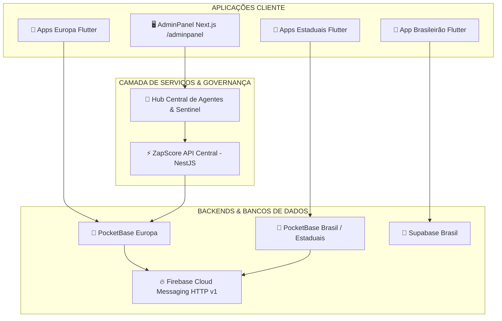

### 1.2 Mapa de Diretórios do Workspace
```text
d:\zapscore\
├── apps\
│   ├── api\                           # Backend Central NestJS (Scrapers, API-Football proxy, etc.)
│   ├── europa\                        # Ecossistema Europa
│   │   ├── pb_hooks\                  # JS Hooks do PocketBase Europa (notifications.pb.js, etc.)
│   │   ├── laliga\                    # App Flutter La Liga
│   │   ├── bundesliga\                # App Flutter Bundesliga
│   │   ├── premierleague\             # App Flutter Premier League
│   │   ├── seriea-italia\             # App Flutter Serie A
│   │   ├── ligue1-franca\             # App Flutter Ligue 1
│   │   └── relatorios\                # Relatórios técnicos e planos específicos da Suíte Europa
│   ├── estaduais\                     # Apps Flutter dos Campeonatos Estaduais
│   ├── mobile\                        # Template base Flutter (NUNCA MODIFICAR DIRETAMENTE)
│   ├── sync-supabase\                 # Pipeline de sincronização com o Supabase
│   └── web\                           # Painel Administrativo Next.js (AdminPanel)
├── relatorios\                        # Documentações, planos de implementação e este documento ECOSYSTEM.md
└── .agents\                           # Regras mandatárias de conduta dos Agentes IA (AGENTS.md)
```

---

## 🗺️ Capítulo 2: Mapeamento de Aplicativos, Ligas e Credenciais

### 2.1 Mapeamento da Suíte Europa

| Liga / App | `app_slug` | `league_id` (API) | Projeto Firebase | Canal Android (`channel_id`) | Service Account |
| :--- | :--- | :--- | :--- | :--- | :--- |
| **La Liga** | `laliga` | `140` | `applaliga` | `laliga_live_channel` | `service_account_laliga.json` |
| **Bundesliga** | `bundesliga` | `78` | `appbundesliga` | `bundesliga_live_channel` | `service_account_bundesliga.json` |
| **Premier League** | `premierleague` | `39` | `apppremierleague-8935b` | `premierleague_live_channel` | `service_account_premierleague.json` |
| **Serie A** | `seriea-italia` | `135` | `appseriea-italia` | `seriea-italia_live_channel` | `service_account_seriea-italia.json` |
| **Ligue 1** | `ligue1-franca` | `61` | `appligue1` | `ligue1-franca_live_channel` | `service_account_ligue1-franca.json` |

### 2.2 Mapeamento Brasil, Copas e Campeonatos Estaduais

| Competição / Módulo | `league_id` (Ext) | Módulo no AdminPanel | Escopo | Projeto Firebase | Service Account |
| :--- | :--- | :--- | :--- | :--- | :--- |
| **UEFA Champions League** | `2` | `/adminpanel/europa` | Continental Europa | `appchampions` (`954840066349`) | `appchampions-firebase-adminsdk-fbsvc-2afe7578ad.json` |
| **Brasileirão Séries A e B** | `71` / `72` | `/adminpanel/brasil` | Nacional Brasil | `appbrasileirao-a2daa` (`704384421414`) | `service_account_brasileirao.json` |
| **Copa Libertadores** | `13` | `/adminpanel/copas` | Continental | - | - |
| **Copa do Brasil** | `73` | `/adminpanel/copas` | Eliminatória Nacional | - | - |
| **Copa do Nordeste** | `612` | `/adminpanel/copas` | Regional | - | - |
| **Paulistão A1 / A2** | `475` / `476` | `/adminpanel/estaduais` | Estadual SP | `apppaulista` | `apppaulista-firebase-adminsdk-....json` |
| **Carioca (Taça GB / Rio)** | `624` / `851` | `/adminpanel/estaduais` | Estadual RJ | `appcarioca` | `appcarioca-firebase-adminsdk-....json` |
| **Mineiro Mód 1 / Mód 2** | `629` / `619` | `/adminpanel/estaduais` | Estadual MG | `appmineiro` (`584623894874`) | `appmineiro-firebase-adminsdk-fbsvc-beec05d305.json` |
| **Gaúcho Série A / A2** | `477` (622) / `478` (853) | `/adminpanel/estaduais` | Estadual RS | `appgaucho-ad96b` (`2396513433`) | `service_account_campeonato_gaucho.json` |
| **Baiano 1ª / 2ª Divisão** | `602` / `613` | `/adminpanel/estaduais` | Estadual BA | `appbaiano` | `service_account_campeonato_baiano.json` |
| **Paranaense 1ª / 2ª Divisão** | `606` / `614` | `/adminpanel/estaduais` | Estadual PR | `appparanaense` | `service_account_campeonato_paranaense.json` |
| **Cearense 1ª / 2ª Divisão** | `607` / `617` | `/adminpanel/estaduais` | Estadual CE | `appcearense` | `service_account_campeonato_cearense.json` |
| **Pernambucano 1ª / Série A2** | `622` / `1125` | `/adminpanel/estaduais` | Estadual PE | `apppernambucano` | `service_account_campeonato_pernambucano.json` |
| **Paraibano 1ª / 2ª Divisão** | `603` / `1037` | `/adminpanel/estaduais` | Estadual PB | `appparaibano` | `service_account_campeonato_paraibano.json` |
| **Maranhense 1ª / 2ª Divisão** | `608` / `854` | `/adminpanel/estaduais` | Estadual MA | `appmaranhense` | `service_account_campeonato_maranhense.json` |

### 2.3 Configurações dos Clientes Flutter (`AppConfig`)
Cada app possui seu arquivo `lib/helpers/app_config.dart` com constantes imutáveis:
* `leagueId`: ID em String (ex: `'135'`).
* `externalLeagueId`: ID numérico para consultas à ZapScore API (ex: `135`).
* `appName`: Nome de exibição formatado.
* `appSlug`: Identificador no PocketBase (`'seriea-italia'`, `'ligue1-franca'`, etc.).
* `apiBaseUrl`: `https://zapscore-zapscore-api.gtalg3.easypanel.host`.
* `pocketbaseBaseUrl`: `https://zapscore-pocketbase-europa.gtalg3.easypanel.host`.

---

## 🗄️ Capítulo 3: Infraestrutura de Backend e Bancos de Dados

### 3.1 Zapscore API Central (NestJS Backend)
A API central (`apps/api`) atua como gateway inteligente e provedor de dados:
* **Proxy & Cache da API-Football**: Gerencia requisições com cache em memória para preservar cotas diárias de chamadas.
* **Endpoints de Partidas**:
  * `GET /fixtures?status=LIVE` — Jogos ao vivo de todas as ligas ativas.
  * `GET /fixtures/today?leagueId=...` — Grade de partidas do dia por liga.
  * `GET /fixtures/round?leagueId=...&season=...` — Partidas por rodada/temporada.
  * `GET /fixtures/{id}/ai-analysis` & `/fixtures/ai-analysis/performance` — Análises táticas e métricas preditivas de IA.
* **Módulo de Auditoria Sentinel**: Rotas `/sentinel/health-check` e `/sentinel/audit`.

### 3.2 Instâncias do PocketBase e Schemas de Coleções
O PocketBase é utilizado para orquestração de notificações push, gerenciamento de inscrições e cache reativo de partidas.

#### Coleções Fundamentais:
1. **`apps`**: Cadastro das competições ativas (`app_slug`, `name`, `league_id`, `active`).
2. **`subscriptions`**: Dispositivos inscritos para push:
   * `app_slug` (Text): Liga do app.
   * `fcm_token` (Text): Token único gerado pelo Firebase no aparelho.
   * `device_id` (Text): Identificador persistente no `SharedPreferences` do dispositivo.
   * `platform` (Text): `'android'` ou `'ios'`.
   * `notify_goals`, `notify_start`, `notify_end` (Bool): Preferências de notificações.
   * `favorite_teams` / `favorite_fixtures` (JSON Array): Listas de IDs favoritados pelo usuário.
3. **`match_cache`**: Controle de estado ao vivo:
   * `fixture_id`, `league_id`, `home_team_id`, `away_team_id`.
   * `home_score`, `away_score`, `status` (`1H`, `2H`, `HT`, `LIVE`, `FT`).
   * `minute` e `last_event_hash`: Controle de minutagem e prevenção de disparos duplicados.
4. **`notification_logs`**: Telemetria e auditoria de mensagens enviadas.

### 3.3 Particularidades do Runtime Goja no PocketBase (JS Engine)
O motor JavaScript do PocketBase é o **Goja** (um interpretador JS escrito em Go). Desenvolver para Goja exige cuidados arquiteturais estritos:
1. **Isolamento de Escopo por Handler:** Cada `routerAdd` e cada `cronAdd` executa em instâncias separadas. Funções utilitárias no escopo global não são herdadas automaticamente. Todas as rotinas de geração de token JWT, criptografia RSA e envio HTTP devem ser autoencapsuladas dentro de cada callback.
2. **Go Slices vs JavaScript Arrays (`.includes()`):** Arrays retornados de campos JSON do banco são mapeados como slices do Go (`[]interface{}`) e **não possuem métodos de protótipo do JS como `.includes()`**. Chamar `.includes()` causa falha silenciosa. É mandatório iterar com laço `for` clássico ou converter para string e fazer parsing defensivo.
3. **Criptografia RS256 Pura:** O Goja não possui o módulo `crypto` do Node.js nem o Web Crypto API. Toda a pilha de parsing de chaves ASN.1 DER PKCS#8, hash SHA-256 em nível de bytes e exponenciação modular com Teorema Chinês do Resto (`BigInt`) é implementada em código JavaScript puro dentro do script.

### 3.4 Sincronização Supabase (Módulo Brasil)
O módulo Brasil utiliza pipeline dedicado em `apps/sync-supabase/` para espelhamento dos dados do Brasileirão com persistência relacional no PostgreSQL do Supabase.

### 3.5 Procedimento de Deploy dos Hooks (`pb_hooks`) no Easypanel
Os arquivos de automação JS (`notifications.pb.js`, `scorer_sync.pb.js`, etc.) residem na pasta `apps/europa/pb_hooks/`:
1. **Montagem de Volume:** No container do PocketBase no Easypanel, a pasta `/pb_hooks` é mapeada diretamente como volume persistente.
2. **Hot-Reloading do Goja:** Modificações nos arquivos `.pb.js` são automaticamente recarregadas na próxima execução do Cron ou requisição HTTP. Caso necessário, o container pode ser reiniciado no painel Easypanel para forçar a renovação da memória.
3. **Integridade de Credenciais:** As chaves `service_account_*.json` devem sempre acompanhar o arquivo `.pb.js` no mesmo volume para leitura via `$os.readFile(__hooks + "/service_account_*.json")`.

### 3.6 Dicionário Seguro de Variáveis de Ambiente (Padrão `.env.example`)
Nenhum valor secreto ou senha deve constar em documentações. A seguir, o dicionário seguro das chaves utilizadas:

#### `apps/web/.env` (AdminPanel Next.js):
* `NEXT_PUBLIC_API_BASE_URL`: URL pública da API NestJS central.
* `NEXT_PUBLIC_POCKETBASE_EUROPA_URL`: URL pública do PocketBase Europa.
* `NEXT_PUBLIC_SUPABASE_URL`: Endpoint da instância Supabase (Módulo Brasil).
* `NEXT_PUBLIC_SUPABASE_ANON_KEY`: Chave pública anônima do cliente Supabase.

#### `apps/api/.env` (Backend Central):
* `PORT`: Porta de execução do servidor NestJS (padrão `3000`).
* `API_FOOTBALL_KEY`: Chave da API-Football para scrapers e partidas ao vivo.
* `POCKETBASE_EUROPA_ADMIN_EMAIL` / `POCKETBASE_EUROPA_ADMIN_PASSWORD`: Credenciais administrativas para operações de backend.

---

## 🔔 Capítulo 4: Motor de Sincronização e Notificações Push (FCM v1)

### 4.1 Monitoramento em Tempo Real (`zapscore_live_sync`)
* **Cron de Alta Frequência**: Execução nativa a cada 1 minuto (`* * * * *`) via `pb_hooks/notifications.pb.js`.
* **Fluxo de Comparação**: Consulta `GET /fixtures?status=LIVE`, filtra as ligas com `active = true` na coleção `apps` e compara o placar/minutagem com o `match_cache`.

### 4.2 Regras de Disparo por Evento (`start`, `end`, `goal`)
* **🔔 Início de Jogo (`start`):** Enviado para **TODOS** os assinantes da liga com `notify_start = true`. (Filtro de times favoritos é ignorado para garantir entrega universal).
* **🏁 Fim de Jogo (`end`):** Enviado para **TODOS** os assinantes da liga com `notify_end = true`. (Filtro de favoritos é ignorado). Varredura em `GET /fixtures/today` garante detecção de partidas finalizadas após saírem do feed LIVE.
* **⚽ Gols (`goal`):** 
  * Se o usuário possui `favorite_teams` ou `favorite_fixtures` preenchidos, **só recebe** se o seu time ou a partida estiver na lista.
  * Se a lista de favoritos estiver vazia, recebe os gols de todas as partidas da liga.

### 4.3 Protocolo de Autenticação FCM HTTP v1 (OAuth2 JWT RS256 Puro)
O hook do PocketBase implementa assinatura criptográfica pura em JavaScript:
1. Monta o cabeçalho `{ alg: "RS256", typ: "JWT" }` e claims com escopo `https://www.googleapis.com/auth/firebase.messaging`.
2. Decodifica o PEM PKCS#8 da Service Account e assina o hash SHA-256 via exponenciação modular BigInt (`_rsaSign`).
3. Obtém o access token OAuth2 `Bearer` em `https://oauth2.googleapis.com/token`.
4. Armazena o token em cache na memória (`_googleTokenCache`), renovando-o 5 minutos antes da expiração.

### 4.4 Agente Push Self-Healer (Expurgo de Tokens Órfãos)
Ao disparar via FCM HTTP v1 (`fcm.googleapis.com/v1/projects/.../messages:send`):
* Respostas `404`, `403` ou mensagens `NotRegistered` / `NOT_FOUND` indicam que o usuário desinstalou o aplicativo.
* O hook executa automaticamente a exclusão do registro na coleção `subscriptions` (`[POCKETBASE PURGE 🗑️]`), mantendo a base 100% saudável.

### 4.5 Sistema Híbrido de Broadcast (Notícias & Vídeos com Deep Linking)
Permite disparo de notificações ricas a partir do AdminPanel:
* **Fila de Sugestões:** Content Scout captura notícias via RSS e vídeos do YouTube.
* **Aprovação com 1 Clique:** O administrador aprova o disparo no AdminPanel.
* **Deep Linking no Flutter:** Ao tocar na notificação, o app mobile abre diretamente o player de vídeo ou a matéria.

### 4.6 Guia Rápido de Troubleshooting de Push (Diagnóstico em 1 Minuto)

Para testar ou simular o envio de push diretamente no navegador sem aguardar partidas reais:

#### Rotas de Diagnóstico e Simulação:
* **Serie A (Itália):** `GET https://zapscore-pocketbase-europa.gtalg3.easypanel.host/api/test-notifications?app=seriea-italia&simulate=true`
* **La Liga (Espanha):** `GET https://zapscore-pocketbase-europa.gtalg3.easypanel.host/api/test-notifications?app=laliga&simulate=true`
* **Ligue 1 (França):** `GET https://zapscore-pocketbase-europa.gtalg3.easypanel.host/api/test-notifications?app=ligue1-franca&simulate=true`
* **Bundesliga (Alemanha):** `GET https://zapscore-pocketbase-europa.gtalg3.easypanel.host/api/test-notifications?app=bundesliga&simulate=true`
* **Premier League (Inglaterra):** `GET https://zapscore-pocketbase-europa.gtalg3.easypanel.host/api/test-notifications?app=premierleague&simulate=true`

#### Tabela de Códigos de Resposta do Google FCM:

| Status Code | Significado Técnico | Ação do Sistema |
| :--- | :--- | :--- |
| **`200 OK`** | Notificação aceita e enfileirada no Google FCM. | Incrementa contador de sucesso (`sentCount++`). |
| **`404 NOT_FOUND`** / `NotRegistered` | O app foi desinstalado ou o token expirou. | **Auto-Expurgo Ativo:** Remove o token da coleção `subscriptions`. |
| **`403 FORBIDDEN`** / `AuthError` | Falha na Service Account ou credencial inválida. | Loga erro de autenticação para auditoria. |
| **`400 INVALID_ARGUMENT`** | Payload corrompido ou formato de token inválido. | Ignora envio e loga payload com erro. |

---

## 🤖 Capítulo 5: Central de Governança, Hub de Agentes e Sentinel

### 5.1 Hub Central de Agentes (`/adminpanel/agents`)
Ponto único de observabilidade e governança de agentes inteligentes no menu lateral do AdminPanel Next.js:
1. **🛡️ Sentinel Multi-Módulo:** Guardião de partidas e sincronismo.
2. **⚡ Push Self-Healer:** Expurgo e telemetria de notificações FCM.
3. **📰 Content Scout:** Coleta automatizada de conteúdo RSS e YouTube.
4. **⏱️ Quota Watchdog:** Monitor de cotas e rate limit da API-Football.

### 5.2 Sentinel Multi-Instâncias em 4 Abas (`/adminpanel/sentinel`)
Auditoria em tempo real dividida em 4 abas isoladas:
* 🇧🇷 **Aba Brasil:** Série A (`71`) e Série B (`72`).
* 🇪🇺 **Aba Europa:** La Liga (`140`), Premier League (`39`), Bundesliga (`78`), Serie A (`135`), Ligue 1 (`61`).
* 🏆 **Aba Copas:** Libertadores (`13`), Copa do Nordeste (`612`), Copa do Brasil (`73`).
* 📍 **Aba Estaduais:** Paulistão (`475`/`476`), Carioca (`624`/`851`), Mineiro (`629`/`619`).
* **Ações:** Detecção de partidas travadas em `LIVE` (>115 min) e botão de **Sync Forçado**.

### 5.3 [A FAZER - AMANHÃ] Agente Scorer Sentinel & Hybrid Self-Healer (Artilharia Híbrida Oficial + Fallback por Cálculo Local)
* **Localização Principal:** `apps/api/src/competitions/scorer-agent.service.ts` e `apps/api/src/sync/sync-jobs.service.ts`.
* **Rota no AdminPanel:** `/adminpanel/agents/scorers` (com cards por liga e gaveta de emergência).
* **Proposta Arquitetural:** Eliminação do risco de dados corrompidos/incompletos em grandes ligas e garantia de cobertura autônoma para competições menores que a API oficial não audita.

#### 1. Árvore de Decisão em 2 Camadas (Oficial ➔ Fallback por Eventos)
O agente opera de forma inteligente através de uma rotina diária (executada 1x ao dia às 00:30 BRT, logo após a consolidação das tabelas de classificação):
1. **Camada 1 (Prioridade Primária — Oficial API-Football):**
   - O agente consulta o endpoint oficial `/players/topscorers?league={id}&season={season}` da API-Football (consumindo apenas **1 única requisição HTTP leve por liga ao dia**).
   - **Se `response.length > 0`:** Aplica `upsert` dos dados consolidados da federação (gols oficiais, assistências, pênaltis e fotos oficiais em alta resolução de `media.api-sports.io`).
   - Seta a tag da competição como `🟢 OFICIAL (API-Football)`.
   - **Exemplos atendidos:** Brasileirão Séries A e B, Premier League, La Liga, Serie A, Bundesliga, Ligue 1, Libertadores e Copa do Brasil.
2. **Camada 2 (Fallback Autônomo — Detecção de Ausência Oficial):**
   - Quando a API-Football não audita a artilharia daquela competição (comum em estaduais menores como Paraibano, Maranhense, Cearense, Potiguar ou divisões de acesso), ela retorna resposta vazia: `{ "results": 0, "response": [] }`.
   - **Inteligência de Detecção:** O agente intercepta o `results === 0` e **não zera a tabela nem emite erro**.
   - Emite log de auditoria: `[ScorerAgent] Liga {id} ({nome}) sem cobertura oficial na API-Football. Ativando motor de cálculo por eventos locais...`.
   - **Motor de Cálculo Local:** Varre os eventos de gols (`FixtureEvent` com `type: 'goal'`) das partidas monitoradas daquela liga e consolida a artilharia acumulativa.
   - Seta a tag da competição como `🟡 CALCULADO PELO AGENTE (Eventos Locais)`.
   - **Exemplos atendidos:** Campeonato Paraibano, Campeonato Maranhense, etc.

#### 2. Erradicação Absoluta do `deleteMany()` Destrutivo
- **Proibição Mandatória:** Fica terminantemente proibido o uso de `prisma.scorer.deleteMany()` nos crons de sincronização.
- **Gravação Cirúrgica via `upsert`:**
  - Chave única composta: `(leagueId, season, playerName, teamName)`.
  - Se o jogador já existe, atualiza as estatísticas mantendo seu UUID inalterado. Se não existe, cria o novo registro.
  - Isso garante que os aplicativos móveis Flutter **nunca enfrentem telas em branco ou contagens zeradas** durante o processo de sincronização.

#### 3. Painel de Governança, Badges e Gestão de Emergência no AdminPanel (`/adminpanel/agents/scorers`)
- **Tags Semafóricas de Origem por Competição:**
  - 🟢 **Oficial (API-Football):** Dados 100% auditados pela federação.
  - 🟡 **Calculado pelo Agente:** Modo autônomo ativo para ligas menores sem cobertura oficial.
  - 🔴 **Sem Registros:** Competição ainda sem partidas iniciadas na temporada.
- **Gaveta de Gestão Manual de Emergência (Safety Valve):**
  - Permite a edição inline instantânea de qualquer jogador (gols, time, fotos, rank).
  - **Botão "Travar Artilheiro" (Freeze Lock):** Permite congelar um atleta manualmente caso haja disputa de súmula no tribunal desportivo da federação, impedindo qualquer automação de alterar até a liberação do operador.

#### 4. Plano de Execução em 4 Fases (Cronograma para Amanhã)
* **Fase 1 (`apps/api`):** Refatorar `scorer-agent.service.ts` para implementar a árvore de decisão híbrida (Oficial ➔ Fallback) e eliminar `deleteMany()`.
* **Fase 2 (`sync-jobs.service.ts`):** Desativar o cron horário agressivo e plugar o `handleHybridScorersSync` no cron diário da madrugada (1x ao dia, economia máxima de cota).
* **Fase 3 (Baseline Imediato):** Rodar rotina de saneamento para aplicar os dados oficiais corretos no Brasileirão Série A (Viveros 18, Pedro 15, etc.) e ligas europeias.
* **Fase 4 (`apps/web` AdminPanel):** Atualizar `/adminpanel/agents/scorers` com as tags de origem (Oficial vs. Calculado) e ferramentas de edição de emergência.

### 5.4 Agente Monitor de IA (AI Sentinel & Feedback Loop Preditivo)
* **Rota:** `/adminpanel/agents/ia-monitor`.
* **Auditoria Pós-Jogo:** Compara as análises e probabilidades pré-jogo com o placar final `FT`.
* **Dynamic Few-Shot Learning:** Injeta histórico de acertos e vieses táticos aprendidos diretamente nos prompts das próximas rodadas, elevando a precisão do modelo progressivamente.

### 5.5 Agente Quota Watchdog (Controle de Taxa da API-Football)
* Monitora o cabeçalho `x-requests-remaining` da API-Football.
* Se a cota diária atingir nível crítico (<20%), comuta a cadência de polling dos jogos ao vivo para proteger o serviço contra rate limits.

### 5.6 Agente Lineup Agent (Escalações Oficiais Multi-Fonte & Buffer PocketBase)
* **Rota no AdminPanel:** `/adminpanel/agents/lineups`.
* **Proposta:** Captura antecipada (50 a 60 min pré-jogo) dos 22 titulares oficiais para todas as partidas monitoradas nas próximas 4 horas, com zero consumo da API-Football.
* **Buffer Desacoplado no PocketBase:** Ingestão segura via coleção `match_lineups` em `zapscore-pocketbase-multiapkagent`, isolando a API ZapScore de variações ou bloqueios WAF externos.
* **Cascata Multi-Fonte:** Sofascore (Principal) ➔ FotMob (Fallback 1) ➔ GloboEsporte/365 (Fallback 2).
* **Integração Automática com Push Agent:** Ao consolidar os 22 titulares, atualiza atomicamente o PostgreSQL local (`FixtureLineup`), emite WebSocket para os apps móveis e arma o gatilho automático de disparo pré-jogo do Push Agent a 10 min do apito inicial.

### 5.7 [A FAZER - AMANHÃ] Agente Push Sentinel & Delivery Intelligence (Certificação de Entrega, Latência E2E e Funil de Conversão)
* **Rota no AdminPanel:** `/adminpanel/agents/push-sentinel`.
* **Proposta:** Eliminação do ponto cego do Google FCM v1 através de telemetria ativa e certificação física de entrega nos clientes Flutter.
* **Os 4 Pilares Centrais:**
  1. **Certificação Real de Entrega (Device ACK):** Pingback leve disparado pelo app em segundo plano confirmando recepção física no dispositivo (eliminando a falsa impressão de que `200 OK` do Google significa entrega).
  2. **Medição de Latência E2E e Alerta de Lag:** Cálculo instantâneo do tempo decorrido entre o envio no servidor e o recebimento no aparelho (`<2s` ideal / `>10s` alerta crítico de lag de gol).
  3. **Funil Completo de Conversão:** Disparadas ➔ Aceitas pelo FCM ➔ Entregues no Aparelho ➔ Abertas (CTR Real) ➔ Deep Link Success.
  4. **Diagnóstico OEM & Doze Mode:** Mapeamento de retenção de notificações por fabricante (Xiaomi MIUI/HyperOS, Samsung OneUI, Motorola) e detecção de "Ghost Devices" para quarentena inteligente.
* **Detalhamento Arquitetural Completo:** Consulte a especificação técnica detalhada no [Capítulo 16.10](#1610-a-fazer---amanhã-agente-de-telemetria-e-certificação-de-entrega-push-push-sentinel--delivery-intelligence).

### 5.8 [CONCLUÍDO] Agente Publicador de Aplicativos (Store Publisher Agent — Google Play Edits API & Canva Pro)
* **Rota no AdminPanel:** `/adminpanel/agents/store-publisher` (Card ativo no Hub `/adminpanel/agents`).
* **Proposta Arquitetural:** Elimina 100% da fricção manual no lançamento e atualização de aplicativos na Google Play Store. Reúne ASO copywriting de alta conversão, templates de dimensões oficiais do Canva Pro (1024x500, 1080x1920, 512x512) e preenchimento validado de formulários regulatórios em uma única interface.
* **Isolamento Absoluto:** Desenvolvido estritamente dentro de `apps/web/app/(main)/adminpanel/agents/store-publisher/`. A Zapscore API (`apps/api`) e os apps móveis Flutter permanecem 100% intocados.
* **Os 5 Pilares de Engenharia:**
  1. **Catálogo & Auto-Discovery de Pastas Clonadas (`auto-discovery.ts`):** Varre em tempo real `apps/estaduais/`, `apps/brasil/` e `apps/europa/`. Quando um app é clonado no disco (ex: `alagoano`, `sergipano`), o botão "Varredura Automática" detecta o `pubspec.yaml`, `app_config.dart` e `build.gradle.kts`, inserindo-o no painel com a tag `AUTO`.
  2. **Formulários Obrigatórios e Isenção de Famílias/COPPA (`store-forms.ts`):**
     - **Público-Alvo:** 16+ (16-17 e 18+), isentando o app da restritiva Política de Famílias e da legislação COPPA.
     - **Categorização:** Categoria Primária **Esportes (`SPORTS`)** e Tag/Secundária **Entretenimento (`ENTERTAINMENT`)**.
     - **Anúncios:** Declarado **Sim** (Google AdMob SDK integrado).
     - **Classificação IARC:** Livre / Everyone (PEGI 3, USK 0, DJCTQ Livre).
     - **Data Safety:** Identificadores de dispositivo (tokens FCM para push) e localização aproximada (AdMob) com criptografia HTTPS/TLS 1.3.
     - **Acesso ao App:** Livre sem credenciais de login (`ALL_FUNCTIONALITY_AVAILABLE`).
  3. **ASO Copywriting com Limites Rígidos (`aso-generator.ts`):** Título (máx 30c), Breve (máx 80c), Completa (máx 4000c) e Novidades (máx 500c), com integração inteligente ao Gemini.
  4. **Canva Pro com Deep-Links Dimensionados (`canva-service.ts`):** Abre pranchetas oficiais na conta do operador com dimensões exatas da loja sem necessidade de credenciais de API.
  5. **Google Play Edits API & Exportador Offline (`google-play-api.ts` & `export-package.ts`):** Autenticação JWT RS256 nativa com suporte a **Workload Identity Federation (OIDC sem chaves estáticas)**, modo Dry-Run seguro e download do pacote consolidado (`.txt`, `.json`, `.md`).
* **Documentação e Tutorial Completo:** Consulte o [Capítulo 21.12](#2112-concluído-store-publisher-agent-automação-de-assets-formulários-16sports-canva-pro-e-google-play-edits-api).

---

## 📱 Capítulo 6: Aplicativos Mobile Flutter (Arquitetura White-Label & Cubits)

### 6.1 Padrão White-Label e Diretrizes de Isolamento
* Cada aplicativo estadual ou europeu opera como flavor ou módulo isolado.
* **Proibição Absoluta:** O diretório base `apps/mobile/` é intocável. Qualquer customização de cores, ícones, splash screen ou tema pertence estritamente à pasta do respectivo app (`apps/europa/<liga>/` ou `apps/estaduais/<estado>/`).

### 6.2 Camada de Estado e Cubits (`HomeCubit`, `LeagueCubit`, `LiveCubit`)
A gerência de estado e sincronização com a API nos aplicativos Flutter segue a seguinte arquitetura:
1. **`HomeCubit` (Calendário e Partidas do Dia):**
   * Endpoint: `/fixtures?leagueId={id}&date={YYYY-MM-DD}`.
   * Fallback: Consulta `/competitions/stored` para renderizar a estrutura inicial sem travar a interface.
2. **`LeagueCubit` (Tabelas, Rodadas e Artilharia):**
   * Dispara chamadas paralelas com `Future.wait([getRecentFixtures(leagueId, limit: 500), getStandings(leagueId), getScorers(leagueId)])`.
   * **Temporada Padronizada:** `2026`.
   * **Contagem de Rodadas por Estrutura de Liga:**
     * *Premier League, La Liga, Serie A* (20 clubes): **38 rodadas** (`Regular Season - 1` a `38`).
     * *Bundesliga, Ligue 1* (18 clubes): **34 rodadas** (`Regular Season - 1` a `34`).
3. **`LiveCubit` (Jogos Ao Vivo em Tempo Real):**
   * Endpoint: `/fixtures?status=LIVE&leagueId={id}`.
   * **Auto-Refresh Ativo:** Timer periódico a cada 30 segundos com controle de ciclo de vida (`dispose`/`stopAutoRefresh`) ao trocar de tela.

### 6.3 PushNotificationService (Foreground, Background e Permissões)
* **`PushNotificationService.initialize()`**:
  * Registra o handler em segundo plano `@pragma('vm:entry-point') _firebaseMessagingBackgroundHandler`.
  * Cria o canal Android de alta prioridade (`Importance.max`).
  * Solicita permissão nativa `POST_NOTIFICATIONS` (Android 13+ / iOS).
  * Gera e persiste o `device_id` único no `SharedPreferences`.
  * Registra e atualiza token e preferências no PocketBase.
* **Foreground:** Mensagens recebidas com o app aberto são exibidas instantaneamente através do `flutter_local_notifications`.

### 6.4 Monetização com Google Mobile Ads (AdMob)
Estruturado através do `AdService` (`lib/services/ad_service.dart`) e `AdBannerWidget`:
* **Banner Fixo na Home**: Posicionado logo acima do menu inferior (`HomeNavBottom`).
* **Banners Inline em Listas**:
  * Lista de Jogos: 1 banner a cada 5 partidas.
  * Notícias e Vídeos: 1 banner a cada 3 itens.
  * Aba de IA (`ai_analysis.dart`): 1 banner entre os palpites rápidos e a análise técnica.
* **Anúncios Intersticiais (Tela Cheia)**:
  * Exibidos na transição de leitura de notícias (`NewsContentScreen`), player de vídeos (`WatchContentScreen`) e Dashboard de IA (`AiPerformanceDashboardPage`).

---

## 🛡️ Capítulo 7: Diretrizes Rígidas de Desenvolvimento e Modificação

### 7.1 Regra Máxima: Edição Estritamente Cirúrgica
* **PROIBIÇÃO ABSOLUTA:** É terminantemente proibido alterar qualquer arquivo, widget, estilo, padding, cor, fonte ou estrutura que **não tenha sido explicitamente solicitada** pelo usuário.
* **Nenhum Efeito Colateral:** Alterações devem afetar **apenas e tão somente** o elemento ou linha estritamente determinada.

### 7.2 Intocabilidade do App Base (`apps/mobile`)
* Nunca editar os arquivos dentro de `apps/mobile/` para resolver demandas de aplicativos específicos. Toda alteração deve residir no módulo white-label de destino.

### 7.3 Checklist de Validação Obrigatório para Agentes IA
Antes de concluir qualquer tarefa, o agente deve verificar:
1. [ ] A edição afetou apenas os arquivos estritamente solicitados?
2. [ ] Todos os contratos de API e modelos de dados permanecem 100% intactos?
3. [ ] Nenhum layout, cor, padding ou estilo visual foi alterado sem pedido explícito?
4. [ ] As chaves e slugs de competições continuam correspondendo à matriz do Capítulo 2?

### 7.4 Imutabilidade Rígida dos Motores de Crawling (Notícias e Vídeos)
* **PROIBIÇÃO ABSOLUTA DE MODIFICAÇÃO DO CÓDIGO FONTE:** É expressamente proibido modificar o código-fonte de `apps/api/src/news/news-crawler.service.ts` e `apps/api/src/videos/video-crawler.service.ts`, bem como qualquer pipeline de extração de imagens ou sanitização de HTML.
* **Mecanismo Oficial de Expansão de Conteúdo:** O abastecimento e expansão de conteúdos para qualquer nova competição, estadual ou copa deve ser feito **EXCLUSIVAMENTE** via inserção e curadoria de URLs de Feeds RSS e canais através do AdminPanel (`/adminpanel/news/sources`) ou via endpoint `POST /news-sources`.

---

## 📈 Capítulo 8: Histórico de Implementações e Roadmap de Incrementos

### 8.1 Histórico de Entregas Validadas
* **[2026-09-03]**: Implementação do **Lineup Agent** (Agente Autônomo de Escalações Multi-Fonte) na ZapScore API central (`apps/api/src/lineups`). Coleta antecipada (50 a 60 min antes do jogo) com tripla redundância em cascata (Sofascore, FotMob e GloboEsporte/365), janela estrita de 4 horas, escopo filtrado pelas ligas do Sentinel, zero chamadas à API-Football e integração automática com o worker de 10 minutos do Push Agent.
* **[2026-08-31]**: Integração do Agente Sentinel com o Agente Push: detecção autônoma de conclusão de partidas (100% FT do dia em todas as ligas monitoradas), geração imediata de resumo de placares da rodada, persistência na tabela `PushQueue` (Prisma/PostgreSQL), fila de aprovação com contagem regressiva em tempo real no AdminPanel e disparo automático por fallback após 60 minutos via worker em segundo plano.
* **[2026-08-23]**: Validação e disparo em produção com 100% de sucesso (19/19 Serie A, 14/14 La Liga) via FCM HTTP v1.
* **[2026-08-23]**: Unificação da regra de Início (`start`) e Fim (`end`) de jogos em `notifications.pb.js` para entrega universal a todos os inscritos.
* **[2026-08-23]**: Criação e enriquecimento do documento vivo de arquitetura e governança [relatorios/ECOSYSTEM.md](file:///d:/zapscore/relatorios/ECOSYSTEM.md) com diretiva mandatória no [.agents/AGENTS.md](file:///d:/zapscore/.agents/AGENTS.md).
* **[2026-08-22]**: Especificação dos planos de arquitetura do Agente de Artilharia Automática (`scorer_sync.pb.js`) e do Agente Monitor de IA (`/adminpanel/agents/ia-monitor`).
* **[2026-08-21]**: Mapeamento completo e auditoria de sincronização de rodadas (38 vs 34 rodadas) e auto-refresh de 30s nos 5 apps europeus.
* **[2026-08-18]**: Especificação do Sistema Híbrido de Broadcast de Notícias e Vídeos com deep linking no Flutter.
* **[2026-08-17]**: Conclusão da Fase 1 do Sentinel Multi-Instâncias em 4 abas (Brasil, Europa, Copas e Estaduais) e criação do Hub de Agentes no AdminPanel.
* **[2026-08-16]**: Resolução de particularidades do runtime Goja no PocketBase (auto-encapsulamento de escopo e parser de slices Go).
* **[2026-08-02]**: Implementação e homologação do motor de push notifications no PocketBase Europa com FCM HTTP v1 nativo em JavaScript.

### 8.2 Backlog e Próximos Incrementos Planejados
* [ ] **[A FAZER - AMANHÃ 🚀] Novas Funcionalidades: Pílulas "Você Sabia?" & Central de Probabilidades Preditivas**: Implementação no app piloto Brasileirão Série A (e posterior escalação white-label) do feed de curiosidades com dados profundos (estilo Stories/Reels) e gráficos interativos de probabilidade de título, Z4 e gols minuto a minuto ([Capítulo 23](#-capítulo-23-a-fazer---amanhã-novas-funcionalidades-de-engajamento-e-estatísticas-preditivas-pílulas-você-sabia--central-de-probabilidades)).
* [ ] **[A FAZER - AMANHÃ 🚀] Agente Push Sentinel & Delivery Intelligence**: Implementação do sistema de certificação física de entrega (Device ACK), medição de latência ponta a ponta (tempo real de gols), funil de abertura (CTR) e auditoria de fabricantes OEM no AdminPanel ([Capítulo 5.7](#57-a-fazer---amanhã-agente-push-sentinel--delivery-intelligence-certificação-de-entrega-latência-e2e-e-funil-de-conversão) e [Capítulo 16.10](#1610-a-fazer---amanhã-agente-de-telemetria-e-certificação-de-entrega-push-push-sentinel--delivery-intelligence)).
* [ ] **Agente de Comentários Táticos ao Vivo (Crawl4AI + LLM Engine)**: Implementação do comentador em tempo real de 5 em 5 minutos em 6 fases cronológicas ([Capítulo 15](#-capítulo-15-a-fazer-agente-de-comentários-táticos-ao-vivo-e-coleta-multi-fontes-crawl4ai--ia-engine)).
* [ ] **Ajuste Sintático na Chave PEM Bundesliga**: Ajustar os 4 hífens de fechamento para 5 (`-----END PRIVATE KEY-----`) em `notifications.pb.js`.
* [ ] **Ativação dos Workers de Segundo Plano**:
  * Implementação do worker cron do Content Scout em `apps/api` (coleta RSS/YouTube a cada 30 min).
  * Implementação do middleware Quota Watchdog na `apps/api` para telemetria da API-Football.
* [ ] **[A FAZER - AMANHÃ 🚀] Reestruturação do Agente Scorer Sentinel & Hybrid Self-Healer**: Implementação da árvore de decisão com prioridade oficial na API-Football (1x/dia na madrugada, gastando apenas 1 request/liga), detecção inteligente de ausência de dados para estaduais menores (ativação automática do motor de cálculo por eventos locais), erradicação do `deleteMany()` destrutivo via `upsert` acumulativo e interface com badges de origem e gestão de emergência no AdminPanel ([Capítulo 5.3](#53-a-fazer---amanhã-agente-scorer-sentinel--hybrid-self-healer-artilharia-híbrida-oficial--fallback-por-cálculo-local)).
* [ ] **[A FAZER] AdMob Rewarded IDs Exclusivos nos Apps Estaduais**: Criar IDs de anúncio premiado (Rewarded) dedicados no Google AdMob para os 6 apps (`baiano`, `carioca`, `cearense`, `gaucho`, `mineiro`, `paranaense`), substituindo o ID compartilhado herdado do paulista (`ca-app-pub-6887857057070736/1666213763`) em `lib/services/ad_service.dart` para permitir a segregação de relatórios de receita por aplicativo.
* [ ] **[A FAZER] Inclusão de 3 Novos Estaduais no Monitoramento ZapScore e Clonagem Mobile**:
  * **Etapa 1 — Monitoramento no Backend (`apps/api` & Governança)**:
    1. Mapear IDs oficiais na API-Football para Campeonato Maranhense, Campeonato Paraibano e Campeonato Pernambucano (1ª Divisão).
    2. Cadastrar competições em `apps/api/src/config/competitions.config.ts`.
    3. Cadastrar cards e rotas no AdminPanel (`apps/web/.../registry.ts`) e Sentinel (`sentinel/page.tsx`).
    4. Cadastrar registros na coleção `apps` do PocketBase Estaduais e provisionar Service Accounts Firebase para notificações push.
    5. Disparar rotinas de bootstrap (`/sync/bootstrap`) e artilharia (`/sync/scorers`).
  * **Etapa 2 — Clonagem Cirúrgica dos Apps Flutter (`apps/estaduais/*`)**:
    * Execução sequencial e isolada (um por um) utilizando `paulista` como molde estabilizado:
      1. `apps/estaduais/pernambucano`
      2. `apps/estaduais/paraibano`
      3. `apps/estaduais/maranhense`
    * Sanitização de identificadores (`pubspec.yaml`, `AndroidManifest.xml`, `build.gradle.kts`, `AppConfig`, `push_notification_service.dart`), injeção dos IDs AdMob (App ID, Banner, Interstitial, Native, Rewarded), identidade visual (`colors.dart`, telas `about_{app}.dart`), assets/ícones dedicados, ajuste fino dos engines (`standings_engine`, `bracket_engine`, `competition_normalizer`) conforme o regulamento de cada federação e validação estática de 0 erros via `flutter analyze`.
* [ ] **[ROADMAP IMEDIATO 🚀 (Início: 12/09/2026)] Execução em 6 Sprints Rumo aos 50k & Monetização**:
  * **Sprint 1 (12/09 a 14/09):** Contingência Total do Lineup Agent (Aliases, URL direta, Editor Manual e IA T-20m).
  * **Sprint 2 (15/09 a 18/09):** Criação do Hub `/adminpanel/growth` e Conexão da Canva Connect API Pro (3 templates oficiais).
  * **Sprint 3 (19/09 a 22/09):** Social Growth Agent (geração de mídias, copy com IA, Telegram/X/WhatsApp e rotina 5 min).
  * **Sprint 4 (23/09 a 26/09):** Rede Própria de Anúncios (House Ads & Direct Sponsorships: PocketBase, API, `/adminpanel/growth/ads` e Flutter híbrido) ([Capítulo 20](#-capítulo-20-a-fazer-rede-própria-de-anúncios-house-ads--direct-sponsorship-network)).
  * **Sprint 5 (27/09 a 29/09):** Store Publisher Agent (Feature Graphic, screenshots 3D, ícones, ASO e upload Google Play Edits API) + Quality Gatekeeper.
  * **Sprint 6 (30/09):** Growth Orchestrator Agent (painel de metas 50k, pacing diário e briefing matinal via Telegram) ([Capítulo 22.6](#226-roadmap-operacional-cronograma-de-execução-imediata-início-12092026)).

---

## 🖥️ Capítulo 9: AdminPanel — Arquitetura, Estrutura e Guia de Desenvolvimento

### 9.1 Visão Geral e Stack Tecnológica
O **AdminPanel** é a interface central de comando operacional do ecossistema ZapScore, localizada no diretório `apps/web`. Ele é responsável pela governança de dados, monitoramento em tempo real de partidas, supervisão dos agentes inteligentes, auditoria de push e curadoria de conteúdo.

#### Stack Principal:
* **Framework:** Next.js 15+ (App Router).
* **Linguagem:** TypeScript (estritamente tipado).
* **Estilização:** Tailwind CSS (Dark Mode padrão: `bg-slate-950`, `bg-slate-900`, `border-slate-800`, textos `text-slate-100`/`text-slate-400`).
* **Ícones:** `lucide-react`.
* **Biblioteca de Componentes:** Componentes modulares próprios (sem dependências pesadas de terceiros), preservando máxima performance e responsividade.

### 9.2 Mapa de Rotas e Telas
A aplicação está organizada sob a pasta `apps/web/app/(main)/adminpanel/`:

| Rota | Arquivo Fonte | Responsabilidade Principal |
| :--- | :--- | :--- |
| `/adminpanel` | `page.tsx` | **Dashboard Geral Unificado**: KPIs agregados dos 4 módulos, jogos ao vivo e status de saúde do ecossistema. |
| `/adminpanel/agents` | `agents/page.tsx` | **Hub Central de Agentes**: Card grid interativo com métricas e controles dos 4 agentes autônomos. |
| `/adminpanel/sentinel` | `sentinel/page.tsx` | **Sentinel Multi-Instâncias**: Auditoria em tempo real em 4 abas (Brasil, Europa, Copas, Estaduais) com detecção de anomalias e sync forçado. |
| `/adminpanel/agents/ia-monitor` | `agents/ia-monitor/page.tsx` | **Monitor de IA**: Auditoria de palpites e previsões táticas, assertividade pós-jogo e observabilidade de tokens/latência. |
| `/adminpanel/agents/scorers` | `agents/scorers/page.tsx` | **Painel da Artilharia (Scorer Engine)**: Sincronização e auditoria de artilheiros das ligas. |
| `/adminpanel/agents/publisher` | `agents/publisher/page.tsx` | **Publisher / Broadcast**: Fila de aprovação com 1 clique para disparo de push de notícias e vídeos. |
| `/adminpanel/europa` | `europa/page.tsx` | **Gestão Módulo Europa**: Jogos, tabelas e configurações conectadas ao PocketBase Europa. |
| `/adminpanel/brasil` | `brasil/page.tsx` | **Gestão Módulo Brasil**: Painel das Séries A e B do Brasileirão. |
| `/adminpanel/copas` | `copas/page.tsx` | **Gestão Módulo Copas**: Painel da Libertadores, Copa do Brasil e Copa do Nordeste. |
| `/adminpanel/estaduais` | `estaduais/page.tsx` | **Gestão Módulo Estaduais**: Painel do Paulistão, Carioca, Mineiro e Gaúcho. |
| `/adminpanel/news` | `news/page.tsx` | **Curadoria de Notícias**: Gerenciamento de fontes RSS, feed capturado e publicação. |
| `/adminpanel/videos` | `videos/page.tsx` | **Curadoria de Vídeos**: Importação e gestão de canais do YouTube por liga. |
| `/adminpanel/growth` | `growth/page.tsx` | **Hub de Divulgação & Monetização**: Seção central de crescimento, campanhas ativas, downloads e métricas de conversão. |
| `/adminpanel/growth/agent` | `growth/agent/page.tsx` | **Social Growth Agent**: Geração de artes (campinho, onde assistir, tabelas), copy com IA e disparos em redes sociais. |
| `/adminpanel/growth/ads` | `growth/ads/page.tsx` | **Rede Própria de Anúncios (House Ads)**: Gestão de campanhas de patrocínio, banners próprios e capping. |
| `/adminpanel/growth/calendar` | `growth/calendar/page.tsx` | **Calendário Diário de Divulgação**: Rotina diária de 5 minutos (ações de segunda a domingo com checklist). |
| `/adminpanel/growth/links` | `growth/links/page.tsx` | **Auditoria de Links & UTMs**: Rastreamento de instalações por canal e gerador de links para influenciadores. |
| `/adminpanel/agents/store-publisher` | `agents/store-publisher/page.tsx` | **Store Publisher Agent**: Automação oficial de lançamento na Google Play Store (ASO 30c/80c, Formulários 16+/SPORTS, Canva Pro, Edits API v3 e Auto-Discovery). |

### 9.3 Registro Centralizado de Módulos (`registry.ts`) e Renderização Dinâmica
Localizado em `apps/web/app/(main)/adminpanel/registry.ts`, este arquivo centraliza os metadados de todas as competições e fontes de dados:

```typescript
export interface LeagueConfig {
  id: number;
  slug: string;
  name: string;
  country: string;
  flag: string;
}

export interface EcosystemModule {
  id: string;
  name: string;
  shortName: string;
  icon: any;
  badge: string;
  badgeColor: string;
  href: string;
  dbType: 'pocketbase' | 'supabase' | 'rest';
  dbUrl?: string;
  leagues: LeagueConfig[];
}

export const ECOSYSTEM_MODULES: EcosystemModule[] = [
  // europa, estaduais (12 competições), brasil, copas
];
```

#### Arquitetura de Geração Dinâmica de Telas:
1. **Cards do Módulo (`/adminpanel/[module]/page.tsx`):**
   - Itera automaticamente sobre `ECOSYSTEM_MODULES.find(m => m.id === 'modulo')?.leagues`.
   - Gera os cards de cada torneio com bandeira/ícone, ID numérico, país/estado e link direto para a rota de detalhe (`/adminpanel/[module]/${league.id}`).
2. **Páginas de Gestão de Conteúdo (`/adminpanel/[module]/[id]/page.tsx`):**
   - Resolve o torneio dinamicamente por ID ou slug a partir do `registry.ts`.
   - Disponibiliza as 3 abas essenciais de governança para qualquer torneio cadastrado:
     - **Notícias:** Curadoria manual e publicação instantânea.
     - **Vídeos & Melhores Momentos:** Gestão de URLs do YouTube, players modais e sincronização.
     - **Artilharia:** Tabela com classificação dos maiores goleadores, fotos e clubes.

> **Diretriz:** Ao adicionar uma nova liga ou campeonato ao ecossistema, o registro em `registry.ts` deve ser atualizado obrigatoriamente. O módulo **Estaduais** contém 12 torneios cadastrados: Mineiro (Módulo 1 e 2), Carioca (Série A e A2), Paulista (Série A1 e A2), Gaúcho (Série A e A2), Baiano (1ª e 2ª Divisão) e Paranaense (1ª e 2ª Divisão).

### 9.4 Componentes Centrais de Layout e Navegação
Localizados em `apps/web/app/(main)/adminpanel/components/`:
* **`ZapScoreAdminSidebar.tsx` / `AdminSidebar.tsx`**:
  * Menu lateral moderno e colapsável com ícones `lucide-react`.
  * Agrupamento visual: *Visão Geral*, *Módulos de Competições*, *Governança & Agentes*, *Conteúdo & Mídia*.
  * Badges dinâmicos para indicar status online e contadores de anomalias.
* **`AdminHeader.tsx` / `AppHeader.tsx`**:
  * Cabeçalho fixo superior com navegação hierárquica (breadcrumbs), seletor rápido de módulo e indicador de status de conexão.
* **`Backdrop.tsx`**:
  * Camada de escurecimento para fechamento suave de gavetas e modais em telas menores/mobile.

### 9.5 Integração com Backends e APIs
O AdminPanel consome dados de três fontes distintas:
1. **ZapScore API Central (`apps/api`)**:
   * Utilizada para partidas ao vivo, grades de rodadas, telemetria de cotas e endpoints `/sentinel/health-check` e `/sentinel/audit`.
2. **PocketBase Europa (`https://zapscore-pocketbase-europa.gtalg3.easypanel.host`)**:
   * Utilizado para consultar `apps`, `subscriptions`, disparar testes em `/api/test-notifications` e gerenciar `match_cache`.
3. **Supabase (PostgreSQL)**:
   * Persistência dos dados das Séries A e B do Módulo Brasil.

### 9.6 Telas de Governança de Agentes e Operações
* **Central de Agentes (`/adminpanel/agents`)**:
  * Painel de monitoramento dos agentes `Sentinel`, `Push Self-Healer`, `Scorer Engine`, `Monitor de IA`, `Content Scout` e `Quota Watchdog`.
  * Exibição de métricas: tokens purgados, assertividade de previsões, status de cotas e partidas auditadas.
* **Sentinel Multi-Instâncias (`/adminpanel/sentinel`)**:
  * Supervisão em 4 abas isoladas configuradas via matriz `tabConfigs`:
    - **Sentinel Brasil** (`leagueIds: [71, 72]`) — Brasileirão Série A e B.
    - **Sentinel Europa** (`leagueIds: [78, 140, 39, 135, 61]`) — Bundesliga, La Liga, Premier League, Serie A, Ligue 1.
    - **Sentinel Copas** (`leagueIds: [13, 612, 73]`) — Libertadores, Copa do Nordeste e Copa do Brasil.
    - **Sentinel Estaduais** (`leagueIds: [629, 619, 624, 851, 475, 476, 477, 478, 602, 613, 606, 614]`) — 12 competições ativas (Mineiro, Carioca, Paulista, Gaúcho, Baiano e Paranaense).
  * **Funcionalidades do Sentinel:**
    - Varredura em tempo real para capturar partidas com status inconsistente (`LIVE`/`2H` > 115 min) e botão para forçar sincronização imediata.
    - Consulta agregada de `GET /fixtures/today?leagueId=${id}` em paralelo para todas as ligas da aba ativa.
    - Botão de ação rápida para disparar sync sob demanda via POST com `x-api-key`.
* **Monitor de IA (`/adminpanel/agents/ia-monitor`)**:
  * Gráficos de assertividade preditiva pós-jogo (mercado de gols, resultado final, ambas marcam).
  * Tabela de confrontos com auditoria do payload enviado à LLM e diagnóstico de desvios táticos.
* **Lineup Agent Dashboard (`/adminpanel/agents/lineups`)**:
  * **Supervisão em Tempo Real:** Monitora as partidas do dia das competições ativas na janela de 4 horas.
  * **Telemetria de Sucesso:** Acompanha capturas e consolidações por provedor (`pocketbaseSuccessCount`, `sofascoreSuccessCount`, etc.).
  * **Progresso Visual de Titulares:** Exibe o preenchimento de titulares (0 a 22) com badges dinâmicos (22 Confirmados, Parcial ou Aguardando).
  * **Auditoria de 22 Titulares:** Modal com divisão completa entre mandante e visitante (número, nome e posição tática).
  * **Ações Imediatas:** Botão de varredura imediata (`POST /lineups/sync-now`), disparo manual de push de escalação (`POST /notifications/lineups/:fixtureId/dispatch`) e descarte de alertas.

### 9.7 Guia e Padrões para Desenvolvimento de Novas Funcionalidades

Ao desenvolver ou expandir páginas e componentes no `apps/web`:

1. **Design System & Estilização (Tailwind CSS):**
   * **Superfícies:** Fundo principal `bg-slate-950`, containers secundários `bg-slate-900/60`, cards com borda sutil `border-slate-800`.
   * **Tipografia:** Títulos em `text-slate-100 font-bold`, textos auxiliares em `text-slate-400 font-normal`.
   * **Destaques & Cores Semânticas:**
     * Verde / Esmeralda (`text-emerald-400 bg-emerald-500/10 border-emerald-500/20`): Status Online, Sucesso, PocketBase.
     * Âmbar (`text-amber-400 bg-amber-500/10 border-amber-500/20`): Avisos, Copas, Estaduais.
     * Azul / Ciano (`text-sky-400 bg-sky-500/10 border-sky-500/20`): API REST, Transmissões, Notícias.
     * Roxo (`text-purple-400 bg-purple-500/10 border-purple-500/20`): Inteligência Artificial, Sentinel.
     * Vermelho (`text-rose-400 bg-rose-500/10 border-rose-500/20`): Erros, Anomalias, Partidas Travadas.

2. **Padrão de Componentes React:**
   * Sempre utilizar `'use client'` em componentes interativos com hooks (`useState`, `useEffect`, `useCallback`).
   * Manter tratamento de estados de carregamento (`isLoading`) e estados vazios (`EmptyState`) com mensagens legíveis e botões de ação.
   * Modais e gavetas devem conter botão explícito de fechar (`X`) e fechamento ao clicar no `Backdrop`.

3. **Isolamento e Modificações Cirúrgicas:**
   * Nunca quebrar a tipagem de `registry.ts` ou componentes de navegação (`AdminSidebar.tsx` / `ZapScoreAdminSidebar.tsx`).
   * Adições de novas páginas devem respeitar a estrutura de pastas do Next.js App Router (`apps/web/app/(main)/adminpanel/<nome-da-rota>/page.tsx`).

---

### 9.8 Guia Operacional para Adição de Novas Competições no AdminPanel e Sentinel

Ao integrar qualquer nova competição ao AdminPanel (seja novo Estadual, Copa ou Liga Internacional):

#### 1. Cadastro no `registry.ts` (`apps/web/app/(main)/adminpanel/registry.ts`)
Adicione a nova liga ao array `leagues` do respectivo módulo (`estaduais`, `copas`, `brasil`, `europa`):
```typescript
{
  id: 123, // ID numérico API-Football
  slug: 'nome-liga-divisao',
  name: 'Nome Oficial da Competição',
  country: 'Estado / País',
  flag: '📍' // Emoji representativo
}
```
*Efeito Imediato:* O card do torneio surgirá automaticamente na página do módulo correspondente (`/adminpanel/estaduais`), já com link para a tela de gestão `/adminpanel/estaduais/123` (Notícias, Vídeos e Artilharia).

#### 2. Inclusão no Sentinel Multi-Módulos (`apps/web/app/(main)/adminpanel/sentinel/page.tsx`)
Adicione o novo ID ao array `leagueIds` e atualize o texto descritivo na constante `tabConfigs`:
```typescript
tabConfigs: {
  estaduais: {
    description: "Auditoria dos Campeonatos ... e [NOVO ESTADUAL]",
    leagueIds: [...antigosIds, 123], // Adicionar o novo ID
  }
}
```
*Efeito Imediato:* A aba do Sentinel passará a auditar a nova competição em tempo real contra partidas travadas e permitirá disparar sync de emergência para a nova liga com 1 clique.

#### 3. Validação do Build Next.js
Execute sempre a validação local antes de subir para produção:
```bash
npm run build # Dentro de apps/web (deve retornar Exit Code 0)
```

---

## 🚀 Capítulo 10: [A FAZER - PRIORIDADE ARQUITETURAL 🚀] Server-Side FCM Topics & High-Throughput Push Engine

> **Aviso ao Agente:**  
> Esta funcionalidade é uma **tarefa prioritária pendente de implementação** para blindar o PocketBase Europa e preparar a escala para 20+ competições simultâneas (Estaduais, Brasil, Copas).  
> **Documento Detalhado:** [relatorios/plano_implementacao_fcm_topics_server_side_2026_08_23.md](file:///d:/zapscore/relatorios/plano_implementacao_fcm_topics_server_side_2026_08_23.md).

### 10.1 Objetivo e Escopo
Eliminar o gargalo de requisições HTTP individuais síncronas no PocketBase Europa (`notifications.pb.js`), implementando **inscrição automática de tokens em tópicos do Firebase pelo Servidor** (via Google IID API) e disparo instantâneo por tópicos para Início, Fim e Gols, **sem necessidade de alterar os aplicativos Flutter**.

### 10.2 Fases do Plano de Ação:
1. **Fase 1 (Inscrição Server-Side via IID API):**
   * Criar rotina no PocketBase para registrar tokens na API `https://iid.googleapis.com/iid/v1:batchAdd` vinculando-os aos tópicos `{appSlug}_all` e `team_{leagueId}_{teamId}`.
2. **Fase 2 (Hooks de Ciclo de Vida em `subscriptions`):**
   * `onRecordAfterCreateRequest` e `onRecordAfterUpdateRequest` para sincronizar automaticamente tópicos de times quando o usuário adiciona ou remove favoritos.
3. **Fase 3 (Disparo Instantâneo via FCM HTTP v1):**
   * Função `sendFcmTopicPush` disparando para `"topic": "{appSlug}_all"` (Início/Fim) e `"topic": "team_{leagueId}_{teamId}"` (Gols) em **1 única requisição HTTP** (< 100ms).
4. **Fase 4 (Otimização do Cron e Fallback):**
   * Manter timeout curto de 2s para contingência individual e validação com partidas reais.


---

## 🏟️ Capítulo 11: Guia de Clonagem de Apps Estaduais

> **Contexto:** Este capítulo foi criado a partir da experiência prática de criação do app **Campeonato Paulista** (`apps/estaduais/paulista`) usando o **Campeonato Carioca** (`apps/estaduais/carioca`) como base. Serve como guia oficial para a criação de qualquer novo app estadual (Mineiro, Gaúcho, Baiano, etc.).

---

### 11.1 Visão Geral da Estratégia de Clonagem

Todos os apps estaduais compartilham a mesma arquitetura Flutter White-Label. O processo consiste em:
1. Copiar fisicamente o diretório do app de origem (ex: `carioca`).
2. Fazer uma **varredura total** para eliminar qualquer rastro do app de origem.
3. Substituir credenciais (AdMob, Firebase, PocketBase).
4. Customizar identidade visual (cores, ícone, splash).
5. Gerar os assets nativos e fazer o build.

> ⚠️ **REGRA ABSOLUTA:** Nenhum arquivo, string, ID ou referência do app de origem pode permanecer no app clonado. Falhas nesta etapa resultam em conflitos de build, anúncios vinculados à conta errada e identidade visual incorreta.

---

### 11.2 Passo 1 — Cópia Física do Diretório Base

```powershell
# Copiar o app de origem para o novo destino
Copy-Item -Path "d:\zapscore\apps\estaduais\carioca" `
          -Destination "d:\zapscore\apps\estaduais\NOVO_APP" `
          -Recurse -Force

# Remover pastas de build e cache (NÃO clonar build artifacts)
Remove-Item -Recurse -Force "d:\zapscore\apps\estaduais\NOVO_APP\build"
Remove-Item -Recurse -Force "d:\zapscore\apps\estaduais\NOVO_APP\.dart_tool"
Remove-Item -Recurse -Force "d:\zapscore\apps\estaduais\NOVO_APP\.flutter-plugins-dependencies"
```

---

### 11.3 Passo 2 — Varredura e Substituição TOTAL de Referências do App Origem ⚠️

Esta é a etapa mais crítica. É necessário varrer **todos os arquivos de texto** do projeto e substituir cada ocorrência do app de origem. Abaixo estão todos os termos e locais que precisam ser inspecionados:

#### 📋 Termos de Busca Obrigatórios (case-insensitive)

| Termo a buscar | O que representa | Onde costuma aparecer |
|---|---|---|
| `carioca` | Nome do app de origem | `pubspec.yaml`, `lib/`, `android/`, `ios/`, `ECOSYSTEM.md` |
| `estadualcarioca` | Pacote Android do app de origem | `AndroidManifest.xml`, pastas `kotlin/com/zapscore/` |
| `com.zapscore.estadualcarioca` | Application ID Android | `AndroidManifest.xml`, `build.gradle`, `google-services.json` |
| `zapscore_campeonato_carioca` | Nome do pacote Dart | `pubspec.yaml` |
| `Campeonato Carioca` | Nome legível exibido ao usuário | `pubspec.yaml`, `about_*.dart`, `AndroidManifest.xml`, `Info.plist` |
| `icone carioca` / `icone-carioca` | Nomes de arquivos de ícone | `pubspec.yaml`, `assets/` |
| `icone_splash_carioca` | Arquivo de splash separado | `pubspec.yaml` |
| `1D965C` | Cor do fundo do Carioca (verde) | `pubspec.yaml` (flutter_native_splash), `colors.dart` |
| App ID AdMob do Carioca | Credencial AdMob | `AndroidManifest.xml`, `Info.plist`, `ad_service.dart` |
| Firebase Project ID do Carioca | Credencial Firebase | `google-services.json`, `GoogleService-Info.plist` |
| `appcarioca` | Slug Firebase do Carioca | `*.json` de credenciais Firebase |

#### 🔍 Comando de Varredura (PowerShell)

```powershell
# Buscar TODAS as ocorrências de "carioca" no projeto (exceto pasta build)
$appDir = "d:\zapscore\apps\estaduais\NOVO_APP"
Get-ChildItem -Path $appDir -Recurse -File |
  Where-Object { $_.FullName -notmatch '\\build\\' -and $_.FullName -notmatch '\\.dart_tool\\' } |
  Select-String -Pattern 'carioca' -CaseSensitive:$false |
  Select-Object Filename, LineNumber, Line |
  Format-Table -AutoSize
```

> ✅ **O resultado deve ser ZERO linhas** após todas as substituições. Reexecute este comando ao final para confirmar.

#### 📁 Arquivos Críticos a Verificar Individualmente

**`pubspec.yaml`**
```yaml
# ALTERAR:
name: zapscore_campeonato_NOVO        # era: zapscore_campeonato_carioca
description: "App do Campeonato NOVO."
```

**`android/app/build.gradle`**
```gradle
// ALTERAR:
applicationId "com.zapscore.estadualNOVO"  // era: com.zapscore.estadualcarioca
```

**`android/app/src/main/AndroidManifest.xml`**
```xml
<!-- ALTERAR:
  android:label (nome visível do app)
  meta-data com.google.android.gms.ads.APPLICATION_ID (ID AdMob)
-->
<application android:label="Campeonato NOVO">
  <meta-data
    android:name="com.google.android.gms.ads.APPLICATION_ID"
    android:value="ca-app-pub-XXXX~YYYY"/>
```

**`android/app/src/main/kotlin/com/zapscore/`**
```
# A pasta interna deve ser renomeada:
android/app/src/main/kotlin/com/zapscore/estadualcarioca/  →  estadualNOVO/

# Dentro de MainActivity.kt, verificar o package:
package com.zapscore.estadualNOVO
```

**`ios/Runner/Info.plist`**
```xml
<!-- ALTERAR:
  CFBundleDisplayName (nome do app)
  GADApplicationIdentifier (ID AdMob iOS)
-->
```

**`google-services.json`** e **`GoogleService-Info.plist`**
```
# SUBSTITUIR COMPLETAMENTE pelo arquivo do novo projeto Firebase.
# Nunca reutilizar credenciais Firebase de outro app.
```

**`lib/services/ad_service.dart`**
```dart
// ALTERAR todos os 3 IDs:
static const String _bannerAdUnitId = 'ca-app-pub-XXXX/YYYY';
static const String _interstitialAdUnitId = 'ca-app-pub-XXXX/YYYY';
static const String _nativeAdUnitId = 'ca-app-pub-XXXX/YYYY';
```

**`lib/helpers/colors.dart`**
```dart
// Verificar e alterar cor de fundo, cards, drawer, destaques
// para a identidade visual do novo app.
```

---

### 11.4 Passo 3 — Substituição dos IDs AdMob

Cada app estadual possui um **App ID** e **4 Unit IDs** exclusivos no AdMob:

| Tipo | Localização do arquivo |
|---|---|
| App ID | `AndroidManifest.xml` → `meta-data GADApplicationIdentifier` |
| App ID (iOS) | `ios/Runner/Info.plist` → `GADApplicationIdentifier` |
| Banner ID | `lib/services/ad_service.dart` → `_bannerAdUnitId` |
| Interstitial ID | `lib/services/ad_service.dart` → `_interstitialAdUnitId` |
| Native ID | `lib/services/ad_service.dart` → `_nativeAdUnitId` |
| Rewarded ID | `lib/services/ad_service.dart` → `_rewardedAdUnitId` |

> ⚠️ **NUNCA** reutilize IDs AdMob de outro app. Isso resulta em bloqueio da conta AdMob ou distorção de relatórios de monetização.

**Exemplo — App Paulista (referência real):**
```
App ID:   ca-app-pub-6887857057070736~7229322510
Banner:   ca-app-pub-6887857057070736/1753634557
Inter:    ca-app-pub-6887857057070736/5501307878
Nativo:   ca-app-pub-6887857057070736/4063163773
Rewarded: ca-app-pub-6887857057070736/1666213763
```

---

### 11.5 Passo 4 — Customização Visual (Cores e Fontes)

O arquivo central de cores é `lib/helpers/colors.dart`. Defina:

```dart
// Exemplo — App Paulista
static const Color backgroundColor = Color(0xFF284F8E);  // fundo principal
static const Color cardColor       = Color(0xFF1B3765);  // cards e app bar
static const Color drawerHeader    = Color(0xFF152A4E);  // header do drawer
static const Color accentColor     = Color(0xFFFBBF24);  // destaque (amarelo/ouro)
```

Verifique também:
- `lib/presentation/widgets/standings_table.dart` — cores de rebaixamento e classificação
- `lib/presentation/screens/home/settings.dart` — ícones de menu
- `lib/presentation/screens/settings/about_*.dart`, `lgpd.dart`, `privacy_policy.dart` — textos de destaque
- `lib/presentation/widgets/fixture.dart` — badge "Live / Ao Vivo"

---

### 11.6 Passo 5 — Configuração do Ícone do Launcher

#### Preparação do arquivo de ícone
- Coloque o ícone oficial do campeonato em: `icones/icone-NOVO.png`
- O arquivo deve ser uma imagem **quadrada** com bordas arredondadas já na própria imagem (não usar adaptive icons)
- Resolução recomendada: **1024×1024 px**

#### Configuração no `pubspec.yaml`
```yaml
flutter_launcher_icons:
  android: "ic_launcher"
  ios: true
  image_path: "icones/icone-NOVO.png"
  min_sdk_android: 21
  # NÃO usar adaptive_icon_background nem adaptive_icon_foreground
  # NÃO usar image_path_android separado
```

#### ⚠️ Armadilha: pasta `mipmap-anydpi-v26`
Se existir a pasta `android/app/src/main/res/mipmap-anydpi-v26/`, **remova-a completamente** antes de gerar os ícones:
```powershell
Remove-Item -Recurse -Force `
  "android\app\src\main\res\mipmap-anydpi-v26"
```
Essa pasta contém XMLs de adaptive icon que forçam o Android a cortar e dar zoom no ícone, exibindo apenas o centro da imagem.

#### Geração
```powershell
dart run flutter_launcher_icons
```

#### 📱 Ícone no Drawer Menu (menu lateral)
Além do ícone do launcher, o app exibe uma imagem no **header do Drawer**. Ela é controlada por um arquivo separado:

- **Localização:** `assets/icons/icone_transparente.png`
- **Referência no código:** `lib/helpers/assets.dart` → `Assets.transparentIcon`
- **Usado em:** `lib/presentation/widgets/home.dart` → `AppDrawer` → linha `Image.asset(Assets.transparentIcon, width: 80)`

> ⚠️ **ATENÇÃO:** Este arquivo **NÃO é gerado automaticamente** pelo `flutter_launcher_icons`. Ele precisa ser substituído manualmente. Se esquecido, o drawer continuará exibindo o ícone do app de origem.

**Substituição via Python:**
```python
from PIL import Image
import shutil

# Copia o ícone oficial do novo app para o drawer
shutil.copy2('icones/icone-NOVO.png', 'assets/icons/icone_transparente.png')
```

**Ou via PowerShell:**
```powershell
Copy-Item -Path "icones\icone-NOVO.png" `
          -Destination "assets\icons\icone_transparente.png" -Force
```

> 💡 O app também usa `assets/images/app_icon.png` em algumas telas (perfil, etc.). Substitua também:
```powershell
Copy-Item -Path "icones\icone-NOVO.png" `
          -Destination "assets\images\app_icon.png" -Force
```

### 11.7 Passo 6 — Configuração da Splash Screen

#### Por que usar dois arquivos separados?
O `flutter_native_splash` redimensiona a imagem para se encaixar na tela. Se o ícone ocupa 100% do arquivo, a splash estica/corta a imagem. A solução é usar um **arquivo dedicado para a splash**, com o ícone ocupando ~45% do canvas com margens transparentes ao redor.

#### Criação do arquivo de splash
```python
# Script Python para gerar o arquivo de splash com margens
from PIL import Image

icon_path = 'icones/icone-NOVO.png'
output_path = 'icones/icone_splash_NOVO.png'

icon = Image.open(icon_path).convert('RGBA')

canvas_size = 1024
canvas = Image.new('RGBA', (canvas_size, canvas_size), (0, 0, 0, 0))

# 45% do canvas = bom equilíbrio visual sem corte
icon_size = int(canvas_size * 0.45)
icon_resized = icon.resize((icon_size, icon_size), Image.LANCZOS)

offset = (canvas_size - icon_size) // 2
canvas.paste(icon_resized, (offset, offset), icon_resized)
canvas.save(output_path, 'PNG')
```

> 💡 **Referência:** O app Carioca usa `icone_splash_carioca.png` separado de `icone carioca.jpg`. O Paulista usa `icone_splash_paulista.png` separado de `icone-paulista.png`. Este padrão deve ser seguido em todos os apps.

#### Configuração no `pubspec.yaml`
```yaml
flutter_native_splash:
  color: "#COR_FUNDO_HEX"           # cor de fundo da splash
  image: "icones/icone_splash_NOVO.png"   # arquivo COM margens
  android_gravity: center
  ios_content_mode: center
  android_12:
    image: "icones/icone_splash_NOVO.png"
    color: "#COR_FUNDO_HEX"
  fullscreen: false
```

#### Geração
```powershell
dart run flutter_native_splash:create
```

---

### 11.8 Passo 7 — Configuração no PocketBase (Service Account e Coleção `apps`)

Para que o motor de notificações push e sincronização em tempo real funcione, o novo app precisa ser registrado na instância **PocketBase Estaduais**:

#### 1. Arquivo de Chave Privada (`service_account`)
1. Renomeie a chave de serviço administrativa baixada do Firebase Console para o padrão estrito:
   `service_account_{app_slug}.json` (Exemplo: `service_account_campeonato_paulista.json`, `service_account_campeonato_mineiro.json`).
   > ⚠️ **Regra de Nomenclatura Única:** Nunca crie arquivos duplicados ou com variações abreviadas (ex: não criar `service_account_mineiro.json`). Mantenha sempre 1 único arquivo com o `{app_slug}` exato.
2. Salve o arquivo em `apps/estaduais/pb_hooks/service_account_{app_slug}.json`.
3. Garanta que este arquivo seja copiado para a pasta `/pb_hooks/` dentro do container/volume no Easypanel onde roda o PocketBase Estaduais.

#### 2. Registro na Coleção `apps`
No painel web do PocketBase (`/_/`) ou via API autenticada como Superuser/Admin, cadastre as divisões do campeonato na coleção `apps`:

**Campos Obrigatórios:**
* **`name`**: Nome da competição (ex: `Campeonato Paulista` e `Paulista Série A2`).
* **`app_slug`**: Identificador slug igual ao `AppConfig.appSlug` (ex: `campeonato_paulista`).
* **`league_id`**: ID externo numérico da API-Football (ex: `475` para A1 e `476` para A2).
* **`country`**: `Brazil`.
* **`primary_color`**: Cor hexadecimal primária do app (ex: `#284F8E`).
* **`active`**: `true`.

#### 3. Carregamento Backend 100% Dinâmico (Sem necessidade de alterar ou subir `notifications.pb.js`)
> 💡 **Nota Arquitetural:** O script `notifications.pb.js` em execução no PocketBase Estaduais é **100% dinâmico**. Ele consulta a coleção `apps` a cada minuto e carrega a Service Account correspondente (`/pb_hooks/service_account_${slug}.json`) em tempo de execução.  
> Portanto, ao criar e integrar um novo app estadual, **NÃO é necessário editar ou subir novamente o arquivo `notifications.pb.js`**. Basta apenas subir a chave de Service Account e criar os registros na coleção `apps`.

---

### 11.9 Passo 8 — Geração dos Assets Nativos e Build

```powershell
# 1. Limpar caches antigos
flutter clean

# 2. Instalar dependências
flutter pub get

# 3. Gerar ícones do launcher
dart run flutter_launcher_icons

# 4. Gerar splash screen
dart run flutter_native_splash:create

# 5. Build debug para teste no dispositivo
flutter run -d <DEVICE_ID>

# 5b. Ou build release para publicação
flutter build apk --release
```

---

### 11.10 Checklist Final de Validação

Antes de publicar ou entregar o app, confirme **cada item** abaixo:

#### 🔎 Varredura de Referências
- [ ] Busca por `carioca` (ou nome do app de origem) retorna **zero resultados**
- [ ] `pubspec.yaml` → `name` contém o nome do novo app
- [ ] `AndroidManifest.xml` → `android:label` exibe o nome correto
- [ ] `build.gradle.kts` → `applicationId` e `namespace` são únicos para o novo app
- [ ] Pasta `kotlin/com/zapscore/` contém apenas a pasta com o nome do novo app
- [ ] `MainActivity.kt` → `package` declara o novo Application ID
- [ ] `google-services.json` e `GoogleService-Info.plist` são do projeto Firebase correto

#### 💰 AdMob
- [ ] `AndroidManifest.xml` → App ID AdMob é o do novo app
- [ ] `Info.plist` → App ID AdMob é o do novo app
- [ ] `ad_service.dart` → Banner, Interstitial e Native IDs são do novo app

#### 🎨 Visual
- [ ] Cores no `colors.dart` são as do novo campeonato
- [ ] Ícone do launcher exibe a arte correta (sem corte, sem zoom)
- [ ] Splash screen exibe o ícone centralizado com margens adequadas (~45% do canvas)
- [ ] **`assets/icons/icone_transparente.png`** foi substituído pelo ícone do novo app (drawer menu)
- [ ] **`assets/images/app_icon.png`** foi substituído pelo ícone do novo app
- [ ] Nenhum texto em vermelho herdado do app de origem (ou outra cor inconsistente)

#### 🔥 Firebase & PocketBase
- [ ] `service_account_{app_slug}.json` criado em `apps/estaduais/pb_hooks/`
- [ ] Registro(s) da liga cadastrados e ativos na coleção `apps` do PocketBase
- [ ] Notificações push funcionando no dispositivo físico
- [ ] Inscrição de token e sincronização de favoritos gravando na coleção `subscriptions`

---

> 📌 **Histórico:** Capítulo criado em 24/08/2026 com base na criação do app **Campeonato Paulista** clonado do **Campeonato Carioca**. Processo validado em dispositivo físico Samsung SM A075M.


---

## 📢 Capítulo 12: [A FAZER] Agente Semi-Automático de Notificações Push (AdminPanel)

> **Documento Completo do Plano:** [plano_implementacao_agente_push_inteligente_adminpanel_2026_08_24.md](file:///d:/zapscore/relatorios/plano_implementacao_agente_push_inteligente_adminpanel_2026_08_24.md)  
> **Status:** `[A FAZER - PLANEJADO]`  
> **Módulo:** `apps/web/app/(main)/adminpanel/agents/push` e integrações em `apps/api` e `pb_hooks`

### 12.1 Visão Geral e Objetivos de Engajamento
Centralizar a gestão e disparo de notificações push estratégicas no AdminPanel, permitindo controle editorial e automação semi-assistida para aumentar a retenção e sessões diárias nos apps móveis.

### 12.2 Funcionalidades do Agente:
1. **🏁 Resumo da Rodada (Apenas Placares Diretos):**
   * Detecção automática quando 100% das partidas de uma rodada atingem o status `FT`.
   * Geração objetiva contendo apenas os confrontos e resultados (ex: `Bahia 2x1 Vitória | Jacuipense 1x0 Juazeirense`).
   * Sugestão no painel para envio em 1 clique com pré-visualização. Ao tocar, abre direto a classificação no app.
2. **📰 Publicador de Notícias com Rich Push (Cabeça + Thumbnail):**
   * Inclusão do toggle `[x] Disparar Notificação Push ao Publicar` no `NewsPublisherAgentPage` (`/adminpanel/agents/publisher`).
   * Formato visual com **Título + Chamada Curta (Cabeça)** e **Foto em Thumbnail abaixo** em estilo BigPicture para gerar curiosidade e alto CTR.
   * Deep linking no aplicativo (`data: { type: 'news', id: newsId }`) abrindo a matéria na íntegra.
3. **📋 Alerta de Escalações Confirmadas:**
   * Monitoramento de partidas a < 60 min do início.
   * Disparo de alerta aos torcedores quando as escalações oficiais de ambos os clubes forem disponibilizadas.
4. **📱 Simulador Visual de Notificação (Lock Screen Mockup):**
   * Mockup realista de tela de bloqueio Android e iOS no AdminPanel exibindo cabeçalho, chamada e thumbnail antes do disparo.
5. **🛡️ Cooldown e Anti-Spam:**
   * Regra de governança para evitar envios excessivos para a mesma liga (limite de intervalo de segurança de 15-20 min).

### 12.3 Arquitetura de Roteamento Multi-Instâncias do PocketBase:
* A ZapScore API central (`apps/api`) atua como gateway unificado via `POST /notifications/broadcast`.
* O backend consulta `competitions.config.ts` e roteia automaticamente o comando de disparo para a instância correspondente:
  * **Ligas Estaduais** ➔ `PocketBase Estaduais` (`service_account_{app_slug}.json`)
  * **Ligas Europeias** ➔ `PocketBase Europa` (`service_account_{app_slug}.json`)
* O AdminPanel interage exclusivamente com a ZapScore API, garantindo isolamento e facilidade para adicionar novas instâncias.

### 12.4 Fases de Implementação:
* **Fase 1:** Criação da página do agente `/adminpanel/agents/push` e Simulador Visual de Lock Screen (com suporte a Rich Push com Thumbnail).
* **Fase 2:** Integração do seletor de push no agente publicador de notícias (`/adminpanel/agents/publisher`).
* **Fase 3:** Rota centralizada na ZapScore API com roteamento dinâmico multi-PocketBase e serviço gerador de resumo direto de placares da rodada.
* **Fase 4:** Monitor de escalações oficiais e alertas pré-jogo de clássicos.

---

## 🏆 Capítulo 13: Monitoramento de Campeonatos Estaduais no ZapScore API & Mapeamento API-Football

### 13.1 Visão Geral e Matriz de Ligas Estaduais
A API Central **ZapScore API (`apps/api`)** monitora, armazena em cache e sincroniza as partidas ao vivo, tabelas de classificação, elencos e artilharia de todos os campeonatos estaduais suportados a partir da **API-Football (API-Sports)**.

Abaixo está a matriz canônica de identificadores entre API-Football, ZapScore API, PocketBase Estaduais e Clientes Flutter:

| Competição Estadual | ID API-Football | Nome API-Football | Código Interno API (`code`) | `app_slug` (PocketBase) | Divisão / Tipo |
| :--- | :--- | :--- | :--- | :--- | :--- |
| **Paulistão A1** | `475` | `Paulista - A1` | `BR_PAULISTA_1` | `campeonato_paulista` | 1ª Divisão |
| **Paulistão A2** | `476` | `Paulista - A2` | `BR_PAULISTA_2` | `campeonato_paulista` | 2ª Divisão |
| **Carioca Série A** | `624` | `Carioca - 1` | `BR_CARIOCA_1` | `campeonato_carioca` | 1ª Divisão |
| **Carioca Série A2** | `851` | `Carioca - 2` | `BR_CARIOCA_2` | `campeonato_carioca` | 2ª Divisão |
| **Mineiro Módulo 1** | `629` | `Mineiro - 1` | `BR_MINEIRO_1` | `campeonato_mineiro` | 1ª Divisão |
| **Mineiro Módulo 2** | `619` | `Mineiro - 2` | `BR_MINEIRO_2` | `campeonato_mineiro` | 2ª Divisão |
| **Gauchão Série A** | `477` / `622` | `Gaúcho - 1` | `BR_GAUCHO_1` | `campeonato_gaucho` | 1ª Divisão |
| **Gauchão Série A2** | `478` / `853` | `Gaúcho - 2` | `BR_GAUCHO_2` | `campeonato_gaucho` | 2ª Divisão (Acesso) |
| **Campeonato Baiano 1ª Divisão** | `602` | `Baiano - 1` | `BR_BAIANO_1` | `campeonato_baiano` | 1ª Divisão |
| **Campeonato Baiano 2ª Divisão** | `613` | `Baiano - 2` | `BR_BAIANO_2` | `campeonato_baiano` | 2ª Divisão |
| **Campeonato Paranaense 1ª Divisão** | `606` | `Paranaense - 1` | `BR_PARANAENSE_1` | `campeonato_paranaense` | 1ª Divisão |
| **Campeonato Paranaense 2ª Divisão** | `614` | `Paranaense - 2` | `BR_PARANAENSE_2` | `campeonato_paranaense` | 2ª Divisão |
| **Campeonato Cearense Série A** | `609` | `Cearense - 1` | `BR_CEARENSE_1` | `campeonato_cearense` | 1ª Divisão |
| **Campeonato Cearense Série B** | `620` | `Cearense - 2` | `BR_CEARENSE_2` | `campeonato_cearense` | 2ª Divisão |

---

### 13.2 Configuração Central no Backend (`competitions.config.ts`)
Todas as competições monitoradas pela ZapScore API são registradas na constante central `SUPPORTED_COMPETITIONS` em `apps/api/src/config/competitions.config.ts`:

```typescript
export interface CompetitionConfig {
  code: string;
  externalId: number;
  name: string;
  country: string;
  type: 'league' | 'cup';
  activeSeasons: number[];
}
```

Cada entrada define:
- `externalId`: ID numérico consumido diretamente na API-Football.
- `activeSeasons`: Array de anos ativos (ex: `[2026]`).
- `type`: `'league'` para estaduais e torneios de pontos corridos/grupos, ou `'cup'` para copas eliminatórias.

---

### 13.3 Rotinas de Sincronização e Live Sync
O `SyncService` (`apps/api/src/sync/sync.service.ts`) orquestra a ingestão de dados em lote e em tempo real:
1. **`bootstrap(leagueId?, season?)`**: Realiza o carregamento completo de uma ou todas as ligas monitoradas (`syncLeague`, `syncTeams`, `syncFixtures`, `syncStandings`, `syncScorers`).
2. **`syncLiveFixtures()`**: Executado em intervalo de alta frequência para partidas com status `LIVE`, `1H`, `2H`, `HT`, atualizando o Redis e emitindo eventos via `FixturesGateway` (WebSockets).
3. **`syncAiAnalysis()`**: Executa a camada preditiva de inteligência artificial (`AiSyncService`) sobre os confrontos das rodadas ativas.

---

### 13.4 Alimentação dos Clientes Flutter e PocketBase
1. **Clientes Flutter (`apps/estaduais/*`)**:
   - Os apps clientes consultam a ZapScore API através do `ApiClient` (`lib/repository/api/api_client.dart`) usando `AppConfig.externalLeagueId`.
   - O `HomeCubit`, `LiveCubit` e `LeagueCubit` recebem os dados normalizados de partidas, elencos, estatísticas e IA.
2. **PocketBase Estaduais (`pb_hooks/notifications.pb.js`)**:
   - O cron do PocketBase executa a cada minuto consultando `GET /fixtures?status=LIVE` na ZapScore API.
   - Os IDs cadastrados na coleção `apps` filtram os eventos ao vivo e engatilham os disparos push FCM v1 por tópicos ou tokens individuais para os torcedores cadastrados.

---

## ⚡ Capítulo 14: Arquitetura Completa, Governança e Serviços da ZapScore API (`apps/api`)

### 14.1 Visão Geral e Stack Tecnológica
A **ZapScore API** (`apps/api`) é o cérebro central de processamento e normalização de dados esportivos do ecossistema. Desenvolvida em **NestJS** com **TypeScript**, ela gerencia a comunicação com a API-Football, persistência relacional via **Prisma ORM (PostgreSQL)**, cache de alta performance e mensageria em tempo real via **Redis**, crawlers de mídia esportiva e orquestração de inteligência artificial preditiva.

* **Framework Principal:** NestJS (Express adapter)
* **ORM & Persistência Relacional:** Prisma ORM / PostgreSQL
* **Cache & Mensageria:** Redis (`ioredis` / cache-manager)
* **Agendamento & Tarefas em Segundo Plano:** `@nestjs/schedule` (Cron jobs com mutex de execução)
* **WebSockets / Transmissão em Tempo Real:** Socket.io / `@nestjs/websockets` (`FixturesGateway`)
* **Scraping & Ingestão de Notícias/Vídeos:** `cheerio`, `@nestjs/axios`, `rss-parser`
* **Segurança & Rate Limiting:** `@nestjs/throttler` (ThrottlerGuard) e `ApiKeyGuard` (`ADMIN_API_KEY`)

---

### 14.2 Catálogo Completo de Módulos e Controllers

| Módulo / Controller | Rota Base | Autenticação / Proteção | Responsabilidade / Funcionalidades |
| :--- | :--- | :---: | :--- |
| **`AppController`** | `/` | Pública | Healthcheck básico, rota raiz e informações de status da API. |
| **`HealthController`** | `/health` | Pública | Verificação de integridade dos serviços conectados (PostgreSQL, Redis). |
| **`VersionController`** | `/version` | Pública | Controle de versão dos clientes mobile (verificação de force update de APK/iOS). |
| **`CompetitionsController`** | `/competitions` | Pública | Listagem de ligas monitoradas (`SUPPORTED_COMPETITIONS`), metadados e temporadas ativas. |
| **`LeaguesController`** | `/leagues` | Pública | Consulta detalhada de ligas, países, logos e metadados. |
| **`TeamsController`** | `/teams` | Pública | Consulta de times, elencos, estatísticas e históricos de confrontos (H2H). |
| **`FixturesController`** | `/fixtures` | Pública | Partidas ao vivo (`/live`), jogos do dia (`/today`), por liga (`?leagueId=`), estatísticas (`/:id/stats`), eventos (`/:id/events`) e análises de IA (`/:id/ai-analysis`). |
| **`StandingsController`** | `/standings` | Pública | Tabelas de classificação completas, pontuações, saldo de gols e zonas de classificação/rebaixamento. |
| **`PlayersController`** | `/players` | Pública | Consulta de dados individuais de atletas, artilharia por liga e fotos. |
| **`NewsController`** | `/news` | Pública / Admin | Consulta pública de notícias por time/liga e endpoints administrativos de moderação. |
| **`VideosController`** | `/videos` | Pública / Admin | Feed de vídeos e melhores momentos categorizados por competição e clube. |
| **`SentinelController`** | `/sentinel` | Admin / API Key | Diagnóstico profundo (`/health-check`), auditoria de partidas travadas (`/audit`) e sincronização forçada. |
| **`SyncController`** | `/sync` | **`ApiKeyGuard`** | Endpoints de ingestão sob demanda: `/bootstrap`, `/leagues`, `/teams`, `/fixtures`, `/standings`, `/scorers`, `/today`, `/news`, `/videos`, `/repair-photos`. |

---

### 14.3 Motor de Sincronização (`SyncService`)
Localizado em `apps/api/src/sync/sync.service.ts`, o motor realiza as seguintes etapas de processamento e normalização:

1. **`bootstrap(leagueId?, season?)`**:
   - Itera sobre as competições ativas definidas em `competitions.config.ts`.
   - Sincroniza a liga (`syncLeague`), equipes participantes (`syncTeams`), grade completa de partidas (`syncFixtures`), classificação (`syncStandings`) e artilharia (`syncScorers`).
2. **`syncLive(leagueId?)`**:
   - Consulta `fixtures?live=all` na API-Football.
   - Filtra apenas as competições ativas no ecossistema ZapScore.
   - Atualiza placares, status (`1H`, `2H`, `HT`, `LIVE`), tempos de jogo e emite eventos via WebSocket (`FixturesGateway`).
   - Salva o estado consolidado no Redis com TTL curto para alívio de carga do PostgreSQL.
3. **`syncToday()`**:
   - Rotina periódica de reconciliação de todas as partidas agendadas para a data atual.
   - Assegura a transição final de jogos para `FT` (Finished) e resolução de eventos pós-jogo.
4. **`syncScorers(leagueId, season)`**:
   - Ingestão dos 20 maiores artilheiros da competição diretamente da API-Football, persistindo foto, clube, gols e assistências.

---

### 14.4 Agendador de Tarefas e Cron Jobs (`SyncJobsService`)
Localizado em `apps/api/src/sync/sync-jobs.service.ts`, o agendador gerencia o ciclo autônomo da API:

| Frequência / Cron | Método | Objetivo e Lógica de Execução |
| :--- | :--- | :--- |
| **A cada 3 min** (`*/3 * * * *`) | `handleLiveUpdate()` | Verifica no banco se há partidas ativas (`LIVE`, `1H`, `2H`, `HT`) ou iniciando em ≤15 min. Se não houver, pula a chamada da API-Football para economizar cota. |
| **A cada 2 horas** (`0 */2 * * *`) | `handleTodayUpdate()` | Reconciliação e limpeza diária de todas as partidas agendadas para o dia. |
| **Diário à meia-noite** (`0 0 * * *`) | `handleDailyUpdate()` | Atualização integral de tabelas de classificação (`syncStandings`) de todas as ligas e temporadas ativas. |
| **A cada 1 hora** (`0 * * * *`) | `handleTopScorersSync()` | Executa o `ScorerAgentService` recalculando e consolidando a artilharia das ligas. |
| **A cada 12 horas** (`0 */12 * * *`) | `handleNewsSync()` | Dispara o `NewsCrawlerService` para varredura de feeds RSS. |
| **Diário à meia-noite** (`0 0 * * *`) | `handleVideoSync()` | Dispara o `VideoCrawlerService` para captura de vídeos e melhores momentos. |
| **A cada 12 horas** (`0 */12 * * *`) | `handleAiPredictionSync()` | Varre partidas agendadas para as próximas 24h e gera análises preditivas via LLM. |
| **No Startup** (`onApplicationBootstrap`) | `onApplicationBootstrap()` | Varre partidas concluídas (`FT`, `AET`, `PEN`) pendentes de auditoria e calcula a assertividade preditiva da IA (`isHit`). |

---

### 14.5 Serviços de Crawling e Ingestão de Conteúdo

#### 1. `NewsCrawlerService` (`apps/api/src/news/news-crawler.service.ts`)
- **Fontes RSS Confiáveis:** GE Globo, Trivela, UOL Esporte, CBF Oficial, Lance!, Gazeta Esportiva, Terra Esportes, Rádio Itatiaia.
- **Classificador Inteligente:** Carrega equipes e ligas em memória e analisa títulos e resumos para vincular a notícia automaticamente ao `teamId` e `leagueId` correspondentes (com ordenação por tamanho de nome para evitar falsos positivos com nomes curtos).
- **Extração com Cheerio:** Faz parse de imagens de capa em tags `<enclosure>`, `<media:content>` ou direto no corpo HTML.

#### 2. `VideoCrawlerService` (`apps/api/src/videos/video-crawler.service.ts`)
- Coleta vídeos do YouTube através de canais oficiais e agregadores esportivos.
- Extrai IDs de vídeos, miniaturas de alta resolução e categoriza por tags de clubes e torneios.

---

### 14.6 Camada de Segurança, Rate Limiting e Guards

1. **`ApiKeyGuard` (`apps/api/src/common/guards/api-key.guard.ts`)**:
   - Protege endpoints críticos de escrita e sincronização (`/sync/*`, `/sentinel/*`).
   - Exige o header HTTP `x-api-key`.
   - Validação estrita contra a variável de ambiente `ADMIN_API_KEY`.
2. **`ThrottlerGuard` (`@nestjs/throttler`)**:
   - Rate limiting global configurado no `AppModule`.
   - Limite padrão: **100 requisições por minuto por IP** (`ttl: 60000, limit: 100`) para mitigar ataques de negação de serviço (DoS) e scraping abusivo.

---

### 14.7 WebSockets e Transmissão em Tempo Real
- **Gateway:** `FixturesGateway` (`apps/api/src/fixtures/fixtures.gateway.ts`).
- **Salas / Rooms:** Clientes conectam-se em salas por partida (`match_${fixtureId}`) ou por liga (`league_${leagueId}`).
- **Eventos Disparados em Broadcast:**
  - `fixture:score_change` (atualização imediata de placar).
  - `fixture:status_change` (início de jogo, intervalo, prorrogação, fim).
  - `fixture:event` (gols, cartões amarelos/vermelhos, substituições, VAR).

---

### 14.8 Protocolo Operacional para Ingestão e Povoamento de Novos Estaduais

Este é o **roteiro de execução validado** que deve ser rigorosamente seguido ao adicionar qualquer novo campeonato estadual ao ecossistema (ex: Pernambucano, Cearense, Goiano, Catarinense, etc.):

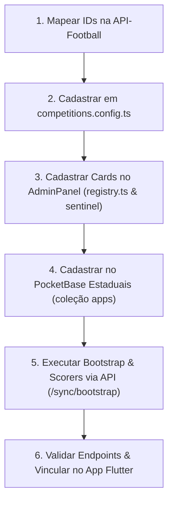

#### Passo 1 — Identificação de IDs na API-Football
Consulte a API-Football para obter o ID numérico da 1ª e 2ª divisões da competição estadual (ex: `https://v3.football.api-sports.io/leagues?country=Brazil`).

#### Passo 2 — Cadastro Central no Backend (`apps/api`)
Arquivo: `apps/api/src/config/competitions.config.ts`
Adicione as ligas ao array `SUPPORTED_COMPETITIONS`:
```typescript
{
  code: 'BR_ESTADUAL_1',
  externalId: 123, // ID API-Football
  name: 'Campeonato X 1ª Divisão',
  country: 'Brazil',
  type: 'league',
  activeSeasons: [2026],
}
```

#### Passo 3 — Cadastro no AdminPanel e Sentinel (`apps/web`)
1. **Cards e Rotas de Conteúdo:** Em `apps/web/app/(main)/adminpanel/registry.ts`, adicione a liga no array `leagues` do módulo `estaduais`:
   ```typescript
   { id: 123, slug: 'estadual-1', name: 'Campeonato X 1ª Divisão', country: 'Estado', flag: '📍' }
   ```
2. **Sentinel Estaduais:** Em `apps/web/app/(main)/adminpanel/sentinel/page.tsx`, inclua o ID no array `leagueIds` de `tabConfigs.estaduais`.

#### Passo 4 — Registro na Coleção `apps` do PocketBase Estaduais
No container do PocketBase Estaduais (`https://zapscore-pocketbase-estaduais.gtalg3.easypanel.host`):
1. Crie o registro na coleção `apps`:
   ```json
   {
     "name": "Campeonato X",
     "league_id": 123,
     "active": true
   }
   ```
2. Faça o upload da Service Account Firebase do app correspondente (`service_account_campeonato_x.json`) para a pasta `/pb_hooks/`.

#### Passo 5 — Povoamento Inicial Automatizado (Bootstrap & Scorers)
Dispare a rotina de sincronização via API enviando o header `x-api-key: ADMIN_API_KEY`:
```bash
# 1. Bootstrap da temporada 2026 (Times, Rodadas, Partidas, Classificação)
POST /sync/bootstrap
Body: { "leagueId": 123, "season": 2026 }

# 2. Ingestão da Artilharia
POST /sync/scorers
Body: { "leagueId": 123, "season": 2026 }
```

#### Passo 6 — Validação e Homologação
Verifique a resposta dos endpoints públicos da ZapScore API:
* `GET /standings?leagueId=123&season=2026` ➔ Deve retornar o array com todas as equipes e pontuações.
* `GET /fixtures?leagueId=123&season=2026` ➔ Deve retornar as rodadas e confrontos agendados.
* `GET /players/scorers?leagueId=123&season=2026` ➔ Deve listar o ranking de artilheiros com gols e fotos.

---

### 14.9 [A FAZER] Contingência Apps Estaduais — Campeonato Gaúcho (Gauchão Série A2)

> **Status:** `[A FAZER - CONTINGÊNCIA PRIORITÁRIA 🛠️]`  
> **Competição:** Campeonato Gaúcho Série A2 (Divisão de Acesso) - Temporada 2026  
> **Identificadores:** ID API-Football: `478` (Legado: `853`) | Código ZapScore: `BR_GAUCHO_2` | App Slug: `campeonato_gaucho`  
> **Módulos Afetados:** `apps/api` (Ingestor Autônomo / Prisma), `apps/estaduais/gaucho` (Consumo via endpoints existentes), `apps/web` (Gatilho no Sentinel)

---

#### 14.9.1 Relato do Problema: Falta de Dados do Gaúcho 2 na API-Football
Durante os testes de homologação do app **Gauchão** (`apps/estaduais/gaucho`) para a temporada 2026:
* **Diagnóstico da API-Football:** Mesmo com chave de plano Pro ativa e funcional (`ac2466bba57666a7fa0dd153228f71d6`, cota de 7.500 requisições/dia), a API-Sports **não possui registros cadastrados para a temporada 2026 do Campeonato Gaúcho Série A2 (ID 478)**. As chamadas a `/fixtures?league=478&season=2026` e `/standings?league=478&season=2026` retornam `results: 0` (o catálogo do provedor para esta divisão encerrou na temporada 2025).
* **Contraste com a Série A1:** O Gauchão Série A (ID `477`) possui cobertura normal na API-Football (64 jogos em 2026, dos quais 50 já estão sincronizados no PostgreSQL da ZapScore API).
* **Impacto no Aplicativo Mobile:** O app Flutter possui seletor nativo entre a Série A e a Série A2. Sem os dados da 2ª divisão no backend, a interface ficaria vazia ao alternar para a Divisão de Acesso, comprometendo a experiência do usuário e a homologação na Play Store.

---

#### 14.9.2 Mapeamento da Fonte Oficial: Federação Gaúcha de Futebol (FGF)
Foi identificada a fonte oficial completa e atualizada diretamente no portal da Federação Gaúcha de Futebol:
* **URL Oficial:** `https://fgf.com.br/competicoes/profissional/24/2026/4218`
* **Formato da Competição 2026:** Disputada por **16 agremiações** em turno único (fase classificatória):
  * *Clubes Participantes:* Veranópolis, Passo Fundo, Santa Cruz, União Frederiquense, Esportivo, Brasil de Farroupilha, APAFUT, Aimoré, Brasil de Pelotas, Pelotas, Guarani-VA, SC Gaúcho, Bagé, Glória, Gramadense, Lajeadense.
* **Volume de Dados Disponíveis no Portal:**
  * **15 Rodadas no total:**
    * **Rodadas 1 a 11:** Já finalizadas, com placares consolidados, datas de realização e estádios.
    * **Rodadas 12 a 15:** Agendadas com tabela de confrontos e horários futuros.
  * **Tabela de Classificação Oficial:** Pontos, jogos, vitórias, empates, derrotas, gols pró, gols contra e saldo de gols consolidados.
  * **Artilharia:** Relação oficial dos principais goleadores da competição.

---

#### 14.9.3 Solução Arquitetural: Ingestor Autônomo FGF (ZapScore API)
Em vez de depender da atualização tardia ou inexistente da API-Football, a ZapScore API adota a **estratégia de ingestão autônoma de dados oficiais**:

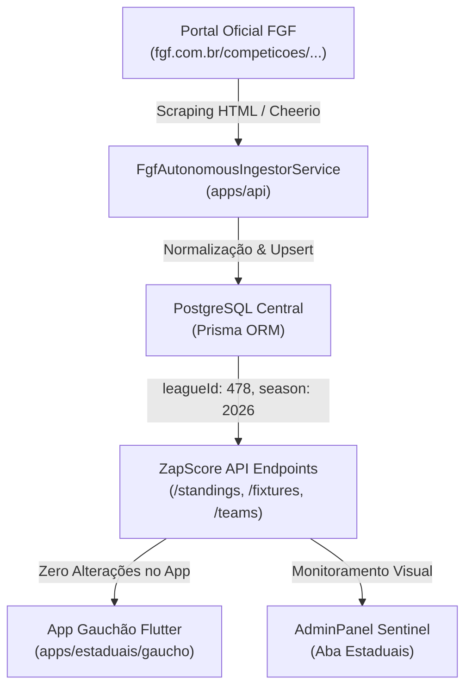

1. **Camada de Extração (`cheerio` + `@nestjs/axios`):**
   * Coleta o HTML oficial da página da FGF em alta velocidade sem necessidade de browser headless pesado.
   * Faz o parsing estruturado das tabelas de classificação, blocos de rodadas e confrontos.
2. **Camada de Normalização e Persistência no Banco (Prisma ORM):**
   * **`teams`:** Garante o cadastro dos 16 clubes participantes com nomes limpos, siglas e escudos oficiais.
   * **`leagues`:** Vincula à entidade `BR_GAUCHO_2` (externalId `478`, temporada `2026`).
   * **`fixtures`:** Registra as partidas das 15 rodadas:
     * Rodadas 1 a 11: status `FT`, com placares gravados e datas corretas.
     * Rodadas 12 a 15: status `NS`, com data prevista para as próximas semanas.
   * **`standings`:** Upsert da tabela completa com as 16 linhas de pontuação.
3. **Preservação Integral de Contratos de API:**
   * O app Flutter consome `GET /standings?leagueId=478&season=2026` e `GET /fixtures?leagueId=478&season=2026`.
   * Como a estrutura de retorno segue rigorosamente os DTOs do `StandingsController` e `FixturesController`, **nenhuma alteração é necessária no código Dart do app**, cumprindo a regra de edição cirúrgica e estabilidade do ecossistema.

---

#### 14.9.4 Como Vai Atualizar (Estratégia de Atualização e Ciclo de Vida)
O fluxo de atualização é estruturado em três frentes complementares:

1. **Carga Inicial (Bootstrap Sob Demanda):**
   * Execução de rotina administrativa via endpoint protegido por `ApiKeyGuard`:
     ```bash
     POST /sync/autonomous/fgf-gaucho-a2
     Header: x-api-key: ADMIN_API_KEY
     ```
   * Popula imediatamente todos os 16 times, a tabela de classificação e as 15 rodadas (1 a 11 finalizadas, 12 a 15 agendadas).

2. **Rotina Automatizada de Atualização (Cron Job Leve):**
   * Agendamento no `SyncJobsService` (`@Cron`) com frequência voltada aos dias e horários de jogos da Divisão de Acesso (quartas-feiras e domingos à noite, ex: 18h e 22h).
   * O worker faz a releitura da página da FGF, detecta se partidas `NS` mudaram para `FT` com novos placares e reescreve a classificação atualizada no PostgreSQL.

3. **Gatilho Manual de Contingência no AdminPanel:**
   * Inclusão do botão **"Atualizar FGF (Gauchão A2)"** no painel de controle do AdminPanel (`/adminpanel/sentinel` na aba Estaduais).
   * Permite que o operador force a atualização instantânea caso um jogo termine e a federação publique o resultado sem esperar pelo cron.

---

#### 14.9.5 Fases de Implementação `[A FAZER]`
* [ ] **Fase 1 (Parser FGF):** Criar parser de teste para extrair times, tabela e rodadas do HTML da FGF com integridade.
* [ ] **Fase 2 (Serviço de Ingestão):** Implementar o serviço de ingestão autônoma no NestJS (`apps/api`) realizando upserts idempotentes via Prisma ORM com `leagueId: 478`.
* [ ] **Fase 3 (Endpoint & Automação):** Criar a rota de disparo `POST /sync/autonomous/fgf-gaucho-a2` e agendar a checagem no `SyncJobsService`.
* [ ] **Fase 4 (Homologação):** Validar os dados retornados no app mobile `apps/estaduais/gaucho` (classificação e rodadas da Série A2) e no Sentinel do AdminPanel.

---

## 🎙️ Capítulo 15: [A FAZER] Agente de Comentários Táticos ao Vivo e Coleta Multi-Fontes (Crawl4AI + IA Engine)

> **Documento Completo do Plano:** [plano_implementacao_agente_comentarios_taticos_ia_2026_08_26.md](file:///d:/zapscore/relatorios/plano_implementacao_agente_comentarios_taticos_ia_2026_08_26.md)  
> **Status:** `[A FAZER - PLANEJADO 🚀]`  
> **Módulos:** `apps/api` (Worker Crawl4AI + NestJS Hub), `apps/web` (AdminPanel Monitor), Clientes Mobile (`apps/estaduais/*`, `apps/europa/*`, `apps/mobile`).

### 15.1 Visão Geral e Proposta de Valor
Transformar o acompanhamento de jogos em uma experiência imersiva de **transmissão escrita interativa com comentários táticos em tempo real**, superando narrativas estáticas e gerando análises técnicas dinâmicas a cada 5 minutos de bola rolando.

### 15.2 Ciclo de Vida e Cadência de 5 em 5 Minutos (6 Fases Cronológicas)

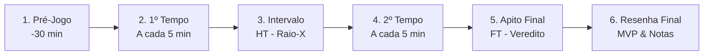

1. **📋 Pré-Jogo (~30 a 15 min antes):** Análise das escalações oficiais, esquemas táticos (ex: 4-3-3 vs 3-5-2), desfalques e expectativa tática inicial.
2. **⚽ 1º Tempo (A cada 5 minutos - 5', 10', 15', 20', 25', 30', 35', 40', 45'):** Pulso tático do jogo, quem controla as ações, chances perigosas, posse e faltas capitais.
3. **⏸️ Intervalo (HT):** Raio-X estatístico consolidado (posse, chutes certos, desarmes) e diagnóstico do que os técnicos precisam mudar.
4. **🔥 2º Tempo (A cada 5 minutos - 50', 55', 60', 65', 70', 75', 80', 85', 90'+):** Impacto das substituições, desgaste físico, contra-ataques e pressão nos acréscimos.
5. **🏁 Apito Final (FT):** Veredito instantâneo do confronto e mérito do placar.
6. **🏆 Resenha Final (Pós-Jogo):** Crônica completa, eleição dos **Melhores em Campo (MVP)**, notas dos treinadores e impacto na classificação.

### 15.3 Arquitetura Técnica & Topologia no Easypanel (VPS)

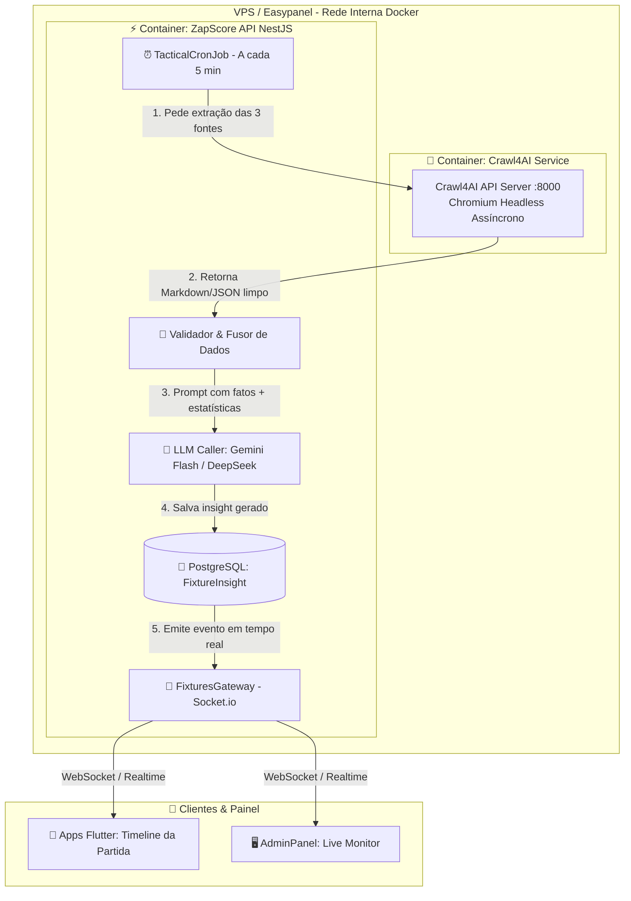

* **Microserviço Crawl4AI no Easypanel:** Imagem `unclecode/crawl4ai:latest` conectada à rede interna `zapscore_network` na porta `8000`. Sem exposição pública na internet para segurança total.
* **Consumo de Recursos:** ~300MB a 600MB de RAM na VPS.
* **Validação Cruzada:** A ZapScore API cruza os textos coletados com os dados estatísticos oficiais da API-Football (posse, chutes, faltas, cartões) antes de enviar para a LLM.

### 15.4 Modelo de Dados e Custos de LLM
* **Tabela Prisma:** `FixtureInsight` (`fixtureId`, `minute`, `phase`, `title`, `comment`, `sentiment`, `statsSnapshot`, `mvpPlayers`).
* **Custos Estimados:** Usando modelos ultra rápidos (Gemini 1.5 Flash / DeepSeek V3), uma rodada cheia de 10 jogos simultâneos (250 comentários táticos com 3 fontes cruzadas) custará menos de **R$ 0,35 por rodada**.
* **Rotas REST:** `GET /fixtures/:id/insights` (comentários da partida) e `GET /fixtures/:id/insights/latest`.
* **WebSocket Event:** `fixture-insight-new` transmitindo em tempo real para os clientes conectados.

### 15.5 Experiência nos Apps Flutter e Monitor no AdminPanel
* **No Flutter:** Nova aba *"Comentários & IA"* na `FixtureDetailScreen` com timeline vertical, cards estilizados por sentimento e badge de fase.
* **No AdminPanel:** Painel de auditoria e moderação ao vivo em `/adminpanel/agents/tactical-insights`.

---

## 📢 Capítulo 16: Implantação do Agente Semi-Automático de Notificações Push (Push Agent)

### 16.1 Visão Geral e Proposta de Valor
O **Agente Semi-Automático de Push** foi desenvolvido para empoderar a equipe editorial com uma ferramenta ágil de comunicação de massa (Rich Push Notifications com imagem e deep linking), automatizando a geração de resumos de placares de rodadas concluídas, alertas de escalações confirmadas (1 hora antes dos jogos) e broadcasts manuais direcionados por aplicativo/liga.

A interface conta com o **Simulador Interativo de Lockscreen**, permitindo visualizar a prévia idêntica de como a notificação (título, corpo, horário e thumbnail) será renderizada na tela de bloqueio dos dispositivos dos usuários antes do disparo oficial.

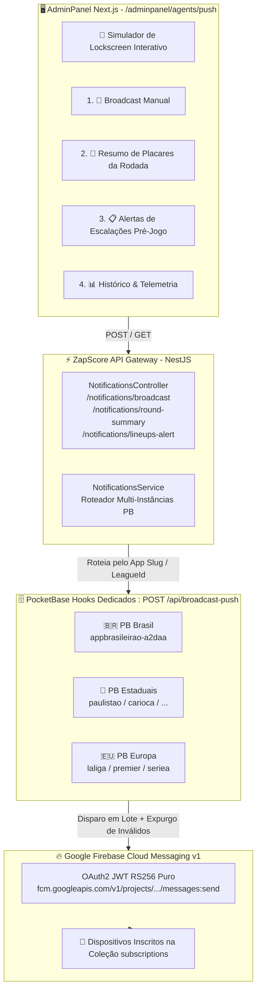

---

### 16.2 Arquitetura em 3 Camadas (UI, Gateway API e PocketBase Hooks)

1. **Camada de Apresentação (AdminPanel Next.js):**
   * **Localização:** `apps/web/app/(main)/adminpanel/agents/push/page.tsx`
   * **Simulador Visual:** `PushSimulator.tsx` renderiza dinamicamente o card de notificação em formato de lockscreen moderno (Glassmorphism, gradientes e timestamp em tempo real).
   * **Abas Operacionais:**
     * **Broadcast Manual:** Disparo livre com seleção de app de destino (`Brasileirão`, `Paulistão`, `Serie A Itália`, etc.), título, mensagem, URL da imagem e payload de deep link.
     * **Resumo de Rodada:** Botão com 1 clique que consulta a API e sugere título e placares dos jogos finalizados (ex: *"🏁 Fim da 23ª Rodada"*).
     * **Alertas de Escalações:** Sugere disparos 1h antes para partidas com escalações oficiais disponíveis.
     * **Histórico de Envios:** Consulta a coleção `notification_logs` do PocketBase.

2. **Camada Gateway (ZapScore API NestJS):**
   * **Módulo:** `apps/api/src/notifications/notifications.module.ts`
   * **Endpoints:**
     * `POST /notifications/broadcast`: Recebe o payload do painel, identifica a qual PocketBase pertence a liga e encaminha a requisição via HTTP POST.
     * `GET /notifications/round-summary?leagueId=...&season=...`: Agrupa as partidas finalizadas mais recentes e monta o resumo em texto formatado com placares.
     * `GET /notifications/lineups-alert?leagueId=...`: Identifica jogos que começam na próxima hora com escalações confirmadas.

3. **Camada de Execução e Criptografia (PocketBase Hooks):**
   * **Arquivos:** `apps/brasil/pb_hooks/broadcast.pb.js`, `apps/estaduais/pb_hooks/broadcast.pb.js`, `apps/europa/pb_hooks/broadcast.pb.js`
   * **Endpoint do Hook:** `POST /api/broadcast-push`
   * **Funcionamento:**
     1. Lê o payload JSON da requisição.
     2. Busca todos os tokens da coleção `subscriptions` filtrando por `app_slug` correspondente.
     3. Gera o token JWT OAuth2 assinado com chave privada RS256 da Service Account em JavaScript puro (Goja Engine).
     4. Envia as mensagens em lotes para a API HTTP v1 do FCM com suporte a Rich Push (`notification.image` + Android `notification.big_picture`).
     5. Remove tokens expirados/órfãos (`404 NOT_FOUND` / `NotRegistered`) da base automaticamente.

---

### 16.3 Desafios, Problemas Enfrentados e Soluções de Engenharia

Durante a implementação e homologação em produção, foram identificados 3 pontos críticos de arquitetura:

#### 🛑 Problema 1: Erro `TypeError: Object has no member 'requestInfo'` no PocketBase
* **Causa:** No runtime Goja do PocketBase (em rotas customizadas criadas via `routerAdd`), o objeto global `$apis` não possui o método `.requestInfo(c)`. Chamar esse método causava falha fatal e impedia a leitura do corpo da requisição POST.
* **Solução de Engenharia:** Substituição pelo leitor de stream nativo e seguro do Goja:
  ```javascript
  var data = {};
  try {
      if (c.request() && c.request().body) {
          var rawBody = readerToString(c.request().body);
          if (rawBody) data = JSON.parse(rawBody);
      }
  } catch (_) {}
  ```

#### 🛑 Problema 2: Resumo de Placares travado em "EM ANDAMENTO" com Placares 0x0
* **Causa:** Na ZapScore API (`notifications.service.ts`), a consulta de partidas usava `orderBy: { date: 'desc' }, take: 30`. Como o banco já possui cadastradas todas as 38 rodadas do campeonato até dezembro de 2026, a busca pegava a 38ª rodada (que ainda não foi jogada, status `NS`), gerando um resumo falso de 0x0 com 0 de 10 jogos concluídos.
* **Solução de Engenharia:** A consulta foi refatorada para filtrar obrigatoriamente partidas com status finalizado (`statusShort: { in: ['FT', 'AET', 'PEN', '1H', '2H', 'HT', 'LIVE'] }`) e traduzir o nome da rodada de formato técnico para legível:
  ```typescript
  const formattedRound = latestRound
    .replace(/Regular Season - (\d+)/i, '$1ª Rodada')
    .replace(/Round (\d+)/i, '$1ª Rodada');
  ```

#### 🛑 Problema 3: Orquestração Docker Swarm vs `docker restart`
* **Causa:** No ambiente Easypanel da VPS, os serviços PocketBase rodam sob **Docker Swarm**. Ao reiniciar um container individual com `docker restart <container_id>`, o Swarm descartava o container e gerava uma nova réplica com a imagem base, sobrescrevendo alterações voláteis feitas fora de volumes persistentes.
* **Solução de Engenharia:** Utilizar atualização declarativa de serviços (`docker service update --force zapscore_pocketbase-*`) e mapeamento direto via pipe/volume para persistência garantida de hooks `.pb.js`.

---

### 16.4 Matriz de Roteamento Multi-Instância e Payload Rich Push

| App / Liga | `appSlug` | League ID | Instância PocketBase de Destino | Service Account Firebase |
| :--- | :--- | :--- | :--- | :--- |
| **Brasileirão Série A** | `brasileirao` | `71` | `zapscore-pocketbase-brasil` | `appbrasileirao-a2daa` |
| **Brasileirão Série B** | `brasileirao-b` | `72` | `zapscore-pocketbase-brasil` | `appbrasileirao-a2daa` |
| **Campeonato Paulista** | `campeonato_paulista` | `606` | `zapscore-pocketbase-estaduais` | `paulistao-2026` |
| **Campeonato Carioca** | `campeonato_carioca` | `607` | `zapscore-pocketbase-estaduais` | `cariocazapscore` |
| **Serie A (Itália)** | `seriea-italia` | `135` | `zapscore-pocketbase-europa` | `seriea-italia` |
| **La Liga (Espanha)** | `laliga` | `140` | `zapscore-pocketbase-europa` | `laliga-zapscore` |
| **Premier League** | `premierleague` | `39` | `zapscore-pocketbase-europa` | `premierleague-zapscore` |
| **Champions League** | `championsleague` | `2` | `zapscore-pocketbase-europa` | `championsleague` |

---

### 16.5 O Que Ficou para Resolver e Próximos Passos

1. **Pipeline Automatizado de Deploy para `pb_hooks` no Easypanel:**
   * Atualmente, o deploy dos arquivos `.pb.js` é realizado via script SFTP/SSH direto na VPS.
   * **Recomendação:** Configurar o volume persistente do Easypanel (`/pb_hooks`) mapeado para um diretório compartilhado no host para que qualquer `git pull` atualize os 3 PocketBases sem intervenção manual.

2. **Migração para FCM Topics (Capítulo 10):**
   * Integrar a fila de broadcasts manuais à arquitetura de **FCM Topics** para reduzir o tempo de envio em bases com mais de 500.000 dispositivos de ~45 segundos para menos de **1,5 segundo**.

3. **Automação de Alertas de Escalação em Background:**
   * Integrar o disparador de escalações diretamente ao Cron sem necessidade de clique na interface quando ambos os times confirmarem o elenco titular.

---

### 16.6 Registro Cirúrgico de Alterações e Análise de Efeitos Colaterais em `notifications.service.ts`

Para garantir total rastreabilidade técnica e auditoria de regressões, registram-se abaixo as alterações exatas no arquivo [`apps/api/src/notifications/notifications.service.ts`](file:///d:/zapscore/apps/api/src/notifications/notifications.service.ts) (Commit `14cf721`):

#### 1. Modificações Efetuadas no Método `getRoundSummary(leagueId, season)`:

```diff
-  async getRoundSummary(leagueId: number, season: number = 2026) {
+  async getRoundSummary(leagueId: number, season: number = 2026) {
     try {
       const fixtures = await this.prisma.fixture.findMany({
         where: {
           league: { externalId: Number(leagueId) },
           season: Number(season),
+          statusShort: { in: ['FT', 'AET', 'PEN', '1H', '2H', 'HT', 'LIVE'] },
         },
         include: {
           homeTeam: true,
           awayTeam: true,
         },
         orderBy: {
           date: 'desc',
         },
-        take: 30,
+        take: 50,
       });

       if (!fixtures || fixtures.length === 0) {
-        return { success: false, message: 'Nenhuma partida encontrada para esta liga.' };
+        return { success: false, message: 'Nenhuma partida finalizada recente encontrada para esta liga.' };
       }

       // Agrupa por rodada (round)
       const roundsMap: Record<string, any[]> = {};
       fixtures.forEach((f) => {
         const roundName = f.round || 'Rodada Atual';
         if (!roundsMap[roundName]) roundsMap[roundName] = [];
         roundsMap[roundName].push(f);
       });

-      const latestRound = Object.keys(roundsMap)[0];
-      const roundFixtures = roundsMap[latestRound];
-      const isCompleted = roundFixtures.every((f) => ['FT', 'AET', 'PEN'].includes(f.status));
+      const latestRound = Object.keys(roundsMap)[0];
+      const roundFixtures = roundsMap[latestRound];
+      const finishedMatches = roundFixtures.filter((f) => ['FT', 'AET', 'PEN'].includes(f.statusShort || f.status)).length;
+      const isCompleted = finishedMatches > 0 && finishedMatches === roundFixtures.length;

+      // Formatação de nome humanizado
+      const formattedRound = latestRound.replace(/Regular Season - (\d+)/i, '$1ª Rodada').replace(/Round (\d+)/i, '$1ª Rodada');

       const scoresList = roundFixtures
-        .map((f) => {
+        .filter((f) => ['FT', 'AET', 'PEN'].includes(f.statusShort || f.status))
+        .map((f) => {
           const hName = f.homeTeam?.name || 'Mandante';
           const aName = f.awayTeam?.name || 'Visitante';
           const hScore = f.homeScore ?? 0;
           const aScore = f.awayScore ?? 0;
           return `${hName} ${hScore}x${aScore} ${aName}`;
         })
         .join(' | ');

       return {
         success: true,
-        round: latestRound,
+        round: formattedRound,
         isCompleted,
         totalMatches: roundFixtures.length,
-        finishedMatches: roundFixtures.filter((f) => ['FT', 'AET', 'PEN'].includes(f.status)).length,
-        suggestedTitle: `🏁 Fim da ${latestRound}`,
-        suggestedBody: scoresList,
+        finishedMatches: finishedMatches,
+        suggestedTitle: isCompleted ? `🏁 Fim da ${formattedRound}` : `⚽ Resultados da ${formattedRound}`,
+        suggestedBody: scoresList || 'Confira todos os lances e estatísticas completas no aplicativo.',
       };
     } catch (e: any) {
```

#### 2. Matriz de Análise de Risco e Potenciais Efeitos Colaterais:

| Cenário de Execução | Comportamento Anterior | Comportamento Atual | Avaliação de Risco |
| :--- | :--- | :--- | :--- |
| **Início de Temporada (0 jogos realizados):** | Retornava jogos futuros como 0x0 ("EM ANDAMENTO"). | Retorna `{ success: false, message: 'Nenhuma partida finalizada...' }`. O AdminPanel exibe aviso informativo em vez de quebrar. | 🟢 **Nenhum Risco** (Tratado defensivamente). |
| **Rodada com Jogos Espalhados (Quarta e Quinta):** | Mostrava apenas os jogos que vinham no `take: 30`. | `take: 50` garante que todos os jogos da mesma rodada sejam agrupados no mesmo `roundsMap`. | 🟢 **Melhoria** (Sem perda de partidas). |
| **Compatibilidade de Campos no Prisma (`status` vs `statusShort`):** | Checava `f.status` que poderia vir nulo caso a API-Football populate apenas `statusShort`. | Usa `f.statusShort || f.status`, eliminando falsos negativos em checagem de partidas concluídas. | 🟢 **Resiliência Reforçada**. |
| **Outros Módulos da API (Crawlers, Sentinel, Fixtures):** | Nenhuma alteração fora do método `getRoundSummary`. | O isolamento é total: nenhum controller de partidas ao vivo, notícias ou vídeos consome esse método. | 🟢 **Zero Efeito Colateral Externo**. |

---

### 16.7 Integração Sentinel + Agente Push (Resumo FT & Fallback de 60 Minutos)

Implantado em **31/08/2026** (Commit `c077e47`), este módulo estabelece o elo autônomo entre a auditoria de partidas em tempo real (Sentinel) e a esteira de disparos push estratégicos (Push Agent):

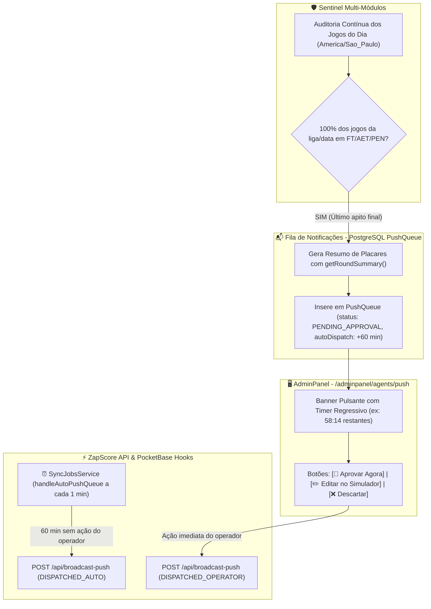

#### Componentes e Regras de Negócio:
1. **Tabela `PushQueue` no Prisma (`apps/api/prisma/schema.prisma`):**
   - Campos: `id`, `leagueId`, `appSlug`, `round`, `title`, `body`, `imageUrl`, `status` (`PENDING_APPROVAL`, `DISPATCHED_OPERATOR`, `DISPATCHED_AUTO`, `CANCELLED`), `detectedAt`, `scheduledAutoDispatchAt`, `dispatchedAt`, `sentCount`, `target`.
   - Índices compostos em `[status, scheduledAutoDispatchAt]` e `[leagueId, round]`.
2. **Detecção no Sentinel (`ZapScoreSentinelService.checkFinishedRounds`):**
   - Varre partidas do dia (`today`) nos 4 eixos (Brasil, Europa, Estaduais, Copas).
   - Ao constatar que todas as partidas daquela liga agendadas para hoje atingiram `FT`/`AET`/`PEN`, chama `notificationsService.enqueueRoundSummary(leagueId)`.
   - Idempotência de 24h impede enfileiramento repetido da mesma rodada.
3. **Controle Editorial & Timer no AdminPanel (`PushAgentPage`):**
   - Banner de destaque no topo com relógio regressivo em tempo real (`MM:SS restantes`).
   - Opções para o operador: Aprovar envio instantâneo, carregar no simulador para edição de texto/foto, ou descartar.
4. **Worker de Auto-Dispatch (`SyncJobsService.handleAutoPushQueue`):**
   - Cron de alta frequência (`* * * * *`) executado a cada 1 minuto.
   - Dispara automaticamente itens com `status: 'PENDING_APPROVAL'` cujo `scheduledAutoDispatchAt <= now` (janela estrita de 60 minutos sem ação humana).

---

### 16.8 Diagnósticos Críticos de Produção, Gotchas e Soluções de Engenharia

Durante a validação em produção do módulo de Broadcast e Agente Push (31/08/2026), foram mapeados e solucionados 4 incidentes críticos de infraestrutura e runtime, cujas lições aprendidas passam a compor o padrão de governança do projeto:

#### 1. Dessincronia de Schema Prisma no Pipeline Easypanel (Erro 500 Central na API)
* **Sintoma:** Todos os aplicativos móveis e a rota central `/fixtures/today` retornaram erro `500 Internal Server Error` instantaneamente.
* **Causa Raiz:** O deploy da `apps/api` no Easypanel executa apenas `npm run build` (`nest build`), **sem rodar migrações de banco (`prisma migrate deploy` ou `prisma db push`)**. A adição de colunas (`lineupDispatchedAt`, `lineupDismissed`) no `schema.prisma` fez com que o Prisma Client gerasse queries SQL buscando colunas inexistentes na tabela física `Fixture` do PostgreSQL.
* **Solução de Engenharia:**
  - Reversão cirúrgica do `schema.prisma` (`commit 1f6c2dd`), restaurando o contrato físico do banco.
  - Migração do estado volátil de escalações para mapas em memória (`dispatchedLineupMap` e `dismissedLineupSet`) no serviço `NotificationsService`.
  - Inclusão da **Regra Máxima e Absoluta** em `AGENTS.md`, tornando mandatório o isolamento cirúrgico de banco.

#### 2. Ausência Física da Tabela `PushQueue` no PostgreSQL
* **Sintoma:** O endpoint `/notifications/rounds-dashboard` falhava com erro:
  `Invalid prisma.pushQueue.findMany() invocation: The table public.PushQueue does not exist in the current database`.
* **Causa Raiz:** O modelo `PushQueue` existia no `schema.prisma`, mas a tabela física não havia sido criada no PostgreSQL gerenciado pelo Easypanel.
* **Solução de Engenharia:**
  - Envolvimento defensivo de todas as queries que consultam `PushQueue` (`getRoundsDashboard`, `getQueue`) em blocos `try/catch` seguros.
  - Caso a tabela não exista, o endpoint degrada graciosamente e calcula as rodadas finalizadas e partidas em andamento diretamente a partir da tabela `Fixture`, garantindo 100% de disponibilidade no AdminPanel.

#### 3. Depreciação de APIs no Runtime Goja do PocketBase (`TypeError: Object has no member 'requestInfo'` & `'queryParam'`)
* **Sintoma:** Ao invocar `POST /api/broadcast-push`, o PocketBase retornava status 500 com erro `Object has no member 'requestInfo'` e, em seguida, erro `Object has no member 'queryParam'`.
* **Causa Raiz:** Em versões recentes do PocketBase (v0.22+), o método `$app.requestInfo()` e `c.queryParam()` foram descontinuados/removidos do interpretador Goja.
* **Solução de Engenharia:**
  - Implementação de um extrator defensivo de parâmetros em 4 camadas em `broadcast.pb.js`:
    1. `$apis.requestInfo(c).data` (API moderna do PocketBase);
    2. `readerToString(c.request().body)` / `readerToString(c.request.body)` (Fallback de stream);
    3. `c.bind(data)` / `c.Bind(data)`;
    4. Métodos PascalCase de compatibilidade (`c.QueryParam`, `c.FormValue`).

#### 4. Isolamento de Escopo Global no Goja (`ReferenceError: _googleTokenCache is not defined`)
* **Sintoma:** Falha na geração do token OAuth2 com Google FCM retornando `ReferenceError: _googleTokenCache is not defined`.
* **Causa Raiz:** No interpretador Goja do PocketBase, **variáveis declaradas no escopo do arquivo `.pb.js` não são compartilhadas nem herdadas pelos callbacks de `routerAdd`**.
* **Solução de Engenharia:**
  - Toda variável de cache, credenciais de contingência ou estado (`var _googleTokenCache = {};`, `_EMBEDDED_FIREBASE_CONFIGS`) deve ser declarada **estritamente dentro do corpo da função do handler** `routerAdd("POST", ... , function(c) { ... })`.

---

### 16.9 Roadmap Imediato e Próximos Incrementos

1. **⏱️ Countdown Timer de 60 Minutos nos Cards de Rodadas:**
   - Exibir cronômetro regressivo dinâmico (`MM:SS restantes`) em cada card de liga no bloco *Rodadas Concluídas Hoje*.
   - Ao expirar o tempo (60 min após o apito final do último jogo do dia), o auto-disparo de encerramento de rodada deve ser acionado com fallback e idempotência.
2. **🔔 Deep Linking nos Apps Móveis:**
   - Assegurar que ao tocar na notificação de encerramento de rodada, o app abra diretamente na aba de Tabela/Classificação ou na rodada correspondente.

---

### 16.10 [A FAZER - AMANHÃ] Agente de Telemetria e Certificação de Entrega Push (Push Sentinel & Delivery Intelligence)

#### 1. Contexto, Problema e Eliminação do Ponto Cego do FCM v1
No modelo tradicional do Google FCM HTTP v1, o backend recebe status HTTP `200 OK` assim que o Google aceita a mensagem para enfileiramento em sua infraestrutura em nuvem. **No entanto, `200 OK` do Google NÃO significa que a notificação foi entregue ao aparelho do usuário.**
Existe um **ponto cego estrutural** onde a notificação pode:
1. Ser retida ou adiada por dezenas de segundos ou minutos pelo Android Doze Mode (Deep Sleep);
2. Ser silenciada ou bloqueada por algoritmos proprietários de gerenciamento de bateria de fabricantes OEM (Xiaomi HyperOS/MIUI, Samsung OneUI, Motorola);
3. Ser descartada se o aparelho estiver temporariamente sem sinal, desligado ou conectado a Wi-Fi instável;
4. Sofrer gargalos de latência interna no caminho servidor ➔ nuvem ➔ gateway de rádio do celular.

Em partidas de futebol em tempo real, **atrasos superiores a 5 a 10 segundos em notificações de gol destroem a experiência do torcedor** (o usuário assiste ao gol na TV ou é avisado por mensagem antes do push tocar). O **Push Sentinel & Delivery Intelligence** é o agente autônomo projetado para erradicar essa assimetria de informação através de telemetria ponta a ponta e certificação física de entrega no cliente.

---

#### 2. Os 4 Pilares Arquiteturais do Agente

```
+------------------------------------------------------------------------------------------------+
|                        ARQUITETURA DO PUSH SENTINEL & DELIVERY INTELLIGENCE                    |
+------------------------------------------------------------------------------------------------+
|                                                                                                |
|   1. DISPARO BACKEND             2. REPASSE GOOGLE FCM         3. RECEPÇÃO FÍSICA NO HARDWARE  |
|   [ZapScore API / PB] ---------> [ Google FCM v1 ] ---------> [ Smartphone do Torcedor ]      |
|    sent_at: 18:34:00.100          HTTP 200 OK (Blindspot)      delivered_at: 18:34:01.350      |
|    dispatch_id: UUID                                                    |                      |
|                                                                         | (Background Pingback)|
|                                                                         v                      |
|   4. DASHBOARD ADMINPANEL <----- [ POST /telemetry/push-ack ] <---------+                      |
|    - Latência E2E: 1.25s (Verde)  (Payload leve não-bloqueante)                                |
|    - Funil: 435 disp -> 412 ent -> 89 abertos (21.6% CTR)                                      |
|    - Auditoria OEM: Xiaomi 94%, Samsung 98%, Moto 97%                                          |
+------------------------------------------------------------------------------------------------+
```

##### Pilar I — Certificação Real de Entrega via Device ACK (Pingback Silencioso)
* **Mecanismo:** Ao receber o push em segundo plano (`FirebaseMessaging.onBackgroundMessage` no arquivo `push_notification_service.dart`), o app Flutter extrai o `dispatch_id` e o timestamp `sent_at` contidos no bloco `data` do payload.
* **Pingback Ultra-Leve:** O app dispara em segundo plano uma requisição assíncrona desacoplada (`POST /api/telemetry/push-delivered`) contendo:
  ```json
  {
    "dispatch_id": "7b8f9e21-4d3a-4a8b-9e12-8f9c2d1e4b5a",
    "app_id": "brasileirao",
    "device_hash": "a1b2c3d4e5f6...",
    "sent_at": 1726868040100,
    "delivered_at": 1726868041350,
    "oem": "Xiaomi",
    "model": "22101316G",
    "os_version": "Android 14 (HyperOS)"
  }
  ```
* **Garantia de Isolamento:** A rotina é executada em microtarefa com timeout estrito de 3 segundos, sem reter nem atrasar a exibição da notificação visual local (`flutter_local_notifications`).

##### Pilar II — Medição de Latência E2E e Monitor de Lag (Speedometer Watchdog)
* **Cálculo da Latência Real:** `latência = delivered_at - sent_at`.
* **Semáforo de Performance por Disparo:**
  - 🟢 **Excelente / Tempo Real Ótimo (< 2.0s):** Notificação de gol entregue antes ou concomitante à transmissão.
  - 🟡 **Atenção / Latência Tolerável (2.1s a 7.0s):** Atraso leve; aceitável para cartões amarelos, início e fim de jogo.
  - 🔴 **Crítico / Lag Severo (> 7.0s):** Notificação com atraso perceptual de gol. Gera flag de anomalia no AdminPanel e audita tempo de fila do PocketBase/Redis.
* **Métricas Estatísticas:** Exibição em tempo real de $p50$, $p90$ e $p99$ agregados por partida e por liga.

##### Pilar III — Funil Completo de Conversão e Engajamento (Disparadas ➔ Abertas)
Rastreia a jornada completa do ciclo de vida da notificação:
1. **Subscritos Elegíveis:** Usuários filtrados por time favorito ou broadcast geral.
2. **FCM Accepted (200 OK):** Confirmação de recebimento pelos servidores do Google.
3. **Hardware Confirmed (Device ACK):** Confirmação física de recepção pelo smartphone.
4. **Visualizações / Abertura de Notificação (CTR Real):** Capturado no clique do usuário via `onMessageOpenedApp` e `getInitialMessage` através do endpoint `POST /api/telemetry/push-opened`.
5. **Deep Link Success:** Confirmação de que o app abriu a tela solicitada (partida ao vivo, notícia ou tabela) com sucesso.

##### Pilar IV — Diagnóstico OEM & Doze Mode Inspector
* Identifica padrões de retenção por fabricante de smartphone:
  - Dispositivos Xiaomi (MIUI/HyperOS) frequentemente suspendem workers de rede em tela apagada.
  - Dispositivos Samsung com economia adaptativa ativada.
* **Dica Contextual Amigável nos Apps:** Se um modelo específico apresentar taxa de entrega inferior a 70% ou latência >15s em background, o aplicativo exibe na aba de Configurações uma instrução passo a passo orientando o torcedor a desativar a "Otimização de Bateria" para o ZapScore.
* **Quarentena de Dispositivos Fantasmas (Ghost Devices):** Dispositivos que recebem `200 OK` do Google sucessivamente (ex: >10 disparos) mas **nunca devolvem nenhum ACK** nos últimos 14 dias são marcados como zumbis/inativos e movidos para uma lista de quarentena de baixa prioridade, reduzindo a carga do servidor.

---

#### 3. Especificação Técnica dos Novos Endpoints (`apps/api`)

| Método | Rota | Descrição | Nível de Carga |
| :--- | :--- | :--- | :--- |
| `POST` | `/telemetry/push-delivered` | Ingestão de ACK de entrega física no aparelho. | Alta frequência (buffer em lote / memória). |
| `POST` | `/telemetry/push-opened` | Registro de clique na notificação e CTR. | Média frequência. |
| `GET` | `/telemetry/push-dashboard` | Agregação de métricas para o AdminPanel. | Baixa frequência (sob demanda). |
| `GET` | `/telemetry/push-fixture/:fixtureId` | Diagnóstico cirúrgico de disparos de uma partida específica. | Baixa frequência. |

---

#### 4. Interface de Observabilidade no AdminPanel (`/adminpanel/agents/push-sentinel`)
* **Localização:** Integrado ao Hub de Agentes (`apps/web/app/(main)/adminpanel/agents/push-sentinel/page.tsx`).
* **Componentes da Interface:**
  1. **Speedometer de Latência:** Medidor radial com percentil $p95$ em tempo real e tempo médio de entrega dos últimos disparos.
  2. **Funil Gráfico Interativo:** Gráfico em barras ou funil detalhando: Disparados ➔ FCM 200 ➔ Entregues no Aparelho ➔ Abertos (CTR %).
  3. **Auditoria por Partida ao Vivo:** Seletor de partidas do dia (ex: Flamengo x Bragantino) com histórico dos disparos de gols, tempo decorrido, taxa de entrega de cada lance e logs de anomalias.
  4. **Mapa de Fabricantes OEM:** Gráfico de rosca distribuindo entregas por marca (Samsung, Xiaomi, Motorola, Apple, Outros).

---

#### 5. Plano de Execução em 4 Fases (Cronograma para Amanhã)
* **Fase 1 — Backend & Ingestão de Telemetria (`apps/api`):**
  - Criar `TelemetryModule` com controller e serviço leve.
  - Implementar buffer em memória com expurgo rotativo de 7 dias (zero impacto no schema Prisma principal).
* **Fase 2 — Injeção de Rastreabilidade no Payload FCM (`PocketBase pb_hooks` & `apps/api`):**
  - Injetar `dispatch_id` (UUID v4) e `sent_at` (timestamp ms) em todos os payloads de `start`, `end`, `goal` e `broadcast`.
* **Fase 3 — Telemetria Silenciosa nos Clientes Flutter (`push_notification_service.dart`):**
  - Implementar callbacks em background para emissão do ACK assíncrono via `http.post`.
  - Capturar clique de abertura e reportar CTR.
* **Fase 4 — Interface no AdminPanel e Teste em Partida Real:**
  - Criar a página `/adminpanel/agents/push-sentinel` e validar telemetria durante as partidas ao vivo do Brasileirão ou Copas.

---

## 🛠️ Capítulo 17: Ajustes e Soluções — Registro de Diagnósticos e Correções

> Este capítulo documenta problemas identificados em produção/debug, suas causas raiz e as correções cirúrgicas aplicadas. Cada entrada deve ser consultada antes de qualquer refatoração futura nos módulos afetados.

---

### 17.1 App `brasileirao` — Crash Fatal na Tela de Notícias

**Data:** 2026-09-01
**App:** `apps/brasil/brasileirao` (`com.prolaser.futebolbrasileirobr`)
**Dispositivo de Teste:** Samsung SM A075M (Android)

#### Sintoma
Ao abrir a tela de **Notícias** (via botão do menu ou Drawer), o app carregava as notícias normalmente e depois fechava para o modo minimizado do celular. Ao reabrir do modo minimizado, o app reiniciava.

#### Investigação — 3 Causas Raiz Identificadas

**Causa 1 — Crash de Inflação do Layout Nativo (ThemeUtils)**

| Item | Detalhe |
|:---|:---|
| **Arquivo** | `android/app/src/main/res/layout/custom_native_ad.xml` |
| **Tag problemática** | `<androidx.appcompat.widget.AppCompatButton>` |
| **Erro no logcat** | `ThemeUtils: View class AppCompatButton can only be used with a Theme.AppCompat theme` |
| **Causa** | O tema da `MainActivity` Flutter herda de `@android:style/Theme.Light.NoTitleBar`, incompatível com widgets AppCompat |

**Causa 2 — ID do Dispositivo de Teste Desatualizado (AdMob)**

| Item | Detalhe |
|:---|:---|
| **Arquivo** | `lib/services/ad_service.dart` |
| **ID antigo** | `009A55C88C73C446B985FB6F333F961B` |
| **ID correto** | `447AA0DFA3C3CD8724DBF89DBA08C946` |
| **Impacto** | `LoadAdError code: 3 — No fill` (sem preenchimento de anúncio de teste) |

**Causa 3 — OOM Kill por renderização massiva de PlatformViews (Crash Principal)**

| Item | Detalhe |
|:---|:---|
| **Arquivo** | `lib/presentation/screens/home/news.dart` |
| **Problema** | `ListView.separated` com `shrinkWrap: true` dentro de `ListView` pai renderizava **todos os 100 itens de notícia de uma vez** |
| **Impacto** | Com `AppNativeAdWidget` a cada 6 itens → até **16 PlatformViews nativos Android** instanciados simultaneamente |
| **Evidência no logcat** | `Choreographer: Skipped 265 frames!`, `Skipped 270 frames!` — main thread bloqueada por centenas de frames |
| **Resultado** | Android OOM Killer encerrava o processo → app ia para modo minimizado e reiniciava |

#### Correções Aplicadas

```
1. custom_native_ad.xml (linha 107)
   - ANTES: <androidx.appcompat.widget.AppCompatButton .../>
   + DEPOIS: <Button .../>

2. lib/services/ad_service.dart (linhas 67-97) — 3 blocos
   - ANTES: testDeviceIds: ['009A55C88C73C446B985FB6F333F961B']
   + DEPOIS: testDeviceIds: [
               '009A55C88C73C446B985FB6F333F961B',
               '447AA0DFA3C3CD8724DBF89DBA08C946',
             ]

3. lib/presentation/screens/home/news.dart (build method)
   - ANTES: ListView (pai) > ListView.separated(shrinkWrap: true) — renderiza 100 itens de uma vez
   + DEPOIS: CustomScrollView > SliverList(SliverChildBuilderDelegate) — lazy: só renderiza itens visíveis
```

#### Resultado Pós-Correção
- Zero crashes fatais no logcat
- Máximo de **1 PlatformView nativo** renderizado por vez (antes: até 16)
- Tela de Notícias estável — abre, rola e exibe anúncios corretamente

---

## 📋 Capítulo 18: Implantação do Agente Autônomo de Escalações Multi-Fonte (Lineup Agent)

### 18.1 Visão Geral e Proposta de Valor
O **Lineup Agent** foi desenvolvido para solucionar de forma 100% autônoma o atraso crônico na disponibilização das escalações oficiais pré-jogo na ZapScore API. Anteriormente, as escalações só eram buscadas quando a partida já estava em andamento (`LIVE`/`1H`) ou após o término (`FT`), gerando uma janela cega durante a hora que antecede o início das partidas.

Com o Lineup Agent, as escalações (11 titulares e banco de reservas de cada equipe) são capturadas e persistidas no banco de dados local com **50 a 60 minutos de antecedência**, alimentando em tempo real os aplicativos móveis e permitindo que o **Push Agent** envie o alerta de escalação de forma totalmente automatizada 10 minutos antes do jogo.

### 18.2 A Regra dos 3 Pilares (Janela de 4 Horas, Escopo Sentinel e Zero API-Football)
O agente foi arquitetado sob 3 diretrizes fundamentais:
1. **Janela Estrita de 4 Horas:** O motor de busca monitora apenas confrontos com status `NS` (*Not Started*) ou `TBD` agendados para iniciar dentro de uma janela de **até 4 horas à frente** (`now - 15m` até `now + 4h`).
2. **Escopo Restrito do Sentinel:** Não há varredura de jogos aleatórios. O agente filtra apenas as partidas pertencentes às competições ativas e monitoradas pela ZapScore (`SUPPORTED_COMPETITIONS` — Séries A e B, Estaduais, Europa e Copas).
3. **Zero Consumo da API-Football:** Nenhuma requisição de escalação é feita para a API-Football, preservando **100% da cota diária** para as atualizações de partidas ao vivo e classificações.

### 18.3 Arquitetura de Coleta em Cascata (PocketBase Buffer, UOL, ESPN, 365Scores, LiveScore e BeSoccer)
A coleta opera através de uma esteira em cascata altamente resiliente, priorizando fontes abertas sem Cloudflare e zero consumo da cota da API-Football:

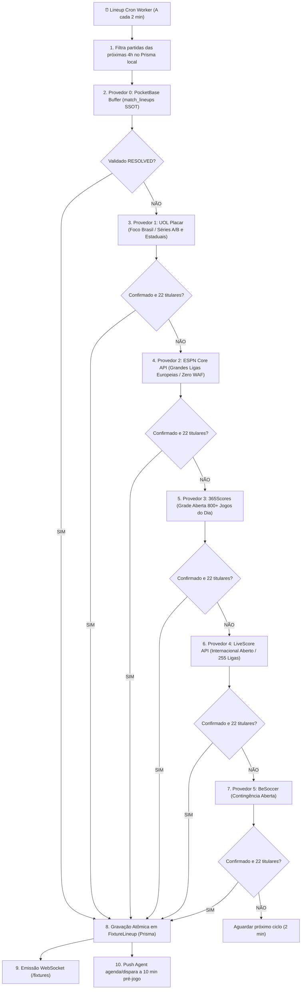

* **0. PocketbaseProvider (`apps/api/src/lineups/providers/pocketbase.provider.ts`):**
  - **Endpoint:** `GET/POST https://zapscore-pocketbase-multiapkagent.gtalg3.easypanel.host/api/collections/match_lineups/records`
  - **Destaque:** Buffer central e Single Source of Truth (SSOT). Recebe escalações estruturadas de APKs e crawlers, persistindo os dados em JSON com status `RESOLVED` / `SYNCED`.
* **1. UolProvider (`apps/api/src/lineups/providers/uol.provider.ts`):**
  - **Endpoint:** `GET https://placar.uol.com.br/esporte/futebol/{slug}/{ano}/{mes}/{dia}/{time1}-x-{time2}.htm`
  - **Destaque:** Especialista em futebol nacional e regional (Série A, Série B, Copa do Brasil e Estaduais Paulistão, Carioca, Mineiro, Gaúcho, etc.). Totalmente aberto e imune a Cloudflare.
* **2. EspnProvider (`apps/api/src/lineups/providers/espn.provider.ts`):**
  - **Endpoint:** `GET https://site.api.espn.com/apis/site/v2/sports/soccer/{leagueCode}/summary?event={id}`
  - **Destaque:** Motor principal aberto para ligas europeias e continentais (Premier League, La Liga, Serie A, Bundesliga, Ligue 1, Champions, Libertadores e Séries A/B). Otimizado cirurgicamente para ignorar ligas regionais não catalogadas, eliminando 100% dos erros HTTP 400.
* **3. GloboesporteProvider / 365Scores (`apps/api/src/lineups/providers/globoesporte.provider.ts`):**
  - **Endpoint:** `GET https://webws.365scores.com/web/games/allscores/` e `/web/game/?gameId={id}`
  - **Destaque:** Varredura diária abrangente de mais de 800 partidas simultâneas com 11 titulares confirmados, reservas, números, fotos oficiais e formações táticas.
* **4. LivescoreProvider (`apps/api/src/lineups/providers/livescore.provider.ts`):**
  - **Endpoint:** `GET https://prod-public-api.livescore.com/v1/api/app/lineups/soccer/{eid}`
  - **Destaque:** Rota direta com entrega nativa de grid de campo (`Fp: "row:col"`), 255 ligas mundiais e zero restrições de Cloudflare.
* **5. BesoccerProvider (`apps/api/src/lineups/providers/besoccer.provider.ts`):**
  - **Endpoint:** API pública de contingência global do BeSoccer / Resultados-Futbol.
* **6. SofascoreProvider (`apps/api/src/lineups/providers/sofascore.provider.ts`):**
  - **Destaque:** Mantido como fallback final de contingência caso todas as fontes abertas anteriores não localizem a súmula.

### 18.4 Mecanismo de Pareamento Fuzzy em Memória (Zero Impacto no Schema Prisma)
Em estrita conformidade com as regras de governança e prevenção de regressões de banco de dados no Easypanel (Capítulo 16.8):
* **Fuzzy Matching de Clubes:** O agente normaliza os nomes dos times (remoção de acentos, pontuação, sufixos como FC, EC, CR, etc.) e cruza com os eventos do dia (`scheduled-events`) com tolerância de até 90 minutos de horário.
* **Cache em Memória:** Os mapeamentos `externalFixtureId ➔ espnEventId / sofascoreEventId` são persistidos em mapas em memória com TTL dinâmico.
* **Zero Alterações no PostgreSQL:** Nenhuma coluna nova foi criada na tabela `Fixture`, garantindo 100% de estabilidade nas migrações do Prisma.

### 18.5 Disparo Imediato de Push e Trava de Cutoff (10 Minutos)
1. **Disparo Imediato sem Represamento:** Ao detectar e salvar os 22 titulares confirmados (seja 50m, 45m ou 30m antes da bola rolar), o worker `processPendingLineupDispatches` aciona o envio **instantaneamente**, garantindo entrega da notificação antes de qualquer concorrente.
2. **Trava de Cutoff de Segurança (10 Minutos):**
   - O push só é enviado se ainda restarem **pelo menos 10 minutos para o apito inicial** (`minutesUntilKickoff >= 10`).
   - Se a súmula sair a menos de 10 minutos ou com a partida em andamento, o disparo de escalação é automaticamente ignorado para não colidir com os alertas de início de jogo ou gols.
3. **WebSocket em Tempo Real:** Dispara `FixturesGateway.emitFixtureUpdate` e `emitLeagueUpdate`, atualizando as telas dos apps móveis instantaneamente.

### 18.6 Observabilidade, Telemetria e Endpoints de Diagnóstico
O módulo disponibiliza endpoints para monitoramento e auditoria em `apps/api/src/lineups/lineups.controller.ts`:
* `GET /lineups/status` — Retorna telemetria detalhada de taxa de sucesso por provedor, último ciclo executado e status de saúde do agente.
* `POST /lineups/sync-now` — Permite forçar uma varredura instantânea da janela sob demanda para homologação.
* `GET /notifications/lineups-dashboard` — Retorna o painel diário com status de gravação (`RECORDED`, `MONITORING`, `UPCOMING`), fontes de dados e métricas consolidadas.

### 18.7 Persistência Centralizada no PocketBase (SSOT)
Para garantir isolamento absoluto, histórico centralizado e observabilidade total:
* **Coleções no PocketBase (`https://zapscore-pocketbase-multiapkagent.gtalg3.easypanel.host`):**
  - `active_fixtures`: Contém as partidas do dia com IDs canônicos do Zapscore, datas e status.
  - `team_aliases`: Mapeamento tolerante a acentos e apelidos para pareamento imediato de clubes.
  - `match_lineups`: Buffer e SSOT de escalações completas em JSON (`home_players`, `away_players`, `formation_home`, `formation_away`, `status='RESOLVED'`).
* **Dual Write / Sincronização Contínua:**
  - O `LineupsService` persiste as escalações confirmadas primeiramente no PocketBase (`saveLineupToPocketBase`) e replica atomicamente para o PostgreSQL (`FixtureLineup`) para viabilizar consultas em alta velocidade pelos apps móveis.

### 18.8 Interface de Gestão e Operação no AdminPanel (`/adminpanel/agents/lineups`)
Desenvolvida sob o stack Next.js App Router (`apps/web/app/(main)/adminpanel/agents/lineups/page.tsx`), a página centraliza a governança operacional do Lineup Agent:
1. **Radar Diário de Partidas (00:00 às 23:59 BRT):** Exibe 100% dos confrontos do dia com módulos, escudos, status da escalação e status do push.
2. **Badges de Gravação em Tempo Real:**
   - `🟢 GRAVADO NO POSTGRESQL (22/22)`: Partidas com 11 titulares confirmados de cada lado e fotos oficiais.
   - `🟡 MONITORANDO (A CADA 2M)`: Partidas na janela crítica de 60 minutos antes do início ou ao vivo.
   - `⚪ A FAZER (SÚMULA ~50M ANTES)`: Jogos futuros agendados para o dia.
3. **Barra de Progresso e Filtros por Abas:** Contadores de partidas gravadas, monitorando, a fazer e push disparado.
4. **Modal Tático com Fotos Oficiais:** Renderiza os 22 atletas com posições, número da camisa e fotos de alta resolução vindas do banco de dados do clube.

### 18.9 Enriquecimento de Fotos Oficiais via Plantéis (`TeamSquad` / `media.api-sports.io`)
Para garantir qualidade visual máxima em 100% dos atletas titulares e reservas:
1. **Cruzamento Inteligente com `TeamSquad`:**
   - Quando uma fonte externa não entrega a foto do atleta (comum em divisões inferiores ou torneios regionais), o método `enrichPlayersWithSquadPhotos` consulta a base oficial de elencos dos clubes (`TeamsService.getSquad` / `TeamSquad`).
   - Faz o cruzamento por número da camisa ou nome normalizado do jogador.
   - Injeta a foto oficial em alta resolução (`https://media.api-sports.io/football/players/...`).
2. **Eliminação de Links Fictícios:** Elimina fallbacks com IDs incompatíveis, garantindo que apenas imagens reais e acessíveis sejam salvas no PocketBase e no PostgreSQL.
3. **Cálculo de Grid Tático Dinâmico:**
   - A partir da formação tática dos clubes (ex: `4-3-3`, `4-2-3-1`, `3-4-2-1`), o motor calcula automaticamente as coordenadas de linha e coluna (`grid: "row:col"`), consumidas pelos componentes de campo dos aplicativos Flutter.

### 18.10 [A FAZER] Contingência Total no Lineup Agent: Normalização de Aliases, Extração por URL Direta e Editor Manual

- **Diagnóstico do Problema (Incidente Coritiba x Athletico-PR / 11-12/09/2026):**
  - O Lineup Agent (`apps/api/src/lineups`) não capturou a escalação oficial da partida Coritiba x Athletico Paranaense pela Série B, mesmo com a súmula já confirmada com 11 titulares e 12 reservas no 365Scores (`webws.365scores.com/web/game/?gameId=4632679`).
  - **Causa Raiz:** Divergência de nomenclatura entre as bases de dados:
    - No banco ZapScore / PocketBase (`active_fixtures`): `home_team_name: "Coritiba"`, `away_team_name: "Atletico Paranaense"`.
    - No 365Scores (GloboesporteProvider): `away_team_name: "Athletico-PR"`.
    - O método `normalizeTeamName()` remove acentos e caracteres especiais, gerando `"atleticoparanaense"` no ZapScore e `"athleticopr"` no 365Scores.
    - Como a comparação de strings `normAway.includes(gAway) || gAway.includes(normAway)` falha (`"athleticopr"` não contém nem está contido em `"atleticoparanaense"`), o pareamento é descartado (`isAwayMatch = false`).
  - **Impacto:** A escalação não foi persistida a tempo no PocketBase e no PostgreSQL pelo Lineup Agent (neste confronto específico, a IA nos comentários táticos supriu a lacuna publicando os nomes dos atletas).
  
- **Solução Arquitetural Planejada `[A FAZER]` (Pacote Completo de Contingência):**
  1. **Dicionário Canônico e Mapeamento de Aliases de Clubes Brasileiros:**
     - Criar dicionário canônico centralizado (ou expandir a collection `team_aliases` no PocketBase) com aliases usuais do futebol brasileiro:
       - `athleticopr` / `atleticopr` / `cap` ➔ `atleticoparanaense`
       - `atleticomg` / `cam` ➔ `atleticomineiro`
       - `americamg` ➔ `americamineiro`
       - `americarn` ➔ `americadenatal` / `americarn`
       - `redbullbragantino` / `rbbragantino` ➔ `bragantino`
       - `botafogosp` ➔ `botafogoderibeiraopreto` / `botafogosp`
       - `botafogopb` ➔ `botafogodaparaiba` / `botafogopb`
       - `atleticogo` ➔ `atleticogoianiense`
  2. **Camada Unificada de Normalização nos Provedores:**
     - Atualizar a função `normalizeTeamName` ou criar `canonicalTeamMatch(nameA, nameB)` compartilhada entre `globoesporte.provider.ts`, `sofascore.provider.ts`, `livescore.provider.ts` e `besoccer.provider.ts`.
     - Aplicar substituição de sufixos de estado (`-pr`, `-mg`, `-sp`, `-rj`, `-go`, `-ba`, etc.) e siglas consagradas antes da checagem de inclusão/Levenshtein.
  3. **Consulta de Fallback na Coleção `team_aliases` do PocketBase:**
     - Se a comparação direta e por alias local falhar, consultar em memória o cache de `team_aliases` sincronizado do PocketBase antes de rejeitar o confronto.
  4. **Fallback de Contingência via Comentários da IA (Janela T-20min):**
     - Caso o Lineup Agent atinja a marca de **20 minutos antes do jogo** (`minutesUntilKickoff <= 20`) sem conseguir confirmar os 22 titulares pelas fontes convencionais estruturadas:
     - O agente deve consultar a coleção de comentários táticos no PocketBase (`fixture_comments`, fase `PRE_MATCH`) gerada pela IA a partir das matérias esportivas de pré-jogo (GE, UOL, Gazeta).
     - Extrair os nomes dos atletas citados na escalação provável/confirmada via parser com IA/Regex, cruzar com a base oficial de elencos (`TeamSquad`) e persistir os titulares para assegurar a exibição tática antes do apito inicial.
  5. **Módulo URL-to-Lineup (Extração Forçada por URL Direta):**
     - **Interface no AdminPanel (`/adminpanel/agents/lineups`):**
       - Cada card de partida ganha o botão **"🔗 Ler por URL"**.
       - Abre modal para colar a URL direta do confronto no 365Scores, GE Globo, UOL ou matéria de imprensa esportiva.
     - **Endpoint na ZapScore API (`POST /lineups/extract-by-url`):**
       - Recebe `{ fixtureId: number, url: string }`.
       - Roteador de domínio inteligente:
         - *365Scores (`webws.365scores.com` ou `365scores.com`)*: Extrai o `gameId` da URL e consome a API JSON direta do 365Scores (`/web/game/?gameId={id}`), obtendo titulares, reservas, camisas e fotos com dados 100% estruturados e bypass total de divergências de nomes.
         - *GE Globo (`ge.globo.com`) / UOL Placar (`placar.uol.com.br`)*: Executa parser HTML da página do jogo para extrair a ficha técnica.
         - *Artigos e Notícias de Imprensa*: Executa parser semântico com LLM/Regex para identificar os 11 atletas citados por equipe.
       - Enriquecimento com fotos oficiais de `TeamSquad` e cálculo automático do grid tático (`grid: "row:col"`).
       - Gravação atômica em `FixtureLineup` (PostgreSQL) e `match_lineups` (PocketBase), emissão de WebSocket e notificação ao Push Agent.
  6. **Editor Manual de Escalação no AdminPanel (Manual Lineup Builder):**
     - **Interface no AdminPanel:** Botão **"✏️ Inserir / Editar Escalação"** no card da partida.
     - **Modal com 2 Modos Operacionais:**
       - *Modo A: Colar Texto / IA*: Campo de texto para colar a lista crua de atletas postada pelo clube em redes sociais (ex: Twitter/Instagram/WhatsApp). Botão *"✨ Interpretar com IA / Regex"* que mapeia os nomes, camisas e posições diretamente com o elenco cadastrado.
       - *Modo B: Seletor de Elenco (TeamSquad)*: Exibe a lista completa de atletas cadastrados de cada clube (`TeamsService.getSquad`). O operador marca os 11 titulares de cada time com 1 clique e escolhe a formação tática (ex: `4-3-3`, `4-2-3-1`).
     - **Endpoint na ZapScore API (`POST /lineups/:fixtureId/manual`):**
       - Recebe o payload estruturado com titulares, reservas e esquema tático.
       - Calcula o grid tático automaticamente e persiste atômica e imediatamente no PostgreSQL e PocketBase, acionando o WebSocket em tempo real e o push pré-jogo.

---

## 🎙️ Capítulo 19: Trio de Agentes para Comentários Táticos ao Vivo (Multifontes, Tático e Auditor de Fatos)

### 19.1 Visão Geral e Topologia em 3 Camadas
O sistema de comentários táticos em tempo real do ZapScore opera através de uma arquitetura coordenada entre **três agentes especializados**, projetados para neutralizar 100% das alucinações de IA, eliminar a repetitividade de clichês e alimentar os aplicativos móveis com leituras táticas autênticas a cada 5 minutos:

```
+---------------------------------------------------------------------------------------------------+
|                                 ECOSSISTEMA DE COMENTÁRIOS TÁTICOS                                |
+---------------------------------------------------------------------------------------------------+
|                                                                                                   |
|  [ 1. CAMADA DE COLETA: AGENTE MULTIFONTES ]                                                      |
|  ESPN REST API + GE Globo + Gazeta Esportiva + Lance! + UOL                                       |
|  └── Promise.allSettled() ➔ Tolerância a Lag (Maior Minuto) ➔ Delta Engine (Últimos 5 Minutos)   |
|                                                                                                   |
|                                         ▼                                                         |
|                                                                                                   |
|  [ 2. CAMADA DE GERAÇÃO: AGENTE TÁTICO ]                                                          |
|  OpenAI GPT-4o-mini (temp: 0.2)                                                                   |
|  ├── Injeção Mandatória da Tabela Oficial (StandingsService: rank, pontos, saldo)                |
|  ├── Histórico Narrativo Sanitizado (previne contaminação por alucinações passadas)              |
|  └── Diretivas Severas Anti-Alucinação (proibição expressa de criar disputas de G4/Z4/Título)     |
|                                                                                                   |
|                                         ▼                                                         |
|                                                                                                   |
|  [ 3. CAMADA DE AUDITORIA: AGENTE AUDITOR DE FATOS ]                                              |
|  FactAuditorService (3 Camadas de Validação Pré-Persistência)                                     |
|  ├── 1. Auditoria de Tabela: Nulidade de G4 para clubes rank > 6 (busca, mira, sonha, etc.)       |
|  ├── 2. Auditoria de Placar: Integridade de 0x0 vs vitórias vs derrotas                           |
|  └── 3. Auditoria de Súmula: Validação de atletas titulares e reservas reais em campo             |
|                                                                                                   |
|                                         ▼                                                         |
|                                                                                                   |
|  [ 4. PERSISTÊNCIA & DISTRIBUIÇÃO ]                                                               |
|  PocketBase Comentários Dedicado ➔ Sockets / REST ➔ Apps Mobile & AdminPanel                     |
+---------------------------------------------------------------------------------------------------+
```

---

### 19.2 Arquitetura do Agente Multifontes de Comentários (5 Fontes & Delta Engine 5m)
* **Diretório no Backend:** `apps/api/src/tactical-comments/crawler/`
* **Serviço Central:** `MultiSourceCommentsAgentService` (`multi-source-comments-agent.service.ts`)

#### 19.2.1 As 5 Fontes Esportivas Concorrentes
1. **ESPN Brasil (`EspnLiveAdapter`):**
   - **Mecanismo:** Consulta direta à API REST pública de placar e súmula (`https://site.api.espn.com/apis/site/v2/sports/soccer/bra.1/summary?event={id}`).
   - **Vantagem Estratégica:** Imune aos bloqueios de bot Akamai que barram o scraping de páginas HTML. Retorna mais de 100 eventos de lance a lance em menos de 1,2 segundo com minutagem e tipo de lance estruturados.
2. **GE Globo (`GeGloboLiveAdapter`):**
   - **Mecanismo:** Coleta da crônica e lances narrativos do Tempo Real do Globo Esporte.
   - **Vantagem Estratégica:** Riqueza narrativa sobre clima de torcida, reclamações de arbitragem e postura tática dos técnicos.
3. **Gazeta Esportiva (`GazetaLiveAdapter`):**
   - **Mecanismo:** Extração direta de lances minuto a minuto do portal paulista.
   - **Vantagem Estratégica:** Foco apurado em clubes paulistas e do Sudeste.
4. **Lance! (`LanceLiveAdapter`):**
   - **Mecanismo:** Varredura do feed esportivo em tempo real e artigos de partida.
   - **Vantagem Estratégica:** Destaques e declarações de beira de campo.
5. **UOL Esporte (`UolLiveAdapter`):**
   - **Mecanismo:** Placar ao vivo aberto, sem barreiras de captcha.
   - **Vantagem Estratégica:** Leitura rápida de cartões e substituições com cronometragem confiável.

#### 19.2.2 Algoritmo de Tolerância a Lag e Sincronização por Maior Minuto
- **Problema Enfrentado:** Portais esportivos frequentemente congelam a atualização do tempo real em minutos passados (ex: UOL travado no minuto 32' enquanto a ESPN já catalogou o minuto 41').
- **Solução de Engenharia:** O `MultiSourceCommentsAgentService` executa todas as 5 fontes via `Promise.allSettled`. Em seguida, aplica:
  $$\text{latestMinute} = \max(\text{elapsedMinute}, \max_{s \in \text{fontes}}(\text{minute}_s))$$
  O sistema sincroniza pelo portal mais adiantado, neutralizando páginas atrasadas ou desconectadas.

#### 19.2.3 Delta Engine de 5 Minutos
- Isola **estritamente os eventos ocorridos entre o último comentário gravado e o minuto atual**:
  $$\text{Delta} = \{ e \in \text{Eventos} \mid \text{minuto}(e) > \text{lastRecordedMinute} \land \text{minuto}(e) \le \text{latestMinute} \}$$
- Se o delta contiver lances relevantes (gols, defesas difíceis, cartões, mudanças táticas), o comentário tático é enriquecido. Se nenhuma fonte registrar alterações, a IA produz uma leitura da dinâmica tática e do controle de posse.

---

### 19.3 Mecanismo Anti-Alucinação e Agente Auditor de Fatos (`FactAuditorService`)
* **Arquivo no Backend:** `apps/api/src/tactical-comments/auditor/fact-auditor.service.ts`

#### 19.3.1 Diagnóstico dos Casos Reais de Alucinação
1. **Caso Botafogo (12º) x Palmeiras (2º):**
   - *Alucinação gerada pela IA:* *"O empate mantém ambos na briga acirrada pelo G4"*.
   - *Erro Factual:* O Botafogo estava em 12º lugar, sem qualquer disputa por G4 ou título.
2. **Caso Corinthians (11º) x Chapecoense (20º):**
   - *Alucinação gerada pela IA:* *"A situação complica para o Corinthians, que busca o G4"*.
   - *Erro Factual:* O Corinthians ocupava a 11ª posição (32 pontos, 13 pontos atrás do G4) e a Chapecoense a 20ª (14 pontos, lanterna). O comentário anterior de pré-jogo (minuto 0') havia sido gerado sem auditoria (*"Corinthians mirando o G4..."*) e contaminou o histórico entregue à IA no minuto 83'.

#### 19.3.2 Regras Estritas de Sanitização no `FactAuditorService`
1. **Regra de Nulidade Absoluta de G4:**
   - Se **ambos os clubes da partida estiverem fora do Top 6** (`homeRank > 6 && awayRank > 6`), **qualquer citação a G4 em qualquer ponto do comentário é terminantemente proibida**.
   - O auditor intercepta expressões variadas (`busca`, `mira`, `sonha`, `almeja`, `quer`, `tentando`, `de olho`, `vaga no G4`) e reescreve cirurgicamente para a realidade da tabela (ex: *"tenta melhorar sua posição na tabela"* ou *"busca estabilidade no meio da classificação"*).
2. **Regra de Disputa Conjunta de G4:**
   - Se apenas um dos clubes estiver no Top 6 (ex: Palmeiras 2º e Botafogo 12º), frases como *"ambos brigam pelo G4"* são reescritas:
     > *"o resultado reflete momentos distintos na tabela, com o Palmeiras (2º) no pelotão de frente e o Botafogo (12º) na zona intermediária"*
3. **Regra de Título:**
   - Clubes abaixo da 4ª colocação (`rank > 4`) não podem ser citados como disputando o título diretamente. O auditor substitui por *"busca subir na tabela"*.
4. **Regra de Z4 (Zona de Rebaixamento):**
   - Clubes acima da 16ª colocação (`rank < 16`) não podem ser rotulados como *"no Z4"* ou *"lutando contra o rebaixamento"*. O auditor substitui por *"na parte intermediária"*.
5. **Auditoria de Placar:**
   - Em partidas com placar zerado (0x0), o auditor expurga menções a "vitória", "venceu" ou "derrota".
   - Em empates com gols (ex: 1x1), o auditor expurga afirmações de "empate sem gols" ou "0 a 0".

---

### 19.4 Ancoragem Factual com Tabela Oficial (`StandingsService`) e Sanitização de Memória
* **Arquivo no Backend:** `apps/api/src/tactical-comments/tactical-comments.service.ts`

#### 19.4.1 Injeção da Tabela Oficial no Prompt
Antes de acionar a OpenAI, o backend consulta o banco de dados oficial via `StandingsService.findMany({ leagueId, season: 2026 })`. O prompt do sistema recebe a seção estruturada:
```text
CLASSIFICAÇÃO REAL NO CAMPEONATO (STANDINGS OFICIAIS):
• Corinthians: 11º lugar (32 pts)
• Chapecoense-sc: 20º lugar (14 pts)
• AVISO: O Corinthians está em 11º lugar: NÃO DISPUTA O G4 NEM O TÍTULO! Jamais mencione que busca ou disputa G4/título.
• AVISO: O Chapecoense-sc está em 20º lugar: NÃO DISPUTA O G4 NEM O TÍTULO! Jamais mencione que busca ou disputa G4/título.
• ATENÇÃO MÁXIMA: NENHUM DOS DOIS CLUBES ESTÁ NO G4. É TERMINANTEMENTE PROIBIDO QUALQUER CITAÇÃO A G4 NESTE COMENTÁRIO!
```

#### 19.4.2 Higienização Prévia da Memória Narrativa (`recentComments`)
Para evitar que alucinações geradas em minutos passados (como o pré-jogo) se propaguem para os minutos seguintes, o array `recentComments` é submetido ao `FactAuditorService.auditComment(...)` **antes** de ser montado no contexto do prompt da IA.

#### 19.4.3 Calibração de Temperatura
A temperatura do modelo OpenAI (`gpt-4o-mini`) foi reduzida cirurgicamente de `0.4` para **`0.2`**, forçando comportamento determinístico e máxima aderência aos dados factuais recebidos.

---

### 19.5 Interface Operacional no AdminPanel (`/adminpanel/agents/multi-source`)
* **Arquivo no Frontend:** `apps/web/app/(main)/adminpanel/agents/multi-source/page.tsx`
* **Card no Hub Central:** Atualizado em `apps/web/app/(main)/adminpanel/agents/page.tsx`

#### 19.5.1 Funcionalidades da Página
1. **Painel de Jogos do Dia (Coluna Esquerda):**
   - Listagem completa das partidas de hoje com placar ao vivo, escudos, status dinâmico (`AO VIVO 1H/2H`, `ENCERRADO FT`, `AGENDADO`) e minuto decorrido.
   - Filtros rápidos por competição: **Todas**, **🇧🇷 Série A (71)**, **🇧🇷 Série B (72)** e campo de busca por nome de clube.
   - Ao selecionar qualquer confronto, a coluna direita é atualizada instantaneamente.
2. **Timeline de Comentários Minuto a Minuto:**
   - Exibição cronológica de 100% dos comentários registrados no PocketBase para a partida selecionada.
   - Badges de minuto (`0'`, `8'`, `15'`, `45'`, `83'`, `90'`), fase do jogo (`Pré-Jogo`, `1º Tempo`, `Intervalo`, `2º Tempo`, `Resumo Final`) e sentimento (`DOMINANTE`, `EQUILIBRADO`, `CRITICO`, `SURPRESA`).
   - Selo de integridade: `🛡️ Auditado • Factual OK`.
   - Snapshot estatístico no rodapé de cada comentário (posse de bola, finalizações totais).
3. **Radar das 5 Fontes Esportivas (Dados Coletados):**
   - Cards de status operacional para **ESPN**, **GE Globo**, **Gazeta Esportiva**, **Lance!** e **UOL Esporte** com indicação de latência e especialidade.
   - Botão **"⚡ Disparar Varredura Multi-Fontes Agora"**: aciona o novo endpoint `GET /fixtures/:id/comments/multi-source-preview` para inspecionar os lances brutos extraídos das fontes em tempo real.
4. **Laboratório de Testes com IA:**
   - Seletor de minuto (0' a 105') e fase da partida para disparar comentários de teste sob demanda com 1 clique.
   - Feedback visual imediato confirmando o modelo de IA, a auditoria de tabela e a persistência no PocketBase.

---

### 19.6 Catálogo de Ajustes a Serem Feitos e Itens Pendentes `[A FAZER]`

Abaixo está o registro formal das melhorias e ajustes identificados para continuidade do ecossistema:

#### 19.6.1 [A FAZER] Automação de Deploy no Easypanel via Webhook do GitHub 🚀
- **Cenário Atual:** Quando um `git push origin main` é realizado, se o Easypanel não possuir webhook configurado, a imagem Docker do `zapscore-api` não reconstrói automaticamente, exigindo que o desenvolvedor clique manualmente em "Deploy" no painel.
- **Ajuste Necessário:**
  1. Copiar a URL de Webhook de Deploy no card do serviço `zapscore-api` no painel do Easypanel.
  2. Adicionar o Webhook no repositório GitHub (`Settings > Webhooks`) com evento de `push` na branch `main`.
  3. Validar se a reconstrução automática é disparada em menos de 3 minutos a cada commit.

#### 19.6.2 [CONCLUÍDO] Expansão do Mapeamento ESPN para Novas Competições ✅
- **Implementação (Commit `apps/api`):** O adaptador `EspnLiveAdapter` (`apps/api/src/tactical-comments/crawler/adapters/espn.adapter.ts`) foi expandido para varrer dinamicamente os scoreboards de múltiplas ligas:
  - `bra.1` (Brasileirão Série A)
  - `bra.2` (Brasileirão Série B)
  - `bra.copa_do_brasil` (Copa do Brasil)
  - `conmebol.libertadores` (Libertadores)
  - `conmebol.sudamericana` (Sul-Americana)
  - `uefa.champions` (UEFA Champions League)
  - `eng.1` (Premier League)
  - `esp.1` (La Liga)
  - `ita.1` (Serie A Itália)
- **Roteamento Dinâmico de Summary:** Ao localizar a partida, armazena a chave da liga correspondente (`matchedLeague`) e a injeta diretamente na rota de resumo (`/soccer/${matchedLeague}/summary?event=${eventId}`), eliminando o bug de partidas da Série B ou internacionais tentarem ser consultadas via `bra.1`.

#### 19.6.3 [A FAZER] Telemetria Visual de Sanitização no AdminPanel
- **Cenário Atual:** Quando o `FactAuditorService` intercepta uma alucinação e a corrige, a advertência é registrada apenas nos logs do NestJS (`[FactAuditor] ⚠️ Inconsistências auditadas...`).
- **Ajuste Necessário:**
  - Salvar na coleção do PocketBase o campo booleano `was_sanitized` e a lista de `audit_warnings`.
  - Exibir na timeline da página `/adminpanel/agents/multi-source` uma tag amarela de destaque quando a frase tiver sido reescrita pelo auditor (ex: `⚠️ Alucinação de G4 prevenida pelo Auditor`).

#### 19.6.4 [A FAZER] Script de Higienização em Lote de Partidas Anteriores
- **Cenário Atual:** Partidas gravadas antes da ativação do `FactAuditorService` (como as primeiras rodadas ou jogos de teste) podem conter frases com menções incorretas a G4 ou Z4 no PocketBase.
- **Ajuste Necessário:**
  - Criar script de manutenção `tools/sanitize_historical_comments.ts` que itere por todos os registros da coleção `fixture_comments` no PocketBase, execute o `FactAuditorService` com a tabela correspondente e execute `PATCH` nas frases que contiverem inconsistências.

#### 19.6.5 [CONCLUÍDO] Reestruturação dos Agentes em 3 Marcos Canônicos & Regra da Expressão Pura do Jogo ✅
- **Motivação e Diagnóstico:** O ciclo dinâmico minuto a minuto (disparos contínuos a cada 5 minutos durante a bola rolando em `1H` e `2H`) causava alucinações de IA, comentários repetitivos e frustração com informações inventadas devido à lentidão ou falta de atualização minuto a minuto dos portais esportivos.
- **Implementação Cirúrgica no Scheduler (`tactical-comments-scheduler.service.ts`):**
  - Removidos completamente os blocos 4 (`1H`) e 5 (`2H`).
  - Restrição estrita e consolidada aos **3 marcos canônicos de alto valor analítico**:
    1. **Pré-Jogo (`PRE_MATCH`)**: Expectativas táticas, postura das equipes (propositiva vs reativa), disputa setorial e impacto na tabela (disparado uma única vez até 45 minutos antes do apito inicial).
    2. **Intervalo (`HALF_TIME`)**: Balanço factual e tático consolidado dos primeiros 45 minutos com números auditados e correções necessárias dos técnicos para o 2º tempo (disparado uma única vez quando o status da partida vira `HT`).
    3. **Fim de Jogo (`FULL_TIME`)**: Resenha final consolidada dos 90 minutos, auditoria final do placar, mérito no resultado, destaques individuais e impacto direto na tabela da competição (disparado uma única vez nos status `FT`, `AET`, `PEN`).
- **Regra de Ouro no Prompt do Sistema (`tactical-comments.service.ts`):**
  - Inserida diretriz mandatória proibindo explicitamente que os comentários mencionem emissoras de TV, plataformas de streaming ou expressões de "onde assistir". O comentário tático pertence estritamente ao que acontece dentro das quatro linhas, enquanto as informações de transmissão possuem um card isolado no aplicativo.

#### 19.6.6 [CONCLUÍDO] Infraestrutura Dinâmica de "Onde Assistir" no PocketBase (`fixture_broadcasts`) & AdMob Nativo Médio ✅
- **Coleção no PocketBase Comentários (`fixture_broadcasts`):**
  - Criada na instância `https://zapscore-pocketbase-comentarios.gtalg3.easypanel.host` com regras públicas de leitura (`listRule: ""` e `viewRule: ""`) e indexada em `fixture_id`.
  - Schema de campos: `fixture_id` (number), `league_id` (number), `match_title` (text), `tv_open` (text), `tv_closed` (text), `streaming` (text), `details` (text), `source_url` (text).
- **Extrator Inteligente de Transmissão (`TacticalCommentsService.extractAndSaveBroadcastInfo`):**
  - Durante o pré-jogo, analisa o conteúdo textual dos artigos de imprensa (GE, Lance!, UOL, Gazeta, ESPN) capturados pelo Crawl4AI.
  - Identifica canais e plataformas: TV Aberta (Globo, SBT, Band, Record), TV Fechada (SporTV, Premiere, TNT, ESPN, Space, BandSports) e Streaming (Max, CazéTV, Globoplay, Disney+, Prime Video, Paramount+).
  - Salva de forma desacoplada e assíncrona na collection `fixture_broadcasts`.
- **Endpoints Expostos na ZapScore API (`TacticalCommentsController`):**
  - `GET /fixtures/:id/broadcast` (público com cache de memória).
  - `POST /fixtures/:id/broadcast` (protegido por `ApiKeyGuard` para inserção ou correção manual pelo AdminPanel).
- **Cliente Flutter (`apps/europa/champions`):**
  - `ApiClient.getMatchBroadcast(int fixtureId)`: consulta de alta velocidade (com timeout de 3s) ao PocketBase com fallback para a API.
  - `CardWhereToWatch` (`presentation/widgets/fixture.dart`): transformado em `StatefulWidget` reativo que carrega os dados dinâmicos da partida, mantendo fallback gracioso dos canais oficiais da competição (`SBT`, `TNT Sports / Space`, `Max (HBO Max)`).
  - AdMob Nativo Médio (`AppNativeAdMediumWidget`): layout retangular nativo de 330dp posicionado logo abaixo do card "Onde Assistir", com `NativeAdFactoryMedium.kt` com binding condicional e `clipChildren/clipToPadding` corrigidos, eliminando qualquer erro de asset boundaries overflow do Google AdMob Validator.

#### 19.6.7 [A FAZER] Rotina de Varredura Antecipada de "Onde Assistir" no Dia do Jogo 🚀
- **Cenário Atual:** A extração automática de transmissão pelo scheduler está atrelada à janela do pré-jogo (45 min antes do apito inicial). No entanto, matérias de guia de TV costumam ser publicadas pelos portais esportivos pela manhã ou até 24h antes do jogo.
- **Ajuste Necessário:**
  - Criar um cron job diário (ex: às 08:00 e às 14:00) em `tactical-comments-scheduler.service.ts` que faça a varredura das partidas do dia e registre antecipadamente as informações na collection `fixture_broadcasts`.
  - Isso garante que qualquer usuário abrindo o app pela manhã já visualize os canais específicos sem precisar esperar os 45 minutos finais.

#### 19.6.8 [A FAZER] Coleção de Detentores Padrão por Liga no PocketBase (`league_broadcast_defaults`) 🚀
- **Cenário Atual:** Quando uma partida ainda não foi raspada pelo agente (por exemplo, jogos futuros da semana que vem ou campeonatos estaduais recém-iniciados), o app precisa de um fallback de canais detentores confiável baseado no `league_id`.
- **Ajuste Necessário:**
  - Criar a coleção `league_broadcast_defaults` no PocketBase Comentários contendo os direitos oficiais de cada liga/competição:
    - Ex: Brasileirão Série A (`71`) ➔ TV Globo / SporTV, Premiere / Premiere, Globoplay, CazéTV.
    - Ex: Brasileirão Série B (`72`) ➔ Band, TV Brasil / Premiere / Canal GOAT.
    - Ex: Copa do Brasil (`73`) ➔ TV Globo / SporTV, Premiere / Prime Video.
    - Ex: Paulistão (`475`) ➔ Record / TNT / Max, CazéTV, PlayPlus.
    - Ex: UEFA Champions League (`2`) ➔ SBT / TNT Sports, Space / Max.
  - O método `getMatchBroadcast` ou o widget Flutter consulta primeiro a partida em `fixture_broadcasts`; se não encontrar registro específico, consulta `league_broadcast_defaults` pelo ID da liga, garantindo precisão imediata em todos os aplicativos white-label do ecossistema sem necessitar de compilações futuras.

#### 19.6.9 [A FAZER - NA MEMÓRIA] Cálculo Dinâmico do "Form" (Últimos Jogos / Momento das Equipes) 🧠
- **Cenário Atual:** O retrospecto recente das equipes nos confrontos ("Form" / Últimos Jogos no formato `V - E - D - V - V`) precisa ser exibido de maneira dinâmica e fidedigna na tela de detalhes da partida.
- **Ajuste Necessário:**
  - Implementar no endpoint `/fixtures/:id` ou `/fixtures/:id/h2h` o cálculo retroativo das últimas 5 partidas disputadas por cada time na mesma temporada e competição, retornando o vetor ordenado de resultados (`W`, `D`, `L`) com links para os confrontos correspondentes.
  - No cliente Flutter, renderizar os crachás circulares estilizados de vitória (verde), empate (cinza) e derrota (vermelho) no card de detalhes da partida.

---

## 📢 Capítulo 20: [A FAZER] Rede Própria de Anúncios (House Ads & Direct Sponsorship Network)

> **Status:** `[A FAZER - PLANEJADO]`  
> **Módulos Envolvidos:**  
> - `PocketBase` (Coleções `ads_campaigns` e `ads_stats` + CDN de Criativos)  
> - `apps/api` (Módulo `AdsModule`: `AdsService`, `AdsController`, `AdsSchedulerService`)  
> - `apps/web` (Interface `/adminpanel/ads`: Gestão de Campanhas, Métricas e Mockup Preview)  
> - `apps/mobile` & Apps Estaduais / Europa (Widgets `HouseAdBanner` e `HouseNativeAdWidget` com fallback AdMob)

---

### 20.1 Visão Geral e Proposta de Valor
Permitir a veiculação autônoma de campanhas publicitárias diretas e patrocínios regionais (casas de apostas, marcas esportivas, varejo local e infoprodutos) diretamente nos aplicativos móveis do ecossistema ZapScore, com:
1. **Monetização 100% Direta:** Eliminação de intermediários e taxas das ad networks para campanhas diretas.
2. **Preenchimento Garantido (Zero Fallback Waste):** Atua como alternativa primária ou como fallback perfeito quando o Google AdMob falhar (`onAdFailedToLoad`) ou apresentar baixo eCPM.
3. **Autonomia Operacional Sem Rebuild:** Criação, pausa, agendamento e troca de banners em tempo real pelo AdminPanel sem necessidade de compilar ou enviar novas versões para Google Play ou App Store.

---

### 20.2 Arquitetura em 4 Camadas (PocketBase, ZapScore API, AdminPanel e Flutter)

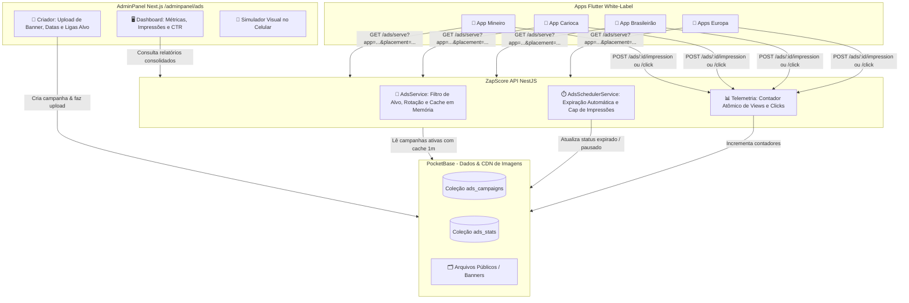

---

### 20.3 Modelo de Dados no PocketBase (`ads_campaigns` e `ads_stats`)

#### 1. Coleção: `ads_campaigns`
* `title` (text, obrigatório): Nome identificador da campanha (ex: *"SuperBet - Final Mineiro"*).
* `advertiser` (text): Nome do anunciante/cliente parceiro.
* `placement` (select):
  * `banner_bottom`: Banner fixo ou rotativo no rodapé (320x50 / 300x50).
  * `native_card`: Card nativo integrado aos feeds de partidas e notícias.
  * `interstitial_modal`: Modal ou tela cheia de transição entre telas/partidas.
  * `popup_launch`: Aviso/banner de boas-vindas na abertura do aplicativo.
* `target_apps` (json): Lista de slugs dos apps autorizados (ex: `["campeonato_mineiro", "campeonato_carioca"]` ou `["all"]`).
* `target_leagues` (json): Array de IDs numéricos da API-Football para segmentação exclusiva por campeonato.
* `creative_image` (file, obrigatório): Arquivo gráfico do banner (PNG, WebP, JPG) com serving direto pela CDN do PocketBase.
* `destination_url` (text, obrigatório): URL externa (com parâmetros UTM) ou rota de deep link interna do app.
* `start_at` (datetime, obrigatório): Início da veiculação.
* `end_at` (datetime, obrigatório): Fim da veiculação.
* `priority` (number, default: 1): Peso para sorteio e rotação entre múltiplas campanhas concorrentes.
* `status` (select): `draft`, `scheduled`, `active`, `paused`, `expired`.
* `max_impressions` (number, opcional): Limite contratual de exibições (*capping*).
* `impressions_count` (number, default: 0): Total acumulado de visualizações.
* `clicks_count` (number, default: 0): Total acumulado de toques.

#### 2. Coleção: `ads_stats` (Telemetria Detalhada / Auditoria)
* `campaign_id` (relation `ads_campaigns`): Identificador da campanha.
* `event_type` (select): `impression`, `click`.
* `app_slug` (text): Slug do aplicativo de origem.
* `league_id` (number, opcional): Campeonato visualizado.
* `timestamp` (datetime): Data/hora do evento.

---

### 20.4 Motor de Agendamento, Rotação e Cron na ZapScore API (`apps/api`)

* **Módulo:** `apps/api/src/ads/`
* **Endpoints:**
  1. `GET /ads/serve`:
     * Query: `?app=campeonato_mineiro&placement=banner_bottom&leagueId=629`
     * Consulta campanhas vigentes no PocketBase (`status = 'active'`, `start_at <= now <= end_at`, matching de `target_apps` e `target_leagues`).
     * Realiza sorteio ponderado pela `priority`.
     * Mantém **cache em memória (1 minuto)** para suportar alto tráfego sem onerar o PocketBase.
  2. `POST /ads/:id/impression`:
     * Registra exibição e incrementa `impressions_count` de forma atômica e assíncrona.
  3. `POST /ads/:id/click`:
     * Registra o clique e retorna a URL de redirecionamento.
* **Cron Jobs (`AdsSchedulerService`):**
  * **A cada 15 minutos:**
    * Campanhas `scheduled` cujo `start_at <= now` ➔ Promove para `active`.
    * Campanhas `active` cujo `end_at <= now` ➔ Promove para `expired`.
    * Campanhas que atingiram `max_impressions` ➔ Altera para `paused`.

---

### 20.5 Interface de Gestão e Criação no AdminPanel (`/adminpanel/growth/ads`)

* **Módulo:** `apps/web/app/(main)/adminpanel/growth/ads/page.tsx` (com rota legada/alias `/adminpanel/ads`)
* **Localização Estrutural:** Integrado à seção dedicada de **Divulgação & Monetização dos Apps** (`/adminpanel/growth/ads`).
* **Funcionalidades:**
  1. **Dashboard Consolidado:** Métricas de Impressões, Cliques, CTR médio e campanhas ativas no momento.
  2. **Tabela Operacional de Campanhas:** Listagem com filtro por status, toggle para pausar/reativar instantaneamente e pré-visualização de imagem.
  3. **Formulário de Criação/Edição:**
     * Upload de arte com validação de dimensões.
     * Seletores dinâmicos de formato (`Banner`, `Card`, `Modal`).
     * Multi-select de aplicativos suportados e competições.
     * Agendamento com intervalo de datas.
  4. **Simulador Visual (Mobile Mockup):** Renderização instantânea do banner no protótipo de smartphone antes de salvar a campanha.

---

### 20.6 Integração Híbrida nos Apps Mobile Flutter (House Ads + AdMob Fallback)

* **Widgets Universais:** `HouseAdBanner` e `HouseNativeAdWidget`
* **Modos de Operação Configuráveis:**
  * **Modo A (House Ad Prioritário):** Busca primeiro o anúncio próprio. Se houver patrocínio ativo, exibe o House Ad com link direto. Se não houver, carrega o AdMob.
  * **Modo B (AdMob com Fallback em House Ad):** Tenta carregar o banner AdMob. Caso o AdMob retorne erro ou sem fill (`onAdFailedToLoad`), renderiza o banner próprio imediatamente, garantindo 100% de aproveitamento de tela.

---

### 20.7 Fases do Plano de Ação

* **Fase 1 (Estrutura no PocketBase & Backend):** Criação das coleções no PocketBase, serviço `AdsService` com cache em memória e endpoints `/ads/serve`, `/ads/:id/impression` e `/ads/:id/click`.
* **Fase 2 (Agendador & Cron):** Implementação do `AdsSchedulerService` em `apps/api` com rotinas automáticas de expiração e transição de status.
* **Fase 3 (Interface no AdminPanel):** Telas de gestão, upload de artes, indicadores de CTR e simulador mobile em `/adminpanel/ads`.
* **Fase 4 (Clientes Flutter):** Desenvolvimento dos widgets híbridos nos apps estaduais, Brasileirão e Europa com rastreamento de impressões e cliques.

---

## 🚀 Capítulo 21: [A FAZER / OPERACIONAL] Divulgação dos Apps e Estratégia de Crescimento Rápido (Ações Diárias de 5 Minutos)

> **Status:** `[OPERACIONAL / DIÁRIO]`  
> **Objetivo:** Estabelecer uma rotina diária ultrarrápida (5 a 10 minutos por dia) para tração e crescimento de downloads orgânicos dos aplicativos ZapScore (Estaduais, Brasileirão e Europa), sem necessidade de equipe de marketing ou investimentos vultosos.

---

### 21.1 Proposta de Valor e Estratégia de Tração Rápida
Os aplicativos do ecossistema ZapScore possuem 4 vantagens competitivas "injustas" em relação a concorrentes genéricos gigantes (Flashscore, Sofascore, 365Scores):
1. **Hiperlocalização Regional:** Um torcedor do Coritiba, Athletico, Grêmio, Inter, Cruzeiro, Bahia, Sport ou Ponte Preta prefere ter o app exclusivo do seu campeonato estadual ou do Brasileirão com as cores e foco exclusivo na sua competição do que um app generalista.
2. **Card "Onde Assistir" Integrado:** A pergunta mais buscada no Brasil nos dias de jogo é *"Onde vai passar o jogo de hoje?"*. O ZapScore entrega essa resposta com destaque nativo.
3. **Escalação Antecipada (50 Minutos Antes) com Campinho Tático Oficial:** Fotos reais dos atletas, posições e formações táticas disponíveis antes da concorrência.
4. **Notificações Instantâneas de Gol:** Velocidade máxima via FCM HTTP v1 sem atraso de streaming.

A estratégia de crescimento baseia-se em **distribuir pequenas doses de valor utilitário** (uma resposta que o torcedor precisa na hora) acompanhada do link direto para baixar o aplicativo.

---

### 21.2 Calendário Operacional Semanal (1 Ação Rápida de 5 Minutos por Dia)

Uma única ação executada com consistência diária gera efeito composto de downloads sem sobrecarregar o desenvolvedor:

| Dia da Semana | Foco da Ação | Tempo Estimado | Canal Ideal | Como Fazer (Passo a Passo) |
| :--- | :--- | :--- | :--- | :--- |
| **Segunda-feira** | **Tabela Pós-Rodada & G4/Z4** | 5 min | X / Threads / Grupos Torcida | 1. Abra o app e tire print da tabela atualizada pós-rodada.<br>2. Destaque o G4 e Z4 com uma legenda provocativa: *"Veja como ficou a tabela do Paulistão/Brasileirão após os jogos de ontem! Acompanhe a classificação atualizada a cada gol: [link do app]"*. |
| **Terça-feira** | **"Onde Assistir" Meio de Semana** | 5 min | TikTok / Reels / Shorts / X | 1. Grave um vídeo rápido de tela (15s a 20s) ou tire print dos cards de transmissão do app.<br>2. Título: *"Onde assistir aos jogos de amanhã (quarta-feira)? TV Aberta, Premiere, CazéTV e streaming. Baixe grátis o app: [link]"*. |
| **Quarta-feira (Dia de Jogo)** | **Furo da Escalação Oficial (50m antes)** | 3 min | Grupos WhatsApp / Telegram / X | 1. Assim que o Lineup Agent confirmar os 22 titulares (50 min antes do jogo), tire print do campinho tático com as fotos oficiais.<br>2. Poste no X e grupos de torcedores: *"OFICIAL! Saiu a escalação de [Time A] x [Time B]! Veja o campinho tático completo e banco de reservas no app: [link]"*. |
| **Quinta-feira** | **Artilharia & Destaques da Rodada** | 5 min | X / Threads / Instagram | 1. Tire print da tela de Artilheiros ou dos Comentários Táticos da IA pós-jogo.<br>2. Texto: *"Quem assume a liderança da artilharia? Acompanhe estatísticas, resenhas táticas da IA e notas no app: [link]"*. |
| **Sexta-feira** | **Agenda do Fim de Semana & "Onde Assistir"** | 5 min | Reels / Shorts / TikTok / Grupos | 1. Mostre a grade dos jogos de sábado e domingo no app.<br>2. Texto/Vídeo: *"Programação completa do futebol no fim de semana: horários e onde assistir cada confronto. Baixe o app e não perca nenhum lance: [link]"*. |
| **Sábado** | **Escalação dos Clássicos / Jogos Decisivos** | 3 min | Grupos WhatsApp / X / Telegram | 1. 50 minutos antes do jogo principal do sábado, publique o print do campinho tático nas comunidades dos dois clubes.<br>2. Link direto para download do app com alertas de gol. |
| **Domingo** | **Plantão do Gol / Placar ao Vivo** | 5 min | X / Threads / Grupos Torcida | 1. Durante os jogos das 16h/18h, compartilhe o placar ao vivo e o impacto na tabela simultânea.<br>2. *"Gol do [Time]! Acompanhe o minuto a minuto e tabela em tempo real pelo app: [link]"*. |

---

### 21.3 Os 4 Formatos de Conteúdo de Alta Conversão

1. **O Print do Campinho Tático:**
   - **Por que funciona:** Torcedor ama ver quem joga, quem foi barrado e a formação tática. O visual com fotos reais dos atletas gera curiosidade e cliques imediatos.
   - **Dica:** Inclua sempre uma marca d'água discreta ou menção: *"Escalação gerada pelo app ZapScore / [Nome do App]"*.
2. **O Vídeo Vertical "Onde Assistir aos Jogos de Hoje" (Shorts / Reels / TikTok):**
   - **Por que funciona:** Os algoritmos do TikTok e YouTube Shorts entregam conteúdos utilitários de alta relevância com extrema facilidade.
   - **Formato:** Vídeo gravando a tela do app rolando a lista de jogos do dia e os canais de TV/streaming, com áudio narrando os principais confrontos.
3. **O Print Recortado da Tabela (Disputa de Título / Z4):**
   - **Por que funciona:** Gera debate e engajamento apaixonado entre torcedores rivais nos comentários das redes sociais.
4. **O Card de Transmissão Estático (Grade de Canais):**
   - **Por que funciona:** Imagem simples em alta resolução listando: *Jogo + Horário + Canal de TV/Streaming*. Altamente compartilhada em grupos de família e amigos no WhatsApp.

---

### 21.4 Protocolo de Disseminação em Grupos de Torcida e Redes

Para maximizar downloads sem ser banido ou considerado spam:
1. **Regra de Ouro (Valor Primeiro, Convite Depois):**
   - Nunca envie apenas o link. Sempre entregue a resposta que o usuário quer no próprio texto ou imagem (a escalação completa ou o canal de transmissão).
   - O link do app entra como convite natural: *"Para receber notificação de gol sem delay e ver as estatísticas ao vivo, baixe o app: [link]"*.
2. **Uso de Parâmetros UTM nos Links:**
   - Crie links rastreados para entender de onde estão vindo as instalações:
     - `https://play.google.com/store/apps/details?id=com.zapscore.estadualpaulista&referrer=utm_source%3Dwhatsapp_grupos`
     - `...&referrer=utm_source%3Dtiktok_onde_assistir`
     - `...&referrer=utm_source%3Dtwitter_escalacoes`
3. **Ativação dos Anúncios Próprios (Cross-Promotion):**
   - Conforme previsto no [Capítulo 20](#-capítulo-20-a-fazer-rede-própria-de-anúncios-house-ads--direct-sponsorship-network), quando um app estadual estiver em período sem partidas, os cards e banners internos devem promover o app do Brasileirão ou da Copa correspondente.

---

### 21.5 Checklist Semanal de ASO (App Store Optimization - 10 Minutos na Sexta-Feira)

Ajustes periódicos simples na página da Google Play / App Store para capturar o fluxo de buscas orgânicas:
* [ ] **Título do App:** Garantir que o nome inclua palavras de busca essenciais (ex: `Paulista: Tabela, Jogos e Onde Assistir`).
* [ ] **Descrição Curta (80 caracteres):** Manter termos fortes de conversão (ex: *"Tabela atualizada, alertas de gol rápidos e onde assistir aos jogos ao vivo"*).
* [ ] **Screenshots Atualizados:** Manter nos prints da loja a tela de escalação com campinho tático e a tela de Onde Assistir, pois são os recursos visuais de maior apelo.
* [ ] **Monitoramento de Avaliações:** Responder a comentários na loja agradecendo e destacando a rapidez dos alertas.

---

### 21.6 [A FAZER] Arquitetura do Social Growth Agent (Marketing & Divulgação Autônoma)

> **Módulo no Backend:** `apps/api/src/growth/`  
> **Interface no AdminPanel:** `apps/web/app/(main)/adminpanel/agents/growth/page.tsx`  
> **Proposta:** Transformar os dados esportivos do ecossistema ZapScore (escalações com fotos, horários, canais de TV, tabelas e gols) em **peças gráficas finalizadas em alta resolução e legendas de marketing geradas por IA**, prontas para postagem autônoma ou publicação em 1 clique.

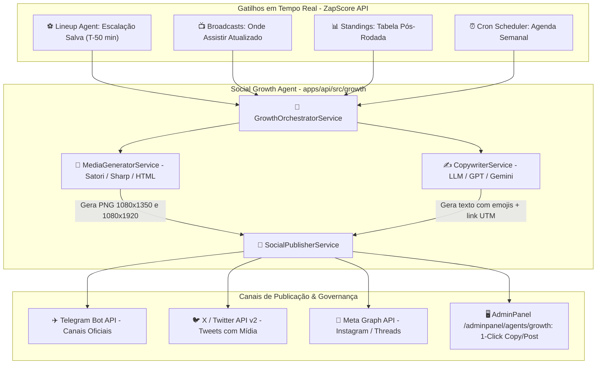

---

### 21.7 Motor Gráfico de Mídia (Canva Connect API Pro & Fallback Headless)

O ecossistema adota uma arquitetura híbrida de alto nível estético, utilizando a **Canva Connect API** conectada à conta **Canva Pro** como motor visual primário, com contingência local headless:

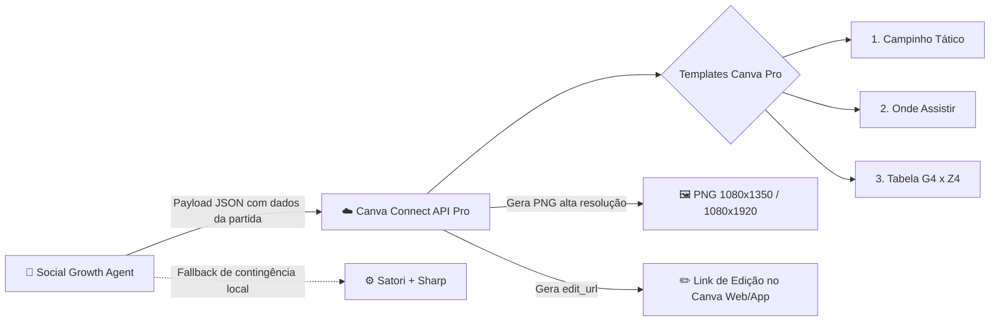

#### 21.7.1 Vantagens da Integração com Canva Pro:
1. **Zero Esforço de Código para Novos Layouts:**
   - Criação e modificação de artes feitas diretamente na interface visual do Canva (arrastar e soltar, efeitos, gradientes, tipografia profissional).
2. **Uso do Brand Kit (Identidade Visual):**
   - Configuração das cores oficiais de cada aplicativo (Paulistão, Carioca, Mineiro, Gaúcho, Brasileirão) e tipografias oficiais da ZapScore.
3. **Autofill Dinâmico via API (`POST /v1/autofills`):**
   - O agente preenche campos dinâmicos no template: nomes dos clubes, placar, horário, formação tática e URLs das fotos oficiais dos atletas e escudos.
4. **Exportação em Alta Resolução (`POST /v1/exports`):**
   - Renderização na nuvem do Canva em PNG nítido para Feed (`1080x1350`) e Stories (`1080x1920`).
5. **Edição Manual Instantânea com 1 Clique (`edit_url`):**
   - No AdminPanel (`/adminpanel/growth/agent`), cada card gerado inclui o botão **"🎨 Abrir no Canva"**, permitindo ajustes finos ou personalizações especiais antes da publicação.
6. **Fallback Headless de Contingência:**
   - Caso a cota da API do Canva expire ou haja instabilidade externa, o motor local (`Satori` + `Sharp`) assume automaticamente a renderização.

---

### 21.8 Gerador de Copy com IA & Rastreamento UTM

O `CopywriterService` recebe o contexto esportivo e gera automaticamente legendas otimizadas para conversão:
* **Geração de Texto:**
  - Linguagem apaixonada de torcedor, com emojis adequados e sem jargões corporativos.
  - Formatação inteligente de acordo com o destino (Twitter: limite de 280 caracteres; Telegram/WhatsApp: formatação com negritos e marcadores).
* **Injeção de Tags UTM Automáticas:**
  - Cada link gerado inclui parâmetros de rastreamento para auditar downloads por canal:
    `https://play.google.com/store/apps/details?id={appSlug}&referrer=utm_source%3D{network}%26utm_campaign%3D{fixtureSlug}`.

---

### 21.9 Conectores de Postagem e Canais de Distribuição

O agente suporta dois modos operacionais configuráveis por canal: **Autônomo (Disparo Direto)** e **Supervisionado (Aprovação Manual)**:

1. **Telegram Bot API (100% Gratuito e Instantâneo):**
   - Método `sendPhoto` enviando o card em alta resolução + legenda formatada direto em canais públicos ou grupos de torcedores.
2. **X / Twitter API v2:**
   - Upload do PNG via `/media/upload` e publicação de tweet oficial com imagem anexada e menção das hashtags do clássico.
3. **Meta Graph API (Instagram & Threads):**
   - Publicação automática no Feed e Stories de páginas oficiais do ZapScore através da API de Content Publishing.
4. **Cópia Instantânea para WhatsApp Pessoal (Modo 1-Clique):**
   - No AdminPanel, botões dedicados:
     - `📋 Copiar Texto Formatado`: Copia a legenda pronta com emojis e link para a área de transferência.
     - `💾 Baixar Imagem PNG`: Salva o card em alta resolução no dispositivo para encaminhamento imediato em grupos de WhatsApp.

---

### 21.10 Seção Dedicada de Divulgação dos Apps no AdminPanel (`/adminpanel/growth`)

Para centralizar a governança de aquisição de novos usuários, parcerias, campanhas e monetização direta, o AdminPanel passa a contar com uma **seção dedicada de 1º nível: "📣 Divulgação & Monetização dos Apps"**, acessível pela barra lateral de navegação em `/adminpanel/growth`.

Essa seção desacopla as ações estratégicas de marketing da governança estritamente técnica de dados do Sentinel, unificando sob uma mesma interface operacional:

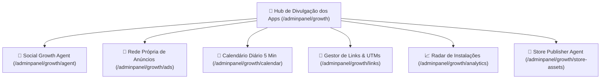

#### 21.10.1 As 6 Sub-Abas de Governança da Seção:

1. **Dashboard Geral de Crescimento (`/adminpanel/growth/page.tsx`):**
   - Visão consolidada: downloads estimados na semana, impressões totais da rede própria de anúncios, campanhas de patrocínio ativas e atalhos rápidos para as ações do dia.
2. **Social Growth Agent (`/adminpanel/growth/agent/page.tsx`):**
   - Radar de partidas do dia com status das artes gráficas (Campinho Tático, "Onde Assistir", Tabela).
   - Visualizador interativo de PNGs (Feed e Stories) e editor rápido de copy com IA.
   - Botões de ação direta: `🚀 Disparar em Todos os Canais (Telegram, X, Meta)` e `📋 Copiar Texto + Baixar PNG` (para envio imediato em grupos pessoais de WhatsApp).
3. **Rede Própria de Anúncios / House Ads (`/adminpanel/growth/ads/page.tsx`):**
   - Criação e gestão de campanhas publicitárias diretas e patrocínios regionais ([Capítulo 20](#-capítulo-20-a-fazer-rede-própria-de-anúncios-house-ads--direct-sponsorship-network)).
   - Upload de criativos, segmentação por app/liga, limites de impressões (*capping*) e simulador em tela de celular.
4. **Calendário Diário de Divulgação (`/adminpanel/growth/calendar/page.tsx`):**
   - Checklist interativo da rotina diária de 5 minutos (Segunda: Tabela G4/Z4; Terça: Onde Assistir; Quarta: Escalação 50m antes; Quinta: Artilharia; Sexta: Agenda do Fim de Semana; Sábado/Domingo: Jogos ao Vivo).
   - Marcação de tarefas concluídas e histórico semanal.
5. **Gestor de Links Rastreados & Parcerias (`/adminpanel/growth/links/page.tsx`):**
   - Gerador de links com UTMs personalizadas para parcerias com influenciadores, páginas de torcida e campanhas pagas.
   - Relatórios de conversão por canal (`utm_source`, `utm_medium`, `utm_campaign`).
6. **Store Publisher Agent (`/adminpanel/growth/store-assets/page.tsx`):**
   - Geração com 1 clique de todos os assets gráficos e metadados ASO para publicação de novos apps na Google Play Console e Apple App Store (Feature Graphic 1024x500, Screenshots com moldura 3D de celular em 1242x2688/1080x1920, Ícone de alta resolução 512x512 e textos ASO formatados).

---

### 21.11 Fases de Implementação do Social Growth Agent

* **Fase 1 — Motor Gráfico & Templates (`apps/api`):**
  - Instalação dos pacotes headless `@resvg/resvg-js`, `satori` e `sharp` na ZapScore API.
  - Implementação dos templates HTML/CSS para Campinho Tático e "Onde Assistir".
  - Endpoint `GET /growth/preview/lineup/:fixtureId` retornando o PNG em tempo real.
* **Fase 2 — Copywriter com IA & UTM Engine:**
  - Implementação do `CopywriterService` integrado ao LLM já homologado nos comentários táticos.
  - Gerador de links rastreados com UTM.
* **Fase 3 — Interface de Governança no AdminPanel:**
  - Criação da página `/adminpanel/agents/growth` com visualizador de imagens e botões de download e cópia de texto em 1 clique.
* **Fase 4 — Conectores Sociais Autônomos:**
  - Ativação do Telegram Bot e Webhooks para disparo automático 50 minutos antes de cada partida monitorada pelo Sentinel.

---

### 21.12 [CONCLUÍDO / OPERACIONAL] Store Publisher Agent: Automação de Assets, Formulários 16+/SPORTS, Canva Pro e Google Play Edits API

> **Status:** `[CONCLUÍDO / 100% OPERACIONAL]`  
> **Localização no Frontend:** `apps/web/app/(main)/adminpanel/agents/store-publisher/` (Acesso via `/adminpanel/agents/store-publisher`)  
> **Card no Hub de Agentes:** Registrado em `/adminpanel/agents`  
> **Diretriz Máxima de Isolamento:** **100% isolado dentro do AdminPanel (`apps/web`)**. Nenhuma linha de código, schema, dependência ou rota da Zapscore API central (`apps/api`) ou dos aplicativos móveis (`apps/mobile`, `apps/estaduais/*`, `apps/brasil/*`, `apps/europa/*`) foi alterada.

```mermaid
flowchart TD
    subgraph UI [Interface do Agente: /adminpanel/agents/store-publisher]
        SELECT["📱 Seletor dos 19 Apps + Filtros de Região (Nacional, Nordeste, Sudeste, Sul, Europa)"]
        SCAN["🔄 Botão de Varredura Automática (Auto-Discovery de Pastas Clonadas)"]
    end

    subgraph ENGINE [Módulos Internos no AdminPanel (apps/web)]
        CATALOG["📂 Catálogo Base + Auto-Discovery (apps-catalog.ts & auto-discovery.ts)"]
        ASO["✍️ ASO Copywriting Engine: Título (30c), Breve (80c), Completa (4000c) (aso-generator.ts)"]
        FORMS["📋 Motor de Formulários da Loja: 16+ Anos, SPORTS, ENTERTAINMENT, Data Safety (store-forms.ts)"]
        CANVA["🎨 Canva Pro Integration: Deep-Links Dimensionados 1024x500, 1080x1920, 512x512 (canva-service.ts)"]
        PLAY_API["🚀 Google Play Edits API v3: Autenticação JWT RS256 + Dry-Run Simulado (google-play-api.ts)"]
        EXP["📦 Exportador de Pacote Consolidado: .txt, .json, .md (export-package.ts)"]
    end

    subgraph DESTINOS [Destinos de Publicação]
        CANVA_PRO["🎨 Canva Pro (Pranchetas com Dimensões Exatas em 1-Clique)"]
        CONSOLE_MANUAL["🌐 Google Play Console (Preenchimento Manual Risco Zero via Pacote TXT/MD)"]
        API_DIRECT["⚡ Google Play Console via API (Sincronização 1-Clique com Service Account ou OIDC)"]
    end

    SELECT --> CATALOG
    SCAN --> CATALOG
    CATALOG --> ASO & FORMS & CANVA & PLAY_API & EXP
    CANVA --> CANVA_PRO
    EXP --> CONSOLE_MANUAL
    PLAY_API --> API_DIRECT
```

---

#### 21.12.1 Os 5 Pilares de Engenharia do Agente:

1. **Catálogo Unificado & Auto-Discovery de Pastas Clonadas (`auto-discovery.ts`):**
   - Mapeamento nativo dos 19 aplicativos do ecossistema (*Brasileirão Séries A e B, Pernambucano, Paraibano, Maranhense, Paulistão, Cariocão, Mineiro, Gauchão, Baiano, Cearense, Copas e Europeus*).
   - **Varredura Automática em Disco:** O motor inspeciona em tempo real as pastas `apps/estaduais/`, `apps/brasil/` e `apps/europa/`. Quando um novo estadual é clonado (ex: `apps/estaduais/alagoano`, `sergipano`, `potiguar`):
     - Confirma a presença do `pubspec.yaml` (validando app Flutter legítimo).
     - Extrai o nome oficial e ID da liga de `lib/helpers/app_config.dart`.
     - Extrai o `applicationId` oficial de `android/app/build.gradle.kts` ou `build.gradle`.
     - Associa estado (UF), região e paleta esportiva automaticamente, exibindo o selo `AUTO` no seletor.
     - Botão **"Varredura Automática"** no topo do painel atualiza a listagem sem recarregar a página.

2. **Motor de Formulários e Declarações Obrigatórias (`store-forms.ts`):**
   - **Público-Alvo (Target Audience):** Pré-selecionado rigorosamente em **16 a 17 anos** E **18 anos ou mais (16+)**. Atração não intencional por crianças declarada como **NÃO**.
     - *Efeito Prático e Regulatório:* **Isenta integralmente o aplicativo das exigências da Política de Famílias do Google Play e da legislação COPPA**, autorizando anúncios Google AdMob sem restrição de inventário infantil e notificações push sem risco de bloqueio.
   - **Categorização da Loja:** Tipo: `Aplicativo` • Categoria Primária: **Esportes (`SPORTS`)** • Categoria Secundária / Tag: **Entretenimento (`ENTERTAINMENT`)**.
   - **Declaração de Anúncios:** Marcado como **SIM, contém anúncios** (Google AdMob SDK integrado).
   - **Classificação Indicativa IARC:** Questionário esportivo respondido com classificação estimada **Livre / Everyone** (PEGI 3, USK 0, DJCTQ Livre).
   - **Segurança dos Dados (Data Safety Form):**
     - Coleta de *Identificadores de Dispositivo* para funcionalidade do app (Tokens FCM para envio de push de gols; efêmero e não vinculado à identidade do usuário).
     - Coleta de *Localização Aproximada (Coarse Location)* para monetização regionalizada via AdMob.
     - Criptografia em trânsito via HTTPS/TLS 1.3 e mecanismo de solicitação de exclusão de dados.
   - **Acesso a Recursos:** Todas as funcionalidades declaradas disponíveis sem exigência de login ou credenciais (`ALL_FUNCTIONALITY_AVAILABLE`).

3. **Copywriting ASO com Limites Rígidos da Google Play (`aso-generator.ts`):**
   - **Título do App:** Máximo estrito de **30 caracteres** (ex: `Pernambucano Ao Vivo - ZapScore`).
   - **Breve Descrição:** Máximo estrito de **80 caracteres** (ex: `Placar ao vivo do Pernambucano, tabela, gols em tempo real e escalações!`).
   - **Descrição Completa:** Formatada em até **4.000 caracteres** com emojis, tópicos de recursos, benefícios de velocidade, termos legais e links da política de privacidade.
   - **Notas da Versão (Release Notes):** Até **500 caracteres** para atualizações e novos lançamentos.
   - Contadores visuais em tempo real na interface com alerta caso ultrapasse os limites da loja e botão de cópia rápida em 1 clique.
   - Suporte a geração de variações persuasivas via **Google Gemini**.

4. **Integração Canva Pro com Deep-Links Dimensionados (`canva-service.ts`):**
   - **Zero necessidade de credenciais de API:** Os links abrem diretamente o Canva na conta do operador com as dimensões oficiais exatas:
     - **Feature Graphic:** 1024 x 500 px (Banner principal da vitrine da loja).
     - **Ícone de Alta Resolução:** 512 x 512 px (PNG 32-bit com cantos retos).
     - **5 Screenshots de Celular (1080 x 1920 px - proporção 9:16):**
       1. *Placar ao Vivo & Gol Instantâneo*
       2. *Tabela e Classificação ao Vivo*
       3. *Escalações Oficiais 50m Pré-Jogo*
       4. *Comentários Táticos com Inteligência Artificial*
       5. *Gols e Melhores Momentos em Vídeo*
   - O painel fornece a **Headline** e o **Subtítulo** prontos para copiar e colar em cada mockup.

5. **Conector Google Play Edits API & Exportador de Pacote Offline (`google-play-api.ts` & `export-package.ts`):**
   - **Edits API v3:** Implementação nativa em Node.js com assinatura JWT RS256 pura (`crypto.createSign`), suportando abertura de sessão (`edits.insert`), atualização da ficha em português (`edits.listings.update`) e commit direto para revisão (`edits.commit`).
   - **Modo Dry-Run (Simulação Segura):** Valida todos os limites de caracteres e regras regulatórias sem fazer requisições externas à loja.
   - **Botão "Baixar Pacote da Loja":** Gera e baixa um arquivo consolidado contendo:
     - `ASO_<appId>_pt_BR.txt` (Textos medidos e prontos).
     - `FORMULARIOS_GOOGLE_PLAY_<appId>.md` (Checklist passo a passo campo a campo).
     - `store_declarations_<appId>.json` (Payload estruturado das declarações).
     - `CANVA_ASSETS_GUIDE_<appId>.md` (Links e copies dos mockups).

---

#### 21.12.2 Governança de Segurança e Autenticação (Por que NENHUMA Chave Fica no Código):

O Google Cloud exibe alertas rigorosos recomendando evitar o download de chaves estáticas de Service Account (`.json`) para prevenir vazamentos acidentais em repositórios públicos. O ecossistema ZapScore segue três princípios absolutos de segurança:

1. **Risco Zero Absoluto (Fluxo Offline Recomendado):**
   - O operador **não precisa baixar nem cadastrar nenhuma chave do Google Cloud**.
   - Clicando em **"Baixar Pacote da Loja"**, o Agente compila todos os textos e formulários mastigados. O desenvolvedor apenas copia e cola no console web da Google Play em 2 minutos. Risco de segurança: **zero**.

2. **Isolamento de Credenciais no Servidor (Se Usar a API Direta):**
   - A chave JSON nunca é incluída no código-fonte nem no Git (`.gitignore` ativo).
   - Se utilizada, reside estritamente nas variáveis de ambiente seguras do Easypanel (`GOOGLE_PLAY_SERVICE_ACCOUNT_JSON`).
   - O campo de texto manual no painel do AdminPanel opera **exclusivamente na memória volátil do navegador** (`useState`), sem gravar dados em disco nem em banco de dados.

3. **Autenticação Avançada: Workload Identity Federation (OIDC):**
   - Em pipelines automatizados de CI/CD (GitHub Actions / GitLab) ou servidores corporativos, o sistema adota **Workload Identity Federation**:
   - **Como funciona na prática:**
     - Não existe arquivo de chave privada física (`.json`) baixado.
     - O servidor e o Google Cloud estabelecem uma relação de confiança federada via **OIDC (OpenID Connect)**.
     - Quando o Agente precisa publicar na loja, ele solicita um token OIDC emitido pelo repositório oficial (`MarcilioLeiteSilva/zapscore`).
     - O Google Security Token Service (STS) valida a assinatura do repositório e emite um **Access Token temporário e efêmero que expira em 60 minutos**.
     - O Agente realiza a publicação usando esse token descartável, eliminando qualquer risco de roubo ou vazamento de credenciais permanentes.

---

#### 21.12.3 Mini-Tutorial Operacional: Publicando ou Atualizando Apps na Prática:

##### Cenário 1: Atualizar ou Lançar um App Já Existente
1. Acesse o AdminPanel em `/adminpanel/agents/store-publisher`.
2. Selecione o aplicativo desejado no seletor (ex: **Pernambucano**, **Paraibano**, **Brasileirão**).
3. Na aba **Ficha ASO**, ajuste os textos ou clique em **"Regerar com Gemini"** e use o botão de cópia rápida.
4. Na aba **Formulários 16+**, consulte o checklist e confirme as respostas no Google Play Console (Público 16+, Categoria SPORTS, Anúncios AdMob, Data Safety).
5. Na aba **Canva Pro & Mockups**, clique em **"Criar no Canva"** em cada asset, cole os textos prontos e baixe os PNGs.
6. Na aba **1-Click Publish**, execute a simulação Dry-Run ou clique em **"Baixar Pacote da Loja"** para obter todos os arquivos consolidados.

##### Cenário 2: Publicar um Novo App do Zero na Google Play
1. No [Google Play Console](https://play.google.com/console), clique em **"Criar app"** e insira o Título gerado pelo Agente (ex: `Paraibano Ao Vivo - ZapScore`).
2. Em **Conteúdo do app**, preencha o questionário com as respostas da aba *Formulários 16+*:
   - Público-Alvo: `16-17` e `18+` (Não direcionado a crianças).
   - Categoria: `SPORTS` (Primária) e `ENTERTAINMENT` (Secundária/Tag).
   - Anúncios: `Sim (Google AdMob)`.
   - Data Safety: Identificadores de Dispositivo (push) e Localização aproximada.
3. Em **Presença na loja > Ficha principal da loja**, suba as imagens criadas no Canva Pro (1024x500, 512x512, 1080x1920) e cole o Título, Breve Descrição e Descrição Completa.
4. Em **Produção**, suba o pacote `.aab` assinado (ex: `apps/estaduais/paraibano/build/app/outputs/bundle/release/app-release.aab`) e envie para revisão.

##### Cenário 3: Adição de um Novo Estadual Clonado
1. Clone a pasta do app em `apps/estaduais/<novo_estado>` (ex: `apps/estaduais/alagoano`).
2. Abra o Agente e clique no botão **🔄 "Varredura Automática"**.
3. O novo app aparece imediatamente com o selo **`AUTO`** e com todas as fichas de ASO, formulários e links do Canva já gerados automaticamente.

---

### 21.13 [A FAZER] Quality Gatekeeper & Vanguard AI Engine (Controle de Qualidade Multimodal e Criatividade de Vanguarda)

> **Módulo no Backend:** `apps/api/src/growth/quality-gatekeeper/`  
> **Interface no AdminPanel:** Integrado em `/adminpanel/growth/agent` e `/adminpanel/growth/store-assets`  
> **Proposta:** Injetar inteligência artificial de ponta em dois eixos complementares: **Auditoria Rigorosa de Qualidade (Quality Gatekeeper)** para garantir zero defeitos visuais, conformidade estrita com políticas das lojas e consistência factual de dados; e **Motor de Vanguarda Criativa (Creative Vanguard Engine)** para dotar os aplicativos de narrativas hiperlocais autênticas, análises táticas preditivas e testes multivariados de marketing que posicionam o ecossistema ZapScore à frente dos grandes concorrentes de mercado.

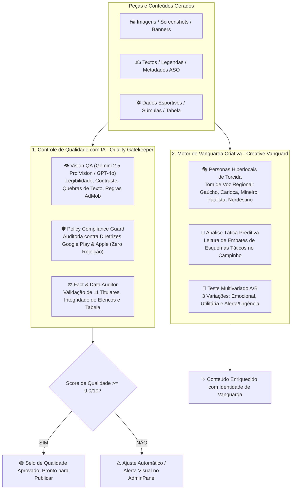

#### 21.13.1 Pilar 1 — Controle de Qualidade com IA (AI Quality Gatekeeper):

1. **Auditoria Visual Multimodal (Vision QA via Gemini 2.5 Vision / GPT-4o):**
   - Inspeciona os arquivos PNG gerados antes de qualquer publicação ou upload nas lojas:
     - **Legibilidade & Contraste:** Mede a razão de contraste entre tipografia e planos de fundo (gramado, degradês do clube, estádio).
     - **Detecção de Quebras e Truncamentos:** Identifica textos cortados com reticências (ex: *"Campeonato Pa..."*), palavras sobrepostas ou desalinhadas.
     - **Auditoria de Diretrizes AdMob:** Garante que mockups com banners e `MediaView` estejam em estrita conformidade com as dimensões mínimas (120x120 dp).
     - **Métrica Estética:** Atribui um índice de qualidade visual de 0 a 10, exigindo nota mínima de **9.0** para aprovação automática.
2. **Escudo Anti-Rejeição de Políticas de Lojas (Google Play & Apple Policy Compliance Guard):**
   - Varredura semântica de 100% dos títulos, descrições e legendas:
     - Previne infrações de marcas registradas (evita termos com tom de titularidade indevida).
     - Bloqueia termos enganosos (ex: *"futebol grátis ao vivo"* ou promessas de pirataria que causam banimento imediato).
     - Elimina o excesso repetitivo de termos de busca (*Keyword Stuffing*), garantindo taxa de aprovação de primeira esteira na Google Play e App Store.
3. **Auditor de Integridade de Dados Esportivos:**
   - Verifica se a formação possui exatamente 11 titulares confirmados, sem duplicatas de atletas, com fotos oficiais ativas e numeração consistente com o plantel oficial (`TeamSquad`).

#### 21.13.2 Pilar 2 — Motor de Criatividade & Vanguarda (Creative Vanguard Engine):

1. **Personas Hiperlocais (O Tom de Voz Autêntico de Cada Torcida):**
   - Substituição de comunicados institucionais e frios por uma linguagem vibrante, que conversa diretamente com a cultura do torcedor de cada campeonato:
     - **Módulo Gaúcho:** Vocabulário de arquibancada do Rio Grande do Sul (*"peleia", "raça", "camisa pesada", clima de decisão no Jaconi, Beira-Rio ou Arena"*).
     - **Módulo Carioca:** Dinamismo, irreverência sadia, clima de Maracanã e São Januário.
     - **Módulo Mineiro:** Tradição histórica, força do Mineirão e a mística dos clássicos em Minas.
     - **Módulo Paulista:** Ritmo de clássicos da capital (Derby, San-São, Choque-Rei) e a vibração do futebol do interior.
     - **Módulo Nordestino (Baiano, Cearense, Pernambucano, Paraibano):** Paixão calorosa das multidões em Fonte Nova, Castelão e Arruda.
2. **Análise Tática Preditiva no Campinho (Além da Escalação Estática):**
   - Ao detectar as formações oficiais (ex: `4-3-3` vs `3-5-2`), a IA gera uma micro-análise do duelo tático:
     - *"O Coritiba deve explorar a transição em velocidade pelas alas aproveitando os espaços cedidos pelos alas adiantados do Athletico; partida com tendência de forte disputa física na faixa central."*
   - Transforma o app em uma referência informativa para torcedores exigentes e apostadores esportivos.
3. **Gerador de Variações Criativas A/B:**
   - A cada rodada, o agente produz 3 versões de chamada de marketing para testes de conversão:
     - **Variação A (Emoção/Paixão):** Foco na camisa, na história e no orgulho do torcedor.
     - **Variação B (Utilitária/Prática):** Foco na utilidade imediata (*"Veja onde assistir e quem vai pro jogo em 5 segundos"*).
     - **Variação C (Alerta/Urgência):** Foco no imediatismo (*"Escalação oficial confirmada com novidades de última hora no time titular!"*).

#### 21.13.3 Interface Operacional no AdminPanel (`/adminpanel/growth`):
* **Card de Auditoria com Selo Visual:**
  - Cada peça gráfica ou pacote de publicação exibe o selo: `🛡️ Auditoria IA: 🟢 APROVADO (Nota 9.7/10)`.
  - Checklist interativo de critérios: Contraste de Cores OK, Políticas Google Play OK, Resolução Retina Display OK, ASO OK.
* **Botão "🪄 Gerar Variação Mais Criativa":**
  - Permite ao operador solicitar uma releitura mais ousada ou descontraída de qualquer postagem ou arte com 1 clique.

---

## 🎯 Capítulo 22: [METAS & CRESCIMENTO] Meta 50k: Projeção de 50.000 Instalações em 5 Meses (Set/26 a Jan/27)

> **Status:** `[PLANEJAMENTO ESTRATÉGICO]`  
> **Horizonte Temporal:** 5 Meses (15 de Setembro de 2026 a 31 de Janeiro de 2027)  
> **Alvo Global:** **50.000 Instalações Ativas** distribuídas pelos aplicativos do ecossistema ZapScore (Brasileirão Séries A e B, Estaduais e Europa).

---

### 22.1 A Rampa de Aceleração Mensal (Curva de Crescimento)

O crescimento de apps de futebol no Brasil segue a sazonalidade do calendário esportivo: as decisões do Brasileirão e Copas (outubro/novembro) geram alta tração, e a largada dos Campeonatos Estaduais (janeiro) gera a maior explosão orgânica do ano:

| Mês | Período / Momento do Futebol | Meta do Mês | Meta Acumulada | Ritmo Diário | Foco Principal |
| :--- | :--- | :--- | :--- | :--- | :--- |
| **Mês 1 (Set/26)** | Ajuste dos agentes, rodadas 25-28 Séries A/B | **4.000** | 4.000 | ~130/dia | Início da rotina de 5 min/dia, ASO nas lojas e testes de posts de "Onde Assistir". |
| **Mês 2 (Out/26)** | Reta final do Brasileirão e semifinais de Copas | **7.000** | 11.000 | ~230/dia | Ativação do Social Growth Agent, vídeos verticais no TikTok/Shorts e grupos de torcida. |
| **Mês 3 (Nov/26)** | Decisões de Título, G4, Acesso e Rebaixamento | **10.000** | 21.000 | ~330/dia | Alertas de escalações nos clássicos decisivos, prints de tabela simultânea e cross-promotion. |
| **Mês 4 (Dez/26)** | Mercado da bola, transferências e pré-temporada | **9.000** | 30.000 | ~300/dia | Lançamento dos novos apps estaduais clonados (Pernambucano, Paraibano, etc.) e aquecimento Europa. |
| **Mês 5 (Jan/27)** | **Estreia dos Campeonatos Estaduais 2027** 🔥 | **20.000** | **50.000** | ~650/dia | **O Grande Ápice:** Paulistão, Carioca, Mineiro, Gaúcho, Baiano na mídia nacional; busca orgânica no pico. |

---

### 22.2 A Abordagem Estratégica em 4 Alavancas

1. **Alavanca 1 — A Força do Orgânico Hiperlocal (Estaduais 2027):**
   - O torcedor brasileiro é apaixonado pelo seu clube e estado. Em janeiro, centenas de milhares de torcedores buscam especificamente por *"tabela do Paulistão"*, *"jogos do Carioca"*, *"Campeonato Mineiro ao vivo"*. Nossos apps estaduais capturam essa demanda direta na barra de busca da Google Play.
2. **Alavanca 2 — Isca de Utilidade Imediata ("Onde Assistir"):**
   - Publicação rápida de vídeos e cards respondendo a maior dor do torcedor em dias de jogo. Gera downloads espontâneos por impulso.
3. **Alavanca 3 — Agilidade Pré-Jogo (Escalação com Campinho 50m Antes):**
   - O print do campinho tático oficial publicado no X/Twitter e grupos de WhatsApp antes de portais convencionais atrai usuários de alto valor que querem a informação mais rápida.
4. **Alavanca 4 — Efeito de Rede & Cross-Promotion (House Ads Gratuitos):**
   - Usuários do app Brasileirão são convidados a baixar o estadual do seu time em dezembro/janeiro, e vice-versa, gerando instalações a custo zero.

---

### 22.3 Ações Práticas de Execução (Direto ao Ponto)

* **Ação 1 (Diária, 5 min):** Cumprir o calendário semanal do [Capítulo 21.2](#212-calendário-operacional-semanal-1-ação-rápida-de-5-minutos-por-dia) (Segunda: Tabela, Terça: Onde Assistir, Quarta/Sábado: Escalação, Domingo: Placar ao vivo).
* **Ação 2 (Vídeos Verticais nos Dias de Jogos Grandes):** 2 a 3 vídeos curtos semanais (15s a 30s) no TikTok/Reels mostrando o card "Onde Assistir" e o campinho tático.
* **Ação 3 (Prontidão para Janeiro/2027):** Publicar e homologar os apps estaduais pendentes até meados de dezembro usando o **Store Publisher Agent** para estarem 100% indexados e ranqueados no réveillon.
* **Ação 4 (Ativação de Micro-Parcerias Locais):** Envio das artes do campinho para 3 a 5 páginas de setoristas de clubes no Instagram/X com permissão de uso gratuito com menção ao app.

---

### 22.4 Métricas e KPIs de Acompanhamento no AdminPanel (`/adminpanel/growth`)

Para medir a saúde do plano sem burocracia, o dashboard monitora 4 métricas essenciais:

1. **Instalações Diárias (Daily Active Installs):**
   - Linha de tendência acompanhando a meta diária do mês (ex: 130/dia em setembro ➔ 650/dia em janeiro).
2. **Taxa de Conversão por Canal (UTM Tracking):**
   - Identifica qual canal gera mais instalações (TikTok, Grupos WhatsApp, X ou Busca Orgânica da Loja).
3. **Retenção D1 e D7 (Usuários que voltam no dia seguinte e em 7 dias):**
   - Mantida alta pelos alertas automáticos de gol e súmula do Push Agent.
4. **Monetização e eCPM (AdMob & House Ads):**
   - Monitoramento do aumento proporcional de receita conforme a base de 50.000 usuários cresce.

---

### 22.5 [A FAZER] Growth Orchestrator Agent: O Gerente de Metas e Estratégia de Tração (Chief Growth Officer de IA)

> **Módulo no Backend:** `apps/api/src/growth/orchestrator/`  
> **Interface no AdminPanel:** `/adminpanel/growth` (Dashboard Principal)  
> **Proposta:** Atuar como o cérebro estratégico central da Meta 50k. Enquanto os outros agentes executam tarefas táticas (o *Social Growth* gera as artes e publica; o *Store Publisher* cuida das lojas), o **Growth Orchestrator Agent** (Growth Sentinel) monitora diariamente o velocímetro de crescimento, envia briefings matinais proativos para o desenvolvedor e comanda o acionamento dos demais agentes para manter a tração sempre no ritmo ideal.

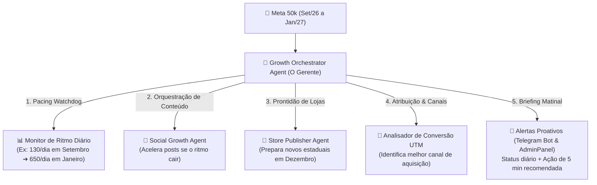

#### 22.5.1 As 4 Funções Executivas do Growth Orchestrator:

1. **Termômetro de Ritmo Diário (Pacing Watchdog):**
   - Calcula a velocidade necessária para bater a meta de cada mês e compara contra as instalações reais:
     - *Exemplo Setembro (Meta: 130/dia):* Se ontem entraram 145 downloads ➔ `🟢 +11% acima do pacing (Ritmo Saudável)`.
     - *Exemplo Queda de Ritmo:* Se o ritmo cair 30% abaixo do pacing em dias sem rodada ➔ emite alerta de aceleração e sugere publicação de conteúdos de "Onde Assistir" ou destaques de tabela.
2. **Briefing Matinal Proativo (Telegram Bot & Painel Web):**
   - Todos os dias às 08h30, envia um resumo executivo direto e objetivo para o Telegram do desenvolvedor:
     > *"⚽ Bom dia! Estamos com 3.120 / 4.000 da meta de setembro (78% concluído).*  
     > *📊 Ontem: +142 instalações (dentro do pacing).*  
     > *🔥 Hoje tem rodada da Série B: o card de 'Onde Assistir' já foi gerado.*  
     > *👉 Ação recomendada: publicar o vídeo vertical no TikTok/Shorts ao meio-dia."*
3. **Orquestração e Acionamento em Cascata dos Agentes:**
   - **Comando do Social Growth Agent:** Quando detecta partidas de alta rivalidade (clássicos) ou queda no ritmo semanal, programa automaticamente mais posts no calendário e prepara artes antecipadas no Canva Pro.
   - **Comando do Store Publisher Agent:** Em novembro, inicia o cronograma de prontidão para a virada de ano, cobrando a compilação e upload dos novos apps estaduais (Pernambucano, Paraibano, Maranhense) para estarem 100% indexados nas lojas antes de 1º de janeiro de 2027.
4. **Auditoria de Origem e ROI de Canais (UTM Engine):**
   - Cruza os downloads com as tags UTM para direcionar o esforço do operador apenas nos canais de maior conversão real (ex: TikTok vs Grupos de WhatsApp vs Busca Orgânica da Loja).

#### 22.5.2 Experiência Visual no AdminPanel (`/adminpanel/growth`):
* **Barra de Progresso Global da Meta 50k:** Barra percentual acumulada dos 5 meses com marcador do dia.
* **Velocímetro de Pacing:** Gráfico simples de velocímetro indicando: `Abaixo da Meta` (amarelo), `No Ritmo` (verde) e `Acelerado` (azul).
* **Card da Ação do Dia:** Exibição destacada da tarefa diária de 5 minutos com botão de execução rápida (`Copiar Texto`, `Ver Arte` ou `Publicar`).

---

### 22.6 [ROADMAP OPERACIONAL] Cronograma de Execução Imediata (Início: 12/09/2026)

Cronograma sequencial, cirúrgico e focado em resultados rápidos, dividido em 6 Sprints progressivos com início imediato em **12/09/2026**:

```mermaid
gantt
    title Roadmap de Crescimento, Monetização & Governança ZapScore
    dateFormat  YYYY-MM-DD
    section Sprint 1
    Contingência Total Lineup Agent (Aliases, URL, Manual, IA T-20m) :2026-09-12, 2026-09-14
    section Sprint 2
    Hub /adminpanel/growth + Setup Canva Connect API Pro :2026-09-15, 2026-09-18
    section Sprint 3
    Social Growth Agent (Artes, Copy IA, Telegram/X/WhatsApp) :2026-09-19, 2026-09-22
    section Sprint 4
    Rede Própria de Anúncios (House Ads: PocketBase, API, Admin, Flutter) :2026-09-23, 2026-09-26
    section Sprint 5
    Store Publisher Agent + Quality Gatekeeper (Google Play Edits) :2026-09-27, 2026-09-29
    section Sprint 6
    Growth Orchestrator Agent + Pacing 50k :2026-09-30, 2026-09-30
```

#### 🗓️ Sprint 1 — Contingência Total do Lineup Agent (12/09 a 14/09/2026)
* **Objetivo:** Blindar 100% das escalações do ecossistema para que nenhum jogo fique sem 22 titulares e campinho tático.
* **Tarefas de Execução:**
  1. **12/09 (Sábado — Amanhã):**
     - Mapeamento e normalização canônica de clubes brasileiros (`athleticopr` ➔ `atleticoparanaense`, `atleticomg`, `americamg`, `bragantino`, etc.) em `globoesporte.provider.ts`, `sofascore.provider.ts`, `livescore.provider.ts` e PocketBase `team_aliases`.
     - Teste prático de resolução imediata com a súmula oficial do Coritiba x Athletico-PR.
  2. **13/09 (Domingo):**
     - Criação do endpoint `POST /lineups/extract-by-url` na ZapScore API (suporte a links diretos do 365Scores, GE Globo e UOL Placar).
     - Implementação do botão "🔗 Ler por URL" no card de partidas em `/adminpanel/agents/lineups`.
  3. **14/09 (Segunda-feira):**
     - Criação do Editor Manual de Escalação (`POST /lineups/:fixtureId/manual`) no AdminPanel com seletor de elenco `TeamSquad` e modo colar texto/IA.
     - Ativação da regra de contingência T-20min via comentários da IA (`fixture_comments` / `PRE_MATCH`).

#### 🗓️ Sprint 2 — Fundação do Hub de Divulgação & Conexão Canva Pro (15/09 a 18/09/2026)
* **Objetivo:** Estruturar a nova seção de 1º nível no AdminPanel e conectar a API oficial do Canva Pro.
* **Tarefas de Execução:**
  1. **15/09 (Terça-feira):**
     - Criação da rota e layout de 1º nível: `/adminpanel/growth` com barra de navegação das 6 sub-abas.
  2. **16/09 (Quarta-feira):**
     - Obtenção das credenciais na plataforma **Canva Developers** (`canva.dev` - Client ID / Secret) e configuração do módulo `CanvaConnectService` na ZapScore API (`apps/api`).
  3. **17/09 e 18/09 (Quinta e Sexta-feira):**
     - Montagem e vinculação dos 3 templates oficiais na conta Canva Pro:
       - *Template 1:* Campinho Tático Oficial (Feed 1080x1350 e Stories 1080x1920).
       - *Template 2:* Card "Onde Assistir" com badges das emissoras.
       - *Template 3:* Recorte de Tabela G4 x Z4.

#### 🗓️ Sprint 3 — Social Growth Agent & Automação de Conteúdo (19/09 a 22/09/2026)
* **Objetivo:** Ativar a geração automática de artes e postagens diárias em redes sociais.
* **Tarefas de Execução:**
  1. **19/09 e 20/09 (Fim de Semana):**
     - Motor `MediaGeneratorService` (Canva Autofill + Export API e fallback Satori/Sharp).
     - Teste de renderização real com partidas ativas da Série A e Série B.
  2. **21/09 (Segunda-feira):**
     - Motor `CopywriterService` com IA (linguagem de torcida, hashtags e injeção automática de tags UTM).
  3. **22/09 (Terça-feira):**
     - Conectores de disparo: Telegram Bot API e X/Twitter API v2.
     - Botões de 1 clique (`📋 Copiar Texto` e `💾 Baixar PNG`) para envio rápido no WhatsApp em `/adminpanel/growth/agent`.
     - Ativação do checklist interativo da rotina diária de 5 minutos em `/adminpanel/growth/calendar`.

#### 🗓️ Sprint 4 — Rede Própria de Anúncios (House Ads & Direct Sponsorship Network) (23/09 a 26/09/2026)
* **Objetivo:** Implementar a infraestrutura autônoma de monetização direta e patrocínios regionais com preenchimento garantido e fallback automático para o Google AdMob ([Capítulo 20](#-capítulo-20-a-fazer-rede-própria-de-anúncios-house-ads--direct-sponsorship-network)).
* **Tarefas de Execução:**
  1. **23/09 (Quarta-feira) — Camada de Dados no PocketBase & Backend API:**
     - Criação das coleções `ads_campaigns` (título, anunciante, placement, target_apps, target_leagues, creative_image, destination_url, datas, prioridade, status, max_impressions, impressions_count, clicks_count) e `ads_stats` (telemetria de impressões e cliques) no PocketBase.
     - Implementação do `AdsModule` em `apps/api` (`AdsService`, `AdsController`) com endpoint `GET /ads/serve?app=...&placement=...&leagueId=...`, cache em memória de 1 minuto e sorteio ponderado por prioridade.
  2. **24/09 (Quinta-feira) — Agendador, Telemetria & Crons:**
     - Endpoints assíncronos atômicos `POST /ads/:id/impression` e `POST /ads/:id/click` com incremento em lote/buffer.
     - Implementação do `AdsSchedulerService` (cron a cada 15 min): ativação automática de campanhas agendadas (`scheduled` ➔ `active`), expiração por data (`active` ➔ `expired`) e corte por capping contratual (`max_impressions` atingido ➔ `paused`).
  3. **25/09 (Sexta-feira) — Painel Operacional no AdminPanel (`/adminpanel/growth/ads`):**
     - Construção da interface `/adminpanel/growth/ads` (com redirecionamento legado de `/adminpanel/ads`):
       - Dashboard executivo: Impressões totais, cliques, CTR consolidado e campanhas ativas.
       - Formulário de cadastro/edição de campanha com upload de arte na CDN do PocketBase e seletores de ligas/apps.
       - Simulador visual em mockup mobile (pré-visualização fiel do banner no celular antes de salvar).
       - Tabela operacional de campanhas com toggle de pausa/reativação instantânea.
  4. **26/09 (Sábado) — Clientes Flutter Híbridos (House Ads + AdMob Fallback):**
     - Desenvolvimento dos widgets universais `HouseAdBanner` e `HouseNativeAdWidget` no core mobile compartilhado e apps estaduais, Brasileirão e Europa.
     - Modo A (House Ad Prioritário com fallback AdMob) e Modo B (AdMob prioritário com fallback House Ad quando `onAdFailedToLoad`).
     - Disparo automático de telemetria (impressão ao renderizar no viewport e clique ao abrir link).

#### 🗓️ Sprint 5 — Store Publisher Agent & Quality Gatekeeper (27/09 a 29/09/2026)
* **Objetivo:** Automação de assets e publicação com 1 clique para Google Play Console e Apple App Store.
* **Tarefas de Execução:**
  1. **27/09 (Domingo):**
     - Geração automática de Feature Graphic (1024x500), Ícone (512x512) e 5 Screenshots em moldura 3D de smartphone via Canva Pro em `/adminpanel/growth/store-assets`.
  2. **28/09 (Segunda-feira):**
     - ASO Text Engine (Título, Descrição Curta 80c e Longa 4000c anti-rejeição).
     - Conector oficial com **Google Play Edits API / Fastlane** para upload automático de imagens, descrições e binário `.aab` em 1 clique.
  3. **29/09 (Terça-feira):**
     - Injeção do **Vision QA (Gemini 2.5 Vision)** para auditoria estética (contraste, textos cortados, nota mínima 9.0/10) e Policy Compliance Guard.

#### 🗓️ Sprint 6 — Growth Orchestrator Agent & Operação Rumo aos 50k (30/09/2026)
* **Objetivo:** Conectar o cérebro executivo de metas e iniciar o monitoramento em tempo real da Meta 50k.
* **Tarefas de Execução:**
  1. **30/09 (Quarta-feira — Manhã):**
     - Dashboard executivo em `/adminpanel/growth`: Barra de progresso dos 5 meses, velocímetro de pacing diário e card da ação do dia.
  2. **30/09 (Quarta-feira — Tarde):**
     - Ativação do Briefing Matinal diário via Telegram Bot (status da meta e ação recomendada de 5 min).
     - Homologação final do ecossistema integrado e início oficial da marcha rumo a Janeiro/2027!

---

## 💡 Capítulo 23: [A FAZER - AMANHÃ] Novas Funcionalidades de Engajamento e Estatísticas Preditivas (Pílulas "Você Sabia?" & Central de Probabilidades)

### 23.1 Visão Geral e Proposta de Valor (Piloto Brasileirão Série A ➔ Escalação White-Label)
Os aplicativos de futebol tradicionais limitam-se a entregar placares ao vivo e tabelas estáticas de classificação. O objetivo deste incremento é posicionar o **ZapScore como um hub de inteligência e entretenimento futebolístico** (estilo *The Athletic* / *Opta Analyst*), combinando duas grandes forças:
1. **Storytelling com Dados ("Você sabia?"):** Pílulas em vídeo curto / cards visuais com curiosidades contra-intuitivas que despertam a atenção do torcedor analítico.
2. **Central de Probabilidades & Estatísticas Preditivas:** Gráficos interativos modernos em Flutter (`fl_chart`) demonstrando probabilidades de título, risco de rebaixamento e termômetro de gols minuto a minuto.

* **Estratégia de Rollout:** O desenvolvimento e homologação ocorrem prioritariamente no app **`apps/brasil/brasileirao`**. Uma vez validado em produção, a arquitetura modular e white-label permite ativar as mesmas telas e widgets nos apps europeus (Premier League, La Liga, Serie A, etc.) e estaduais mudando apenas o identificador da liga (`AppConfig.externalLeagueId`).

---

### 23.2 Funcionalidade 1 — Pílulas "Você Sabia?" (Curiosity Feed & Radar Oculto)

#### 1. Conceito e Formato do Conteúdo
Pílulas de consumo rápido (15 a 20 segundos) que revelam destaques estatísticos que a grande mídia não noticia:
* **O Garçom Oculto:** *"Você sabia? O meia X do Juventude tem mais passes decisivos por jogo que Arrascaeta e Raphael Veiga, mas quase ninguém está falando dele. Olha só o mapa de calor dele..."* (com botão direto para abrir o perfil do atleta).
* **O Time dos Minutos Finais:** *"Você sabia? 45% dos gols do Palmeiras nesta temporada saíram após os 80 minutos de jogo. O time nunca desiste. Veja a distribuição temporal de gols..."*
* **A Muralha Invisível:** *"O goleiro com melhor índice de defesas em finalizações à queima-roupa no campeonato não joga no G4. Descubra quem é."*
* **A Lei do Ex:** Partidas da rodada com atacantes que possuem histórico artilheiro contra seus ex-clubes.

#### 2. Experiência do Usuário (UI/UX no Flutter)
* **Carrossel Superior no Topo da Home:** Círculos com bordas em gradiente neon pulsante (**"Você Sabia?"**, **"Raio-X da Rodada"**, **"Radar Oculto"**).
* **Player / Viewer Imersivo (Estilo Stories/Reels):**
  - Barra de progresso segmentada no topo (15s);
  - Fundo em vídeo vertical (YouTube Shorts embebido via `youtube_player_flutter` ou animação de dados);
  - Card central translúcido em *Glassmorphism* destacando o dado estatístico chave;
  - **Botão de Ação Direta (Deep Link):** Leva o torcedor diretamente para a tela do jogador, da equipe ou da partida dentro do próprio app;
  - **Compartilhamento Viral (Estilo Spotify Wrapped):** Botão nativo que renderiza uma imagem estilizada para compartilhamento com 1 clique no WhatsApp ou Instagram Stories com marca d'água do ZapScore.

---

### 23.3 Motor Autônomo de Geração de Curiosidades (IA Engine + PocketBase Ingestion)
O operador não precisa criar nem digitar conteúdos manualmente:
1. **Agente Curiosity Scout (`CuriosityScoutService` em `apps/api`):**
   - Executa uma varredura semanal no banco de dados consolidado da liga (`FixtureStatistics`, `Player`, `FixtureEvent`).
   - Identifica desvios e anomalias estatísticas positivas (ex: maior média de dribles certos, maior taxa de conversão de chances criadas, equipe com maior posse de bola que menos finaliza).
2. **Enriquecimento com IA (Gemini / OpenAI):**
   - Gera o roteiro/copy pronto em tom provocativo e jornalístico de torcida:
     - Título: *"Você sabia?"*
     - Fato estatístico central;
     - Chamada para ação (*"Abra o app para ver o raio-x completo"*).
3. **Persistência no PocketBase (`curiosities`):**
   - Ingestão na coleção `curiosities` vinculada ao `app_id` e `league_id`.
   - Disponibilização na rota do AdminPanel `/adminpanel/curiosities` para aprovação com 1 clique ou auto-publicação programada.

---

### 23.4 Funcionalidade 2 — Central de Probabilidades & Estatísticas Preditivas

#### 1. Termômetro da Tabela (Probabilidades de Temporada)
Na tela de Classificação (`StandingsScreen`), adiciona-se uma chave seletora no topo: `[ Tabela de Pontos | Probabilidades do Campeonato ]`:
* 🏆 **Chance de Título (%):** Gráfico de barras horizontais coloridas com porcentagem calculada (ex: Botafogo 54%, Palmeiras 31%, Fortaleza 12%).
* 🌎 **Chance de Libertadores (G4 / G6) (%).**
* ⚠️ **Risco de Rebaixamento (Z4) (%):** Barra de perigo em vermelho destacando as probabilidades matemáticas de queda dos clubes ameaçados.
* **Modelo Matemático Autônomo:** Simulação baseada no aproveitamento atual, mando de campo e força relativa dos adversários restantes das rodadas futuras (**zero custo de API externa!**).

#### 2. Raio-X de Partida (Probabilidade de Gols Minuto a Minuto)
Na tela de detalhes de cada jogo (`FixtureDetailScreen`), adiciona-se a aba **"Probabilidades"**:
* **Zonas de Perigo (Distribuição de Gols por Tempo):**
  - Gráfico de colunas dividido em 6 faixas de 15 minutos: `0-15'`, `16-30'`, `31-45'`, `46-60'`, `61-75'`, `76-90'+`.
  - Demonstra claramente as janelas de maior perigo ofensivo e fragilidade defensiva dos dois times (dados já disponíveis no endpoint `/teams/statistics` da API-Football).
* **Mostrador Radial de Gols (Over / Under & Ambas Marcam):**
  - Medidor de pressão (*Gauge Chart*) com estimativa percentual para Over 1.5, Over 2.5 e Ambas Marcam (BTTS).
* **Momento de Pressão ao Vivo (Attack Momentum):**
  - Gráfico de linha em tempo real durante a partida mostrando qual equipe está exercendo maior volume de ataque minuto a minuto.

---

### 23.5 Arquitetura de Apresentação no Flutter (`fl_chart` & Micro-interações)
* **Biblioteca Gráfica Oficial:** Adoção de `fl_chart` nos módulos mobile (alta performance, renderização 60fps via canvas e suporte a sombras e gradientes temáticos em Dark Mode).
* **Design System & Paleta de Cores:**
  - Dark Slate background (`#0B0F19` e `#111827`);
  - Verde Esmeralda / Neon para dados positivos (`#10B981` / `#00E676`);
  - Âmbar / Ouro para destaques e chances de título (`#F59E0B`);
  - Vermelho Carmim para risco de rebaixamento (`#EF4444`).
* **Widgets Modulares Reutilizáveis:**
  - `CuriosityStoryBarWidget` (carrossel superior da Home).
  - `CuriosityStoryViewerScreen` (tela cheia estilo Stories com overlay glassmorphism).
  - `LeagueProbabilitiesCard` (gráfico de chances de título e Z4).
  - `GoalDistributionChartWidget` (gráfico de colunas de gols por faixa de 15 minutos).

---

### 23.6 Estratégia de Monetização (Google AdMob)
1. **AdMob Rewarded (Vídeo Premiado de Alto eCPM):**
   - As probabilidades básicas do campeonato são abertas e gratuitas.
   - O **"Relatório Preditivo Completo da Rodada"** (com projeção de zebras e simulação de rebaixamento jogo a jogo) é desbloqueado mediante a visualização de 1 vídeo premiado de 15 segundos.
2. **AdMob Interstitial Nativo no Stories:**
   - Inserção de anúncio interstitial discreto a cada 4 ou 5 curiosidades navegadas no feed "Você Sabia?".

---

### 23.7 Cronograma de Execução Imediata (Plano de 4 Fases para Amanhã)
* **Fase 1 — Backend & Modelo Matemático (`apps/api`):**
  - Implementação do endpoint de probabilidades da liga (`GET /competitions/:id/probabilities`) com cálculo de Monte Carlo;
  - Criação do serviço agregador de curiosidades estatísticas (`CuriosityScoutService`).
* **Fase 2 — Camada de Dados no PocketBase & AdminPanel (`apps/web`):**
  - Criação da coleção `curiosities` no PocketBase Multi-Apk Agent;
  - Construção da tela de gestão e curadoria `/adminpanel/curiosities`.
* **Fase 3 — Piloto no App Brasileirão (`apps/brasil/brasileirao`):**
  - Adição do pacote `fl_chart` no `pubspec.yaml`;
  - Construção do carrossel de Stories e tela imersiva `CuriosityStoryViewerScreen`;
  - Integração da aba de Probabilidades na tela de Classificação e Detalhes da Partida.
* **Fase 4 — Homologação e Escalação White-Label:**
  - Teste de fluidez e renderização gráfica em dispositivo físico Android;
  - Replicação imediata para a suíte Europa (Premier League, La Liga) e Estaduais.
