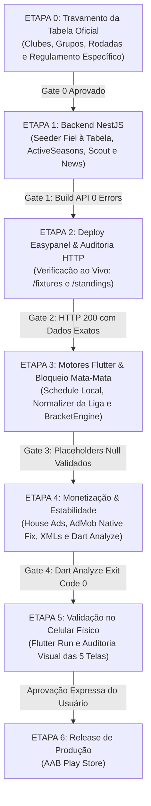

# 📋 Roadmap Oficial e Checklist com Portões de Validação (ZapScore Estaduais)

Este documento estabelece o **Roadmap Operacional com Portões de Validação (Quality Gates)** obrigatórios para a sincronização, padronização e homologação de qualquer campeonato estadual a partir da publicação da tabela oficial da respectiva federação.

> [!CAUTION]
> **REGRA DE OURO CONTRA ALUCINAÇÕES (Zero Suposição e Zero Formato Fixo)**:
> 1. **Cada campeonato possui sua própria estrutura**: A quantidade de clubes (`N`), divisão em grupos (grupo único ou múltiplos grupos), número de rodadas (`R`), total de jogos (`M`), fases eliminatórias (quartas, semifinais, finais, quadrangular de descenso, etc.) e vagas de classificação/rebaixamento **dependem exclusivamente da tabela oficial e do regulamento daquele campeonato**.
> 2. **Bloqueio de Avanço**: É **terminantemente proibido** avançar para a etapa seguinte sem que o teste de validação da etapa corrente tenha retornado **SUCESSO (Exit code 0)**. O agente deve implementar estritamente o que consta na tabela oficial fornecida, sem inventar clubes em mata-mata, sem usar números fixos de outro estadual e sem rodar o app no celular antes da API estar ativa em produção.
> 3. **Protocolo Estrito Anti-Omissão (Como proceder para não omitir nenhum requisito)**:
>    - **Checagem Automatizada de Arquivos Obrigatórios**: Antes de encerrar qualquer etapa, rodar um script de auditoria que testa a existência física (`Test-Path`) de cada arquivo e componente exigido no checklist (ex: `house_ad_service.dart`, `house_header_sponsor.dart`, `house_native_match_card.dart`, `house_popup_launch.dart`, `house_ad_banner.dart`, etc.).
>    - **Diff Estrutural contra o App Modelo**: Executar uma comparação direta entre a árvore de diretórios do app em atualização e a do app de referência (`baiano`/`capixaba`) para acusar instantaneamente qualquer serviço, widget ou injeção faltante.
>    - **Validação Item a Item com Evidência**: Nunca declarar uma etapa encerrada sem listar cada sub-item do checklist acompanhado da respectiva evidência de código (linhas exatas do arquivo onde foi implementado).

---



---

## 🛑 ETAPA 0: Ingestão e Travamento da Tabela Oficial (Fonte Única da Verdade)
Antes de escrever uma única linha de código, a estrutura exata do campeonato em questão deve ser extraída da tabela oficial publicada pela Federação:

1. **Mapeamento Estrito dos Clubes da Tabela Oficial (`N` Clubes)**:
   - Levantar a lista exata de clubes participantes conforme consta na tabela oficial do campeonato (sejam 6, 8, 10, 12, 16 clubes ou qualquer outra configuração).
   - Identificar os clubes promovidos da divisão de acesso e atribuir IDs canônicos dedicados caso ainda não existam na base.
   - **Escudos Estáveis**: Obter URLs de escudos estáveis para 100% dos clubes da tabela (oGol ou CDN oficial sem restrição de `Referer` ou CORS). Nunca usar links quebrados da `media.api-sports.io` que retornem HTTP 403.
2. **Estrutura da Fase Classificatória (`G` Grupos, `R` Rodadas, `M` Partidas)**:
   - Definir conforme a tabela oficial se a competição é disputada em **Grupo Único** ou dividida em **Grupos (A, B, C, etc.)**, e se os confrontos ocorrem dentro do próprio grupo ou cruzados (Ex: Grupo A x Grupo B).
   - Levantar a quantidade exata de rodadas (`R`) e o total de partidas (`M`) que compõem as fases com confrontos já definidos na tabela.
   - Respeitar rigorosamente o mando de campo oficial (1º time listado = Mandante; 2º time listado = Visitante), datas-base, horários e estádios divulgados.
3. **Regulamento Específico das Fases Eliminatórias e Zonas da Tabela**:
   - Mapear quais fases compõem o campeonato após a fase inicial (Ex: 2ª Fase, Quartas de Final, Semifinais, Disputa de 3º Lugar, Taça Secundária, Quadrangular da Permanência, Grande Final).
   - Identificar o formato de cada fase eliminatória (jogo único ou ida e volta) e critérios de desempate (vantagem de empate no agregado para melhor campanha ou pênaltis).
   - Identificar exatamente quantas posições classificam e quantas são rebaixadas (na classificação geral ou dentro de cada grupo).

> [!IMPORTANT]
> ### 🔒 GATE DE VALIDAÇÃO 0
> - [ ] O número de clubes (`N`), grupos (`G`), rodadas (`R`) e partidas (`M`) mapeados reflete com 100% de exatidão a tabela oficial do campeonato?
> - [ ] As URLs de escudos de todos os `N` clubes foram testadas via script e retornam HTTP 200 sem bloqueio anti-hotlink?

---

## 🛑 ETAPA 1: Backend NestJS (`apps/api`) — Seeder e Regras da Competição
Configurar a fonte de dados central que abastecerá o aplicativo via API e PocketBase:

1. **Ativação da Temporada**:
   - Em `apps/api/src/config/competitions.config.ts`, incluir a temporada na propriedade `activeSeasons` da competição (Ex: `activeSeasons: [2026, 2027]`).
2. **Criação do Seeder Canônico**:
   - Criar `apps/api/src/sync/<estadual>-2027-seeder.service.ts`:
     - Cadastrar todos os `N` clubes da tabela oficial e suas classificações iniciais zeradas (`standings`), respeitando a divisão de grupos (`Grupo Único`, `Grupo A`, `Grupo B`, etc.) do campeonato.
     - Inserir **estritamente as `M` partidas já definidas na tabela oficial**.
     - **PROIBIDO** criar partidas no banco de dados com clubes fictícios ou pré-selecionados para fases futuras (Quartas, Semifinais, Final) cujos classificados ainda não estão definidos.
   - Registrar o seeder em `sync.module.ts` e expor o endpoint em `sync.controller.ts` (`@Post('seed-<estadual>-2027')`).
3. **Radar de Notícias e Content Scout**:
   - Cadastrar as palavras-chave da competição e o nome de todos os `N` clubes participantes em:
     - `apps/api/src/news/news.service.ts` (`regionalLeagueRules`)
     - `apps/api/src/news/content-scout.service.ts` (`SCOUT_TARGET_LEAGUES`)
     - `apps/api/src/notifications/notifications.service.ts`

> [!IMPORTANT]
> ### 🔒 GATE DE VALIDAÇÃO 1
> Rodar obrigatoriamente a compilação do NestJS:
> ```powershell
> npm run build --prefix apps/api
> ```
> O comando **deve terminar com código 0**. Qualquer erro de compilação bloqueia o avanço.

---

## 🛑 ETAPA 2: Deploy no Easypanel e Auditoria HTTP ao Vivo
**É proibido iniciar testes no aplicativo mobile antes da API em produção estar atualizada e respondendo com os dados da tabela oficial.**

1. **Commit e Deploy**:
   - Executar `git commit` e `git push origin main`.
   - Aguardar o deploy no Easypanel atualizar o serviço `zapscore-api`.
2. **Execução do Seeder**:
   - Acionar o seeder para gravar os `N` clubes e as `M` partidas da tabela oficial no PocketBase.
3. **Auditoria HTTP ao Vivo**:
   - Verificar os endpoints de produção:
     - `GET https://zapscore-zapscore-api.gtalg3.easypanel.host/fixtures?leagueId=<EXT_ID>&season=2027`
     - `GET https://zapscore-zapscore-api.gtalg3.easypanel.host/standings?leagueId=<EXT_ID>&season=2027`

> [!IMPORTANT]
> ### 🔒 GATE DE VALIDAÇÃO 2
> O script de auditoria HTTP deve comprovar:
> - [ ] O endpoint `/fixtures` retorna exatamente as `M` partidas da tabela oficial?
> - [ ] O endpoint `/standings` retorna exatamente os `N` clubes do campeonato, nos seus respectivos grupos, com 0 pontos e 0 jogos disputados?

---

## 🛑 ETAPA 3: Motores Flutter, Adequação ao Regulamento e Bloqueio de Mata-Mata (`lib/logic/`)

1. **Configuração da Temporada**:
   - Definir `AppConfig.season = 2027` em `lib/helpers/app_config.dart`.
2. **Tabela Offline de Fallback**:
   - Criar `lib/logic/data/<estadual>_2027_schedule.dart` espelhando com exatidão 1:1 os mesmos `N` clubes, grupos e `M` partidas da tabela oficial cadastrada no backend.
3. **Adequação Estrita no `CompetitionNormalizer`**:
   - Estruturar apenas as fases reais previstas no regulamento daquele campeonato (Ex: 1ª Fase em Grupo Único ou Grupos A/B/C, 2ª Fase, Quartas de Final, Semifinais, Final, Quadrangular de Rebaixamento, etc.).
   - Configurar as faixas de classificação e rebaixamento na tabela (`competetion.dart` e `CompetitionNormalizer`) de acordo com as vagas exatas do regulamento da competição.
4. **Regra de Bloqueio Obrigatória no `BracketEngine` (Proibição de Clubes sem Definição)**:
   Em `lib/logic/engines/bracket_engine.dart`, em **qualquer fase eliminatória ou futura** que dependa de classificação prévia, é obrigatório verificar se já existem partidas disputadas antes de projetar clubes:
   ```dart
   final bool hasPlayedMatches = standings.any((st) => st.played > 0);

   // ENQUANTO A FASE CLASSIFICATÓRIA NÃO TIVER JOGOS DISPUTADOS (hasPlayedMatches == false):
   // homeTeam e awayTeam DEVEM SER ESTRITAMENTE NULL!
   final Team? teamA = hasPlayedMatches && standings.isNotEmpty ? _teamFromStanding(standings[0]) : null;
   final Team? teamB = hasPlayedMatches && standings.length > 3 ? _teamFromStanding(standings[3]) : null;

   // As chaves devem exibir apenas os títulos descritivos do cruzamento previsto no regulamento:
   // Ex: '1º Colocado x 4º Colocado', '1º do Grupo A x 2º do Grupo B',
   //     'Vencedor Quartas 1 x Vencedor Quartas 2', 'Vencedor Semifinal 1 x Vencedor Semifinal 2'
   ```
   - Nas fases subsequentes (ex: Final antes das Semifinais acontecerem), manter sempre `homeTeam: null` e `awayTeam: null`, exibindo exclusivamente os placeholders (`Vencedor Semifinal 1` vs `Vencedor Semifinal 2`).

> [!IMPORTANT]
> ### 🔒 GATE DE VALIDAÇÃO 3
> Auditar o `BracketEngine` e o `CompetitionNormalizer`:
> - [ ] As fases e grupos criados correspondem exatamente ao regulamento da tabela oficial?
> - [ ] Com `played == 0`, todas as chaves de fases futuras (Quartas, Semifinais, Final, etc.) possuem `homeTeam == null` e `awayTeam == null`?
> - [ ] Os confrontos futuros exibem apenas as descrições de cruzamento do regulamento sem nenhum clube fixado indevidamente?

---

## 🛑 ETAPA 4: Monetização, Política de Privacidade, Resiliência e Análise Estática

1. **House Ads Padronizados (4 Componentes) & Banners Híbridos**:
   - `house_header_sponsor.dart` ativo no topo da aba Tabela (`competetion.dart`).
   - `house_native_match_card.dart` intercalado na lista de partidas (`fixture.dart`).
   - `house_popup_launch.dart` disparado na abertura da Home (`home.dart`).
   - `ad_banner.dart` envelopando `house_ad_banner.dart` no rodapé fixo da Home (`home.dart`).
   - **Inclusão Obrigatória do Banner (`AdBannerWidget`) nas 4 Telas Internas Secundárias** (Padrão Baiano e Amapaense):
     1. **Detalhes da Partida** (`presentation/screens/fixture/fixt_details.dart`): banner no topo do corpo da tela, logo abaixo da barra de abas.
     2. **Perfil do Clube / Time** (`presentation/screens/profile/team.dart`): banner no topo da visualização do clube.
     3. **Perfil do Atleta / Jogador** (`presentation/screens/profile/player.dart`): banner no topo da visualização do atleta.
     4. **Visualização da Competição** (`presentation/widgets/competetion.dart`): banner posicionado no topo das listas de Classificação, Fases de Grupos e Eliminatórias.
2. **Correção de Race Condition no AdMob (`ad_service.dart`)**:
   - `await MobileAds.instance.initialize()` deve ser executado **na primeira linha do método `init()`**, antes do UMP Consent e antes do `runApp()`.
3. **Correção dos Layouts XML Android**:
   - `custom_native_ad.xml` e `custom_native_ad_medium.xml` devem utilizar `<Button>` nativo (nunca `AppCompatButton`).
4. **Resiliência Offline nos Detalhes da Partida**:
   - Em `fixture_cubit.dart` e `fixt_details.dart`, garantir `fallbackFixture: widget.fixture` para que a abertura de qualquer partida seja imediata e sem tela preta.
5. **Renderização Segura de Fotos de Atletas**:
   - Em `player.dart` e `team.dart`: checagem estrita `(player.photo != null && player.photo!.trim().length > 5)` com `CachedNetworkImageProvider(proxyImage(player.photo!))`.
6. **Política de Privacidade Oficial (Exigências Google Play + App Interno + Pasta `APK/`)**:
   - Elaborar a Política de Privacidade dedicada ao aplicativo conforme as diretrizes da Google Play Store:
     - Citar nominalmente o **Nome do Aplicativo**, o **`Package ID`** exato (`com.zapscore.estadual<nome>`) e o desenvolvedor (**Prolaser Dev**);
     - Declarar explicitamente os dados que **não** são coletados (câmera, microfone, contatos, GPS, Bluetooth, NFC, etc.) e apenas as permissões reais do `AndroidManifest.xml` (`INTERNET`, `ACCESS_NETWORK_STATE`, `POST_NOTIFICATIONS`);
     - Divulgar os SDKs reais utilizados (**Google Play Services**, **Google AdMob / UMP Consent** e **Firebase Cloud Messaging**) com links diretos para suas políticas oficiais, criptografia em trânsito (**HTTPS/TLS**), regras de retenção/exclusão (LGPD) e canal de contato (`contato@prolaserdev.com`).
   - **Atualizar a Tela Interna do App**: Sincronizar o texto completo em `lib/presentation/screens/settings/privacy_policy.dart`.
   - **Salvar na Pasta `APK/` Correspondente**: Gerar e salvar obrigatoriamente na pasta `apps/estaduais/<estadual>/APK/` os dois arquivos prontos para publicação:
     - `politica_privacidade_<estadual>.html` (página web padrão completa para hospedar na URL individual do app);
     - `POLITICA_DE_PRIVACIDADE.txt` (versão em texto padronizada do pacote de release).

> [!IMPORTANT]
> ### 🔒 GATE DE VALIDAÇÃO 4
> - [ ] Checagem automatizada (`Test-Path`) dos arquivos e serviços de HouseAds (`house_ad_service.dart`, `house_header_sponsor.dart`, `house_native_match_card.dart`, `house_popup_launch.dart`, `house_ad_banner.dart`), inclusão comprovada do `AdBannerWidget` nas 4 telas internas secundárias (`fixt_details.dart`, `team.dart`, `player.dart`, `competetion.dart`) e diff estrutural contra o modelo (`baiano`/`capixaba`/`amapaense`) com 100% de paridade comprovada?
> - [ ] Os arquivos `APK/politica_privacidade_<estadual>.html` e `APK/POLITICA_DE_PRIVACIDADE.txt` foram salvos na pasta `APK/` do app e a tela `privacy_policy.dart` foi atualizada com o nome e `Package ID` exatos do aplicativo?
> - [ ] Executar análise estática do código Dart/Flutter:
> ```powershell
> dart analyze apps/estaduais/<estadual>/lib
> ```
> O comando **deve terminar com código 0, ZERO erros e ZERO warnings**.

---

## 🛑 ETAPA 5: Homologação no Celular Físico (`flutter run`)

Somente após a aprovação dos Gates 0, 1, 2, 3 e 4, compilar e rodar no dispositivo físico conectado:
```powershell
flutter run -d <DEVICE_ID>
```

### 📋 Checklist de Auditoria Visual na Tela do Celular (5 Telas Obrigatórias):
1. **Home / Início**:
   - [ ] Pop-up do House Ad exibido na abertura.
   - [ ] Banner nativo AdMob renderizado sem erro no rodapé.
   - [ ] Card de próxima rodada exibindo a 1ª Rodada oficial com os confrontos corretos da tabela.
2. **Tabela / Classificação**:
   - [ ] Banner AdMob (`AdBannerWidget`) e Card patrocinado `HouseHeaderSponsor` renderizados no topo.
   - [ ] Todos os clubes da competição listados corretamente (em grupo único ou divididos por grupos conforme a tabela oficial), todos com 0 pontos e 0 jogos.
   - [ ] Cores de classificação e rebaixamento fiéis às vagas do regulamento.
3. **Rodadas**:
   - [ ] Todas as rodadas da tabela oficial navegáveis no seletor, com mandantes, visitantes, datas e estádios exatos.
   - [ ] Cards de House Ads intercalados entre as partidas.
4. **Mata-Mata / Fases Eliminatórias**:
   - [ ] Chaves exibindo estritamente os cruzamentos previstos no regulamento (ex: `1º Colocado x 4º Colocado`, `Vencedor Semifinal 1 x Vencedor Semifinal 2`) e **ZERO clubes pré-preenchidos**.
5. **Detalhes do Jogo**:
   - [ ] Ao clicar em qualquer confronto da tabela, a tela de detalhes abre instantaneamente sem travamento.
   - [ ] Banner AdMob (`AdBannerWidget`) renderizado no topo do conteúdo da partida.

---

## 🛑 ETAPA 6: Geração de AAB para a Google Play Store
> [!CAUTION]
> **Aviso de Bloqueio Absoluto**:
> O build de release (`flutter build appbundle --release`) **NUNCA** deve ser executado pelo agente por conta própria. Ele só será disparado após o usuário validar o teste no celular na Etapa 5 e autorizar expressamente.
