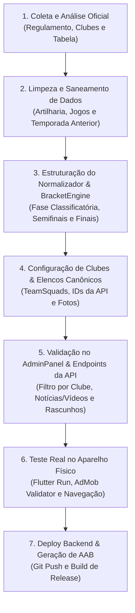

# Checklist Oficial de Padronização e Atualização de Estaduais (ZapScore)

Este documento estabelece o fluxo de trabalho obrigatório, padronizado e auditado para a atualização de qualquer aplicativo de campeonato estadual do ecossistema ZapScore, tendo como referências os projetos já consolidados (**Baianão**, **Tocantinense** e **Amapaense**).



---

## 1. Coleta e Análise do Regulamento e Tabela Oficial
Antes de alterar qualquer linha de código:
- [ ] **Mapeamento de Clubes Participantes**: Identificar todos os clubes confirmados para a temporada 2027 e mapear seus respectivos `teamId` ou `teamExternalId` (API-Football ou banco local).
- [ ] **Formato de Disputa**:
  - Quantidade de clubes na 1ª fase (turno único ou grupos).
  - Número de classificados para mata-mata (ex: semifinais com 4 clubes ou quartas com 8 clubes).
  - Critérios de desempate e vantagens (empate no agregado para o melhor colocado ou disputa de pênaltis).
  - Quantidade de clubes rebaixados para a Série B.
- [ ] **Tabela de Jogos**: Rodadas oficiais, confrontos, datas previstas e horários.

---

## 2. Limpeza e Saneamento da Temporada Anterior
Para evitar que dados históricos de 2026/2025 fiquem misturados na tela inicial ou na tabela:
- [ ] **Saneamento de Artilharia (`Scorer`)**:
  - Verificar se a tela de artilheiros do app ou a home exibe atletas antigos.
  - No `AppConfig.season` do app estadual (ex: `lib/config/app_config.dart`), garantir que o ano da temporada corrente esteja apontado para a temporada ativa (ex: `2027`).
- [ ] **Partidas Anteriores em Loop**:
  - Garantir que o `TeamCubit` e o `FixtureCubit` filtrem apenas partidas da temporada ativa do campeonato e tratem ausência de partidas como estado vazio amigável (`"Nenhum jogo encontrado"` ou `"Em breve"`), sem entrar em loop de requisição.

---

## 3. Motor de Chaves e Mata-Mata (`BracketEngine` & `CompetitionNormalizer`)
- [ ] **Placeholders Limpos para Fases Futuras**:
  - No arquivo `bracket_engine.dart` de cada estadual, nunca preencher equipes antes de partidas serem jogadas na 1ª fase.
  - **Regra de Bloqueio**:
    ```dart
    final hasPlayedMatches = standings.any((st) => st.played > 0);
    ```
  - Se `hasPlayedMatches == false`:
    - Manter `homeTeam: null` e `awayTeam: null`.
    - Definir títulos claros de chave: `1º Colocado x 4º Colocado`, `2º Colocado x 3º Colocado`, `Vencedor Semifinal 1 x Vencedor Semifinal 2`.
- [ ] **Cores e Legendas de Classificação**:
  - No normalizador (`competition_normalizer.dart`), ajustar as legendas e faixas coloridas da tabela:
    - Ex: 1º ao 4º colocados: avanço às semifinais (verde).
    - Ex: 7º e 8º colocados: rebaixamento para a Série B (vermelho).

---

## 4. Cadastro de Clubes e Elencos Canônicos (`TeamSquads`)
- [ ] **Arquivo de Elencos Canônicos**:
  - Criar ou atualizar o arquivo de elencos estaduais (ex: `amapaense_squads.dart`, `tocantinense_squads.dart`).
  - Cadastrar os 8 ou 10 clubes oficiais com jogadores-base (nome, posição, número, idade e URL de foto).
- [ ] **Fallback na API Backend**:
  - Em `apps/api/src/competitions/competitions.service.ts`, registrar o fallback de IDs canônicos para a liga (`getCompetitionPlayers`).
  - Assegurar que caso o clube não tenha registro no banco de dados, o backend crie ou devolva os atletas canônicos automaticamente.

---

## 5. AdminPanel (`apps/web`) e Gestão de Conteúdo
- [ ] **Dropdown de Filtro por Clube**:
  - Na aba de **Jogadores** de `apps/web/app/(main)/adminpanel/estaduais/[id]/page.tsx`, implementar dropdown com a lista de clubes participantes da liga para navegação rápida e sem sobreposição.
- [ ] **CRUD Completo de Atletas**:
  - Inserção de novos jogadores (`POST /competitions/players`).
  - Edição de atleta existente (`PUT /competitions/players/:id`).
  - Exclusão com confirmação (`DELETE /competitions/players/:id`).
- [ ] **Controle de Notícias e Vídeos (Rascunho vs. Publicado)**:
  - Seletor de status (`Publicado` / `Rascunho`) na criação e edição rápida.
  - Filtros de visualização (`Todos`, `Publicados`, `Rascunhos`).
  - Botão de seleção múltipla e **Exclusão em Lote** (`POST /news/bulk-delete`, `POST /videos/bulk-delete`).
  - Preservação da regra máxima de não alterar o schema do Prisma de modo que quebre migrações no PostgreSQL de produção.

---

## 6. Validação e Testes no Dispositivo Real
- [ ] **Execução via ADB / Flutter Run**:
  - Rodar o app no dispositivo conectado (`flutter run -d <DEVICE_ID>`).
- [ ] **Validação AdMob**:
  - Confirmar que o *AdMob Native Ad Validator* exibe zero inconformidades (`"No implementation issues found"`).
  - Verificar se banners e nativos carregam de forma fluida sem vazamentos de memória.
- [ ] **Auditoria de Telas**:
  - **Início**: Sem partidas duplicadas da temporada passada; artilheiros zerados ou corretos.
  - **Tabela**: Classificação com pontos corretos e legenda de vagas/rebaixamento.
  - **Fases de Mata-Mata**: Sem times pré-definidos se a 1ª fase não começou.
  - **Perfil do Clube**: Partidas recentes, tabela, informações institucionais e plantel com atletas e fotos.

---

## 7. Versionamento, Deploy e Build de Produção
- [ ] **Compilação e Auditoria Estática**:
  - `apps/web`: `npx tsc --noEmit` -> 0 erros.
  - `apps/api`: `npx tsc --noEmit` -> 0 erros.
  - `apps/estaduais/<app>`: `flutter analyze` -> 0 erros.
- [ ] **Deploy de Backend / Web**:
  - `git add <arquivos>`
  - `git commit -m "feat(<estadual>): ..."`
  - `git push origin main` (dispara deploy automático no Easypanel).
- [ ] **Build do Pacote para Loja (Google Play)**:
  - Incrementar `version` no `pubspec.yaml` (ex: `version: 1.0.1+2`).
  - Garantir o arquivo `key.properties` configurado apontando para o keystore em `APK/`.
  - Executar: `flutter build appbundle --release`.
  - Copiar o artefato final para o diretório `/<estadual>/APK/` correspondente.

