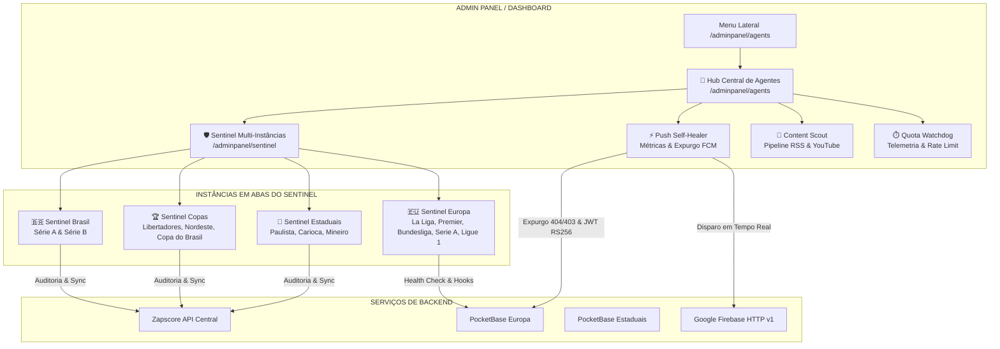

# Plano de Implementação: Expansão do Sentinel & Ecossistema de Agentes Autônomos ZapScore
**Data Inicial:** 16 de Agosto de 2026  
**Última Atualização:** 17 de Agosto de 2026 (Pós-Implementação dos Módulos Brasil, Copas, Hub de Agentes e Sentinel Multi-Instâncias)  
**Status:** Em Execução & Produção Validada (Fase 1 e Fase 2 Parcial Concluídas)  
**Autor:** Antigravity AI Pair Programmer  

---

## 1. Visão Geral e Arquitetura Consolidada

O ecossistema ZapScore opera com 4 módulos de competições autônomos (**Europa**, **Brasil**, **Copas** e **Estaduais**), cada um com suas regras de negócio, feeds de notícias, vídeos, notificações push e integrações.

A evolução da governança central do painel administrativo (`adminpanel`) estabeleceu:
1. A **Central de Agentes Autônomos (`/adminpanel/agents`)**: Hub principal de monitoramento e governança de agentes inteligentes no menu lateral.
2. O **Sentinel Multi-Instâncias (`/adminpanel/sentinel`)**: Sistema de auditoria com **4 instâncias dedicadas em abas** (Brasil, Europa, Copas e Estaduais) para supervisão de partidas em tempo real, consistência de fusos e autocorreção.
3. A **Rede de 4 Agentes Especializados** em segundo plano para auto-correção, expurgo de tokens e proteção de infraestrutura.

---

## 2. Status de Implementação das Fases

### ✅ Fase 1: Governança no AdminPanel & Navegação (Concluída em 17/08/2026)
* [x] **Substituição de Menu:** Remoção do Sentinel direto do menu e criação do menu **"Agentes"** (`/adminpanel/agents`) com ícone `Bot` e badges em todas as sidebars ([ZapScoreAdminSidebar.tsx](file:///d:/zapscore/apps/web/app/%28main%29/adminpanel/components/ZapScoreAdminSidebar.tsx) e [AdminSidebar.tsx](file:///d:/zapscore/apps/web/app/%28main%29/adminpanel/components/AdminSidebar.tsx)).
* [x] **Hub de Agentes (`/adminpanel/agents`):** Criada a tela principal com cards interativos e métricas dos 4 agentes autônomos.
* [x] **Sentinel Multi-Instâncias em 4 Abas (`/adminpanel/sentinel`):**
  * 🇧🇷 **Aba Brasil:** Monitora Brasileirão Série A (`71`) e Série B (`72`).
  * 🇪🇺 **Aba Europa:** Monitora La Liga (`140`), Premier League (`39`), Bundesliga (`78`), Serie A (`135`) e Ligue 1 (`61`).
  * 🏆 **Aba Copas:** Monitora Libertadores (`13`), Copa do Nordeste (`612`) e Copa do Brasil (`73`).
  * 📍 **Aba Estaduais:** Monitora Paulista (`475`/`476`), Carioca (`624`/`851`) e Mineiro (`629`/`619`).
* [x] **Módulos de Gestão Completos:** Implementação dos painéis completos de **Brasil** (`/adminpanel/brasil`) e **Copas** (`/adminpanel/copas`), somando-se a **Europa** e **Estaduais**.

---

## 3. Matriz dos 4 Agentes Autônomos

| Agente | Responsabilidade | Status Atual | Local de Execução |
| :--- | :--- | :--- | :--- |
| **🛡️ Sentinel Multi-Módulo** | Auditoria de partidas, detecção de jogos travados em `LIVE`/`2H` (>115') ou atrasados em `NS`, disparo de sync forçado. | ✅ **Operacional** | `apps/web` (Painel em 4 abas) + `apps/api` (`/sentinel/health-check`, `/sentinel/audit`) |
| **⚡ Push Self-Healer** | Expurgo automático de tokens FCM inválidos/órfãos (`404 NotRegistered`, `403`), renovação proativa de chaves JWT OAuth2 RS256. | ✅ **100% Ativo em Produção** | PocketBase Europa (`notifications.pb.js`) |
| **📰 Content Scout** | Varredura de feeds RSS e YouTube esportivo, categorização automática por `leagueId` e gravação na API sem duplicação. | ⏳ **Telas Prontas / Worker Pendente** | `apps/web` (CRUDs prontos) + `apps/api` (Worker Cron pendente) |
| **⏱️ Quota Watchdog** | Monitoramento de `x-requests-remaining` da API-Football, controle de taxa de polling e proteção contra rate limit. | ⏳ **Telas Prontas / Worker Pendente** | `apps/web` (Telemetria) + `apps/api` (Comutação inteligente pendente) |

---

## 4. Detalhamento dos Agentes e Próximos Passos

### 4.1. 🛡️ Sentinel Multi-Módulo (Match Guardian)
* **Comportamento:** Consulta a cada 30 segundos as partidas do dia para as ligas da aba selecionada no painel.
* **Autocorreção:** Permite ao operador disparar auditorias forçadas, sincronização de partidas ao vivo e teste de conectividade com a API-Football por módulo.

### 4.2. ⚡ Push Self-Healer (Validado em Produção)
* **Comportamento em Produção:** Já validado no PocketBase Europa com matches reais (ex: Deportivo La Coruña 1 x 1 Elche).
* **Expurgo Ativo:** Ao receber resposta `HTTP 404`, `NOT_FOUND` ou `NotRegistered` do Firebase, o registro é removido instantaneamente da coleção `subscriptions` com o log `[POCKETBASE PURGE 🗑️]`.

### 4.3. 📰 Content Scout (Próxima Implementação)
* **Objetivo:** Criar worker cron em `apps/api` executado a cada 30 minutos para ler as fontes cadastradas em `news_sources` e canais do YouTube, gravando automaticamente em `/news` e `/videos`.

### 4.4. ⏱️ Quota Watchdog (Próxima Implementação)
* **Objetivo:** Adicionar middleware na `apps/api` que lê o header `x-requests-remaining` das respostas da API-Football. Se a cota diária for inferior a 20%, ajusta a cadência do cron de jogos ao vivo de 15s para 60s em jogos com placar dilatado.

---

## 5. Histórico de Commits e Entregas (17/08/2026)

| Commit | Escopo | Descrição |
| :--- | :--- | :--- |
| `eec56db` | `apps/web` | Implementação do Módulo Brasil (`/adminpanel/brasil`) e sincronização de ligas Série A e B |
| `da868b5` | `apps/web` | Implementação do Módulo Copas (`/adminpanel/copas`) cobrindo Libertadores, Copa do Nordeste e Copa do Brasil |
| `78f9885` | `apps/web` | Atualização do Dashboard com os 4 ecossistemas unificados |
| `dc5fa86` | `apps/web` | Criação do Hub de Agentes (`/adminpanel/agents`) e Sentinel com 4 instâncias em abas dedicadas |

---

## 6. Conclusão

Com as implementações de hoje, o **Zapscore** conta com uma interface de governança moderna e totalmente modularizada. Os agentes **Sentinel** e **Push Self-Healer** já garantem a integridade operacional e de notificações em produção, enquanto a infraestrutura está pronta para a ativação dos workers de background do **Content Scout** e **Quota Watchdog**.
